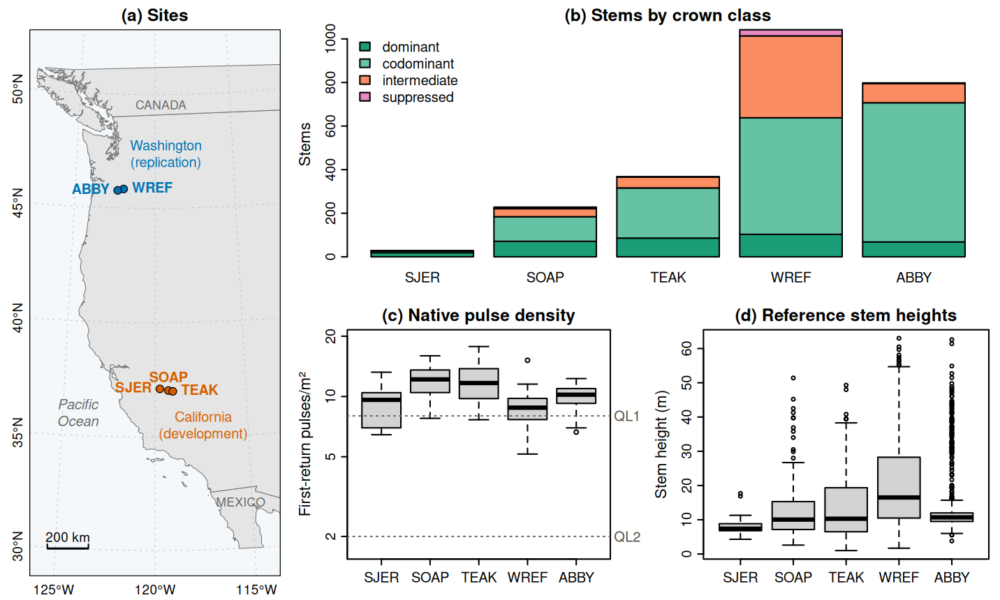
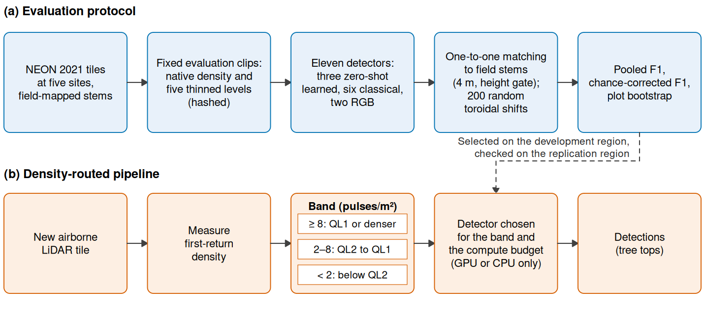
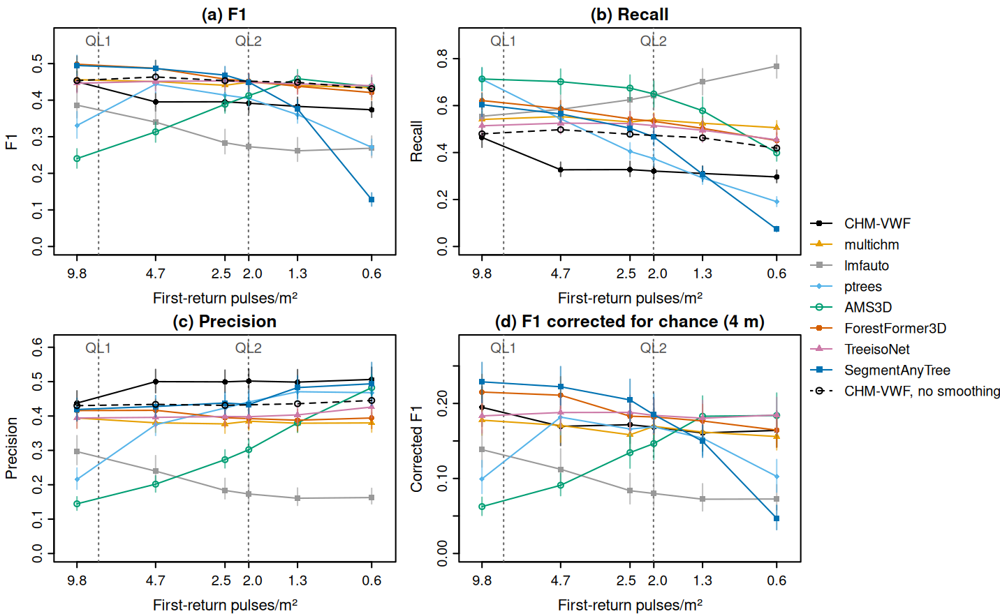
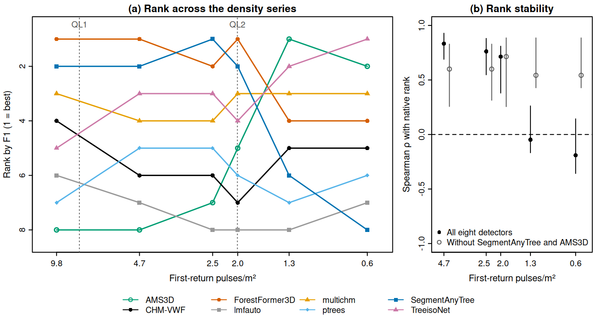
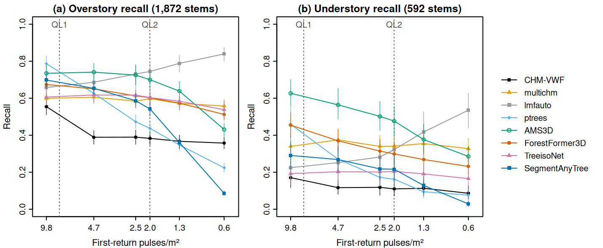
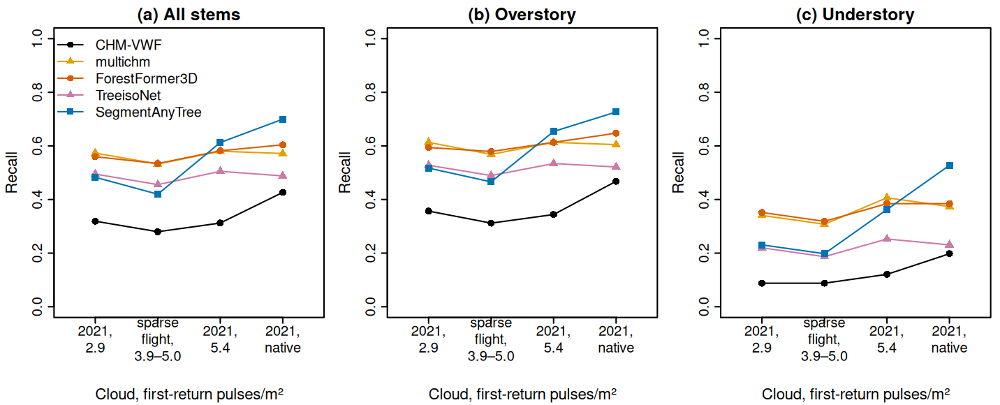
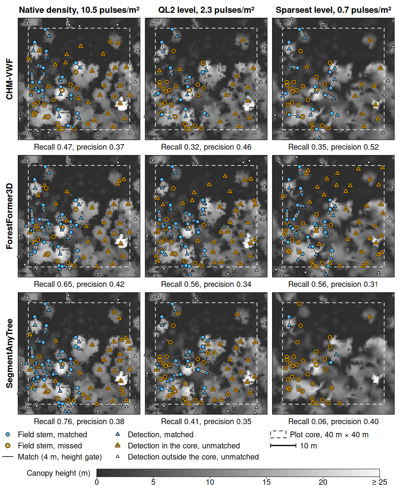

# Choosing tree detectors by point density

Full title: Choosing tree detectors by point density: a field-stem benchmark for
national-mapping airborne LiDAR.

Alex Grigoryev. Co-authors, affiliations and the corresponding address are to be
completed.

Draft manuscript for IEEE JSTARS (IEEE Journal of Selected Topics in Applied
Earth Observations and Remote Sensing); its [LaTeX version](ieee/README.md) is
generated from this file. Citations use the keys of the repository bibliography
(`docs/references.bib`); every number is taken from a committed study report,
listed in the [draft notes](README.md).

## Highlights

- Eleven tree detectors scored against 2,525 field stems; eight at six
  densities.
- Shifted detections reach 70–79% of F1; above chance, segmenters lead by ≤0.03.
- SegmentAnyTree collapses below the QL2 floor; ForestFormer3D and TreeisoNet do
  not.
- Native-density rank predicts rank down to the QL2 floor, not below it.
- Routing by density avoids the collapse; ForestFormer3D alone does as well.

## Abstract

Deep 3D tree segmenters are developed on dense laser scans, while national
mapping programmes deliver airborne laser scanning at a few pulses per square
metre. We scored three published zero-shot learned segmenters, six classical and
two aerial-image detectors against 2,525 field-mapped stems in 106 plots at five
National Ecological Observatory Network sites in conifer forest and oak woodland
of California and Washington, at native density (median 9.8 pulses/m²) and five
thinned densities down to 0.6 pulses/m², one at the U.S. Geological Survey
quality level 2 floor of 2 pulses/m². Randomly shifted detections reach 70–79%
of every detector's F1, so we also correct F1 for chance agreement. At native
density ForestFormer3D and SegmentAnyTree lead a canopy-height-model baseline by
0.048 and 0.044 F1 but by only 0.00–0.03 after correction, a regional
difference: clear in the California development region, absent in the Washington
region held out for replication. SegmentAnyTree collapses below the floor, while
ForestFormer3D and TreeisoNet degrade gracefully, and native-density rank
predicts rank down to the floor (Spearman 0.71) but not below it (−0.05). A
density-routed pipeline, designed post hoc and selected on California, runs
SegmentAnyTree at 8 pulses/m² or more, ForestFormer3D from 2 to 8 and a
multi-layer canopy-model detector below 2. In Washington it gains 0.101 F1 over
SegmentAnyTree below the floor, but ForestFormer3D alone does as well. Clips,
detections and tables rebuild with one command.

**Keywords:** individual tree detection; airborne laser scanning; point density;
deep learning; instance segmentation; chance agreement

## 1. Introduction

Individual tree detection from airborne laser scanning (ALS) feeds forest
inventory, carbon accounting, fuel mapping and habitat models. The data that
most practitioners can obtain for a whole ownership or a whole state come from
national mapping programmes. The U.S. Geological Survey (USGS) 3D Elevation
Program (3DEP) specifies an aggregate nominal pulse density of at least 2
pulses/m² for quality level 2 (QL2) and at least 8 pulses/m² for quality level 1
(QL1) [@usgs2026topographic]. These are the densities at which national
programmes deliver data wall to wall.

Two literatures have grown around the task, and they rarely meet. Classical
detectors were developed and compared on conventional airborne scans of about 1
to 25 pulses/m² [@kaartinen2012international; @jakubowski2013tradeoffs;
@sparks2022crosscomparison]. They include local maxima on a canopy height model
(CHM) with a height-dependent window [@popescu2004seeing], region growing in the
point cloud [@li2012new], multi-scale point segmentation [@vega2014ptrees] and
adaptive mean shift [@ferraz2016lidar]. Deep 3D instance segmenters
[@wielgosz2024segmentanytree; @xiang2025forestformer3d; @xi2025new] are trained
on unmanned, mobile and terrestrial laser scanning. They are benchmarked on
those scans and on high-density airborne scans, at hundreds to thousands of
points per square metre [@puliti2023forinstance; @ruoppa2026benchmarking].

Whether the published checkpoints of these segmenters help at national-mapping
density is therefore open, and four obstacles stand in the way of answering it.
First, we found no per-point instance labels at such densities (Section 2.1), so
the reference has to be field-mapped stems, which are incomplete: a detection of
a real but unmapped tree counts as an error. Second, sparse acquisitions are
usually simulated by thinning a dense one [@jakubowski2013tradeoffs], and the
simulation is rarely checked against a native sparse flight of the same stand.
Third, research code has to be adapted to new data, and an adapter defect can be
mistaken for domain shift. Fourth, a match radius wide enough to absorb
stem-mapping error also admits coincidental matches, whose share stem benchmarks
do not report.

We address the question with a benchmark built to control those obstacles, and
ask four research questions:

- RQ1. At QL1 density, do published zero-shot 3D segmenters detect field-mapped
  stems better than a density-aware canopy-model baseline, beyond what chance
  co-location explains?
- RQ2. How does each detector degrade toward and below the QL2 floor?
- RQ3. Does a detector's rank at native density predict its rank on sparser
  clouds?
- RQ4. Which detector should a user of national-mapping LiDAR run at each USGS
  quality level, given a GPU or only a CPU?

Our contributions are:

1. A field-stem benchmark of eleven detectors (three zero-shot learned, six
   classical, two RGB) at five National Ecological Observatory Network (NEON)
   sites in two regions, on fixed evaluation clips at six densities including
   the QL2 floor, with paired plot-bootstrap intervals.
2. An evaluation protocol that makes such scores comparable: chance-corrected F1
   from a shift null, precision bracketed by censused subplots and a
   co-detection credit, decimation checked against native sparse flights, and a
   dense-domain positive control.
3. A density-routed detection pipeline, designed after the five-site results
   were known: a decision table by measured density and compute budget, selected
   on the development region and checked on the held-out replication region.
4. An open harness whose tables, including the routing analysis, rebuild with
   one command.

In short, at native density two segmenters lead the baseline by 0.04 to 0.05 F1,
but by only 0.00 to 0.03 above chance. Below the QL2 floor one of them collapses
and the native ranking breaks. Routing by measured density keeps that segmenter
off sparse clouds and shows that a CPU detector suffices below the floor, but
with a GPU, ForestFormer3D at every density does as well as the routed pipeline.

## 2. Related work

### 2.1 Benchmarks and point density

Open benchmarks with per-point tree labels are dense. The FOR-instance
collections range from about 500 to 9,500 points/m² [@puliti2023forinstance],
and the helicopter ALS of FGI-EMIT exceeds 1,000 points/m²
[@ruoppa2026benchmarking]. FOR-instance v3 spans 10 to 50,000 points/m² without
stating how its sparsest clouds were obtained [@wielgosz2026segmentanytreev2].
NeonTreeEvaluation [@weinstein2021benchmark] and the IDTReeS competitions
[@marconi2019data; @graves2023data] are built on NEON's sparse ALS, but they
annotate crowns in imagery or the field and use stems for recall or crown
correspondence, not for precision. International comparisons scored classical
detectors against field stems on conventional airborne scans
[@kaartinen2012international; @vauhkonen2012comparative; @eysn2015benchmark;
@wang2016international]. We found no benchmark that scores deep 3D segmenters
against field stems at national-mapping density.

Density studies follow the same split. Classical work varies density from below
1 to about 25 pulses/m² [@hirata2004effects; @jakubowski2013tradeoffs;
@kaartinen2012international; @sparks2022crosscomparison]. @hirata2004effects
found that tree-top extraction from a canopy model declined suddenly below 3 to
5 pulses/m², and @sparks2022crosscomparison compared classical detectors on two
ALS datasets of the same stands, at 8 and 22 pulses/m², without testing
decimation. Deep-model studies vary density between 10 and 10,000 points/m², the
sparsest levels subsampled from dense scans [@wielgosz2024segmentanytree;
@xiang2024automated; @li2026itsnet]. On FGI-EMIT subsampled to 10 points/m², a
retrained ForestFormer3D and the published SegmentAnyTree keep a roughly stable
F1 [@ruoppa2026benchmarking]. @yu2004effects flew one boreal area at about 10, 5
and 2.5 points/m² and thinned the densest data to the sparser two. Thinned and
native data found as many trees at 5 points/m² (1,416 against 1,400) but not at
2.5 (1,331 against 532). The authors attribute that loss to missing canopy
returns at altitude rather than to density alone; we read it as thinning being
strongly optimistic. The nearest evaluation of a pretrained segmenter on
conventional ALS is that of @destouches2026weaklysupervised, who ran the
published SegmentAnyTree on Swiss aircraft ALS at 38 points/m². They counted
instances on four 1 ha tiles labelled by hand and completed with visually
validated automatic detections. Recall by crown class has been reported for
classical methods [@wang2016international; @hamraz2017forest;
@cao2023benchmarking], some of them designed for layered canopies
[@ferraz2016lidar; @hamraz2017forest].

We found no paper that evaluates a pretrained 3D segmenter on native ALS at 1 to
2 pulses/m². We found none that checks decimation against a native sparse
acquisition for a detector's precision and recall against field stems or with
learned detectors. We found no report of understory recall for a deep model
below 50 points/m². We also found no study that gates or routes tree detectors
by point density; the nearest prior art combines detectors by voting on imagery
[@plesoianu2020individual].

### 2.2 Evaluation conventions

Dense-cloud benchmarks match instances one to one at an intersection over union
(IoU) of 0.5 [@puliti2023forinstance; @xiang2025forestformer3d;
@ruoppa2026benchmarking]. Stem benchmarks use restricted nearest neighbours
[@eysn2015benchmark], optimal assignment [@hamraz2016robust;
@kuhn1955hungarian], integer programming [@hershey2022voxelbased] or one-to-one
matching within 4 m [@gominski2025mining]. We found no forestry study that
scores the same detections under greedy and optimal assignment and across radii,
or that reports the score a random placement of the same detections would reach.
The devices exist elsewhere. The toroidal shift is the independence null of
spatial point-pattern analysis [@lotwick1982methods; @wiegand2004rings],
forecast verification corrects threat scores for hits expected by chance
[@hogan2010equitability], and F1 itself carries no chance level
[@powers2011evaluation]. Reference incompleteness is seldom measured:
NeonTreeEvaluation uses stems for recall only [@weinstein2021benchmark], and
@hershey2022voxelbased found most raw false positives to be trees below the
recording threshold or missed by the crew. Double-observer surveys estimate what
one observer misses [@nichols2000doubleobserver]; we found no tree benchmark
that brackets precision this way. Leakage audits and reproducibility standards
are established in machine learning [@kapoor2023leakage;
@heil2021reproducibility], as is reporting the stability of a ranking with
intervals [@dehghani2021benchmark; @agarwal2021deep]. We found no audit of
overlap between a checkpoint's training data and a benchmark's test data, and no
forestry detector benchmark that reports the stability of its ranking.

### 2.3 Recent models

Newer models, SegmentAnyTreeV2 [@wielgosz2026segmentanytreev2], SelectAnyTree
[@nguyen2026selectanytree], ForestMamba [@nguyen2026forestmamba], ForPT
[@yue2026toward], ITS-Net [@li2026itsnet] and ForestQuery
[@zhan2026forestquery], report no performance at 1 to 8 pulses/m², and of these
only ForestMamba has public instance-segmentation weights. These statements,
like the statements of absence in Sections 2.1 and 2.2, rest on a scan of about
ninety primary sources completed on 30 September 2026 and on literature and
repository checks completed on 21 October 2026 (Section S24). We therefore
evaluate the first SegmentAnyTree [@wielgosz2024segmentanytree], ForestFormer3D
[@xiang2025forestformer3d] and TreeisoNet [@xi2025new]. ForestMamba, run on the
same clips after the tables were fixed, is reported in Section S23.

## 3. Data

### 3.1 Sites and airborne LiDAR

The benchmark uses five terrestrial NEON sites in two regions (Table 1, Fig. 1).
San Joaquin Experimental Range (SJER), Soaproot Saddle (SOAP) and Lower
Teakettle (TEAK) lie on a gradient of canopy closure in the Sierra Nevada of
California. Wind River Experimental Forest (WREF), an old-growth forest, and
Abby Road (ABBY), a young, even-aged managed stand, are Douglas-fir forests in
Washington. All were flown by the NEON Airborne Observation Platform in 2021
[@neon2026discrete], SJER in March and the others in July (Table 1). Over the
benchmark plots the discrete-return clouds have a median density of 17.9
points/m² and 9.8 first-return pulses/m², close to the QL1 specification. The
stands differ in density and size as much as in type, from 59 (SJER) to 312
(ABBY) mapped stems per hectare, with maximum heights of 18 m at SJER and 63 m
at WREF (Table S14).

**Table 1.** Sites and reference population. Plots are tower / distributed.
Crown classes are overstory (dominant and codominant) / understory (intermediate
and suppressed) / not classed. Pulse density is the median and range of
first-return density over the plot clips at native density.

| Site | Forest | 2021 flight | Plots | Stems | Crown classes | Pulses/m² | Censused plots / references |
| --- | --- | --- | --- | ---: | --- | --- | --- |
| SJER | Open oak and foothill pine woodland, California | 31 March, RIEGL Q780 | 6 (6 / 0) | 57 | 27 / 1 / 29 | 9.6 (6.4–13.2) | 2 / 14 |
| SOAP | Mixed conifer, California | 12–13 July, Galaxy Prime | 18 (7 / 11) | 231 | 184 / 44 / 3 | 12.2 (7.8–16.0) | 1 / 2 |
| TEAK | Red fir and subalpine conifer, California | 13–14 July, Galaxy Prime | 19 (6 / 13) | 374 | 316 / 52 / 6 | 11.7 (7.7–17.8) | 9 / 119 |
| WREF | Old-growth Douglas-fir and western hemlock, Washington | 18–24 July, Galaxy Prime | 38 (20 / 18) | 1,063 | 638 / 404 / 21 | 8.8 (5.2–15.2) | 28 / 642 |
| ABBY | Managed Douglas-fir, Washington | 19 and 24 July, Galaxy Prime | 25 (13 / 12) | 800 | 707 / 91 / 2 | 10.2 (6.6–12.3) | 17 / 413 |
| All | | | 106 (52 / 54) | 2,525 | 1,872 / 592 / 61 | 9.8 (5.2–17.8) | 57 / 1,190 |

**Figure 1.** Sites and reference population. (a) The five NEON sites: SJER,
SOAP and TEAK in California, the development region, and WREF and ABBY in
Washington, the replication region; each point is the mean position of the
site's plots. Albers equal-area projection; base map from Natural Earth (public
domain). (b) Classed stems by field crown class at each site; the 61 stems
without a crown class, 29 of them at SJER, are not shown. (c) First-return pulse
density of the native plot clips; the dotted lines mark the QL1 (8 pulses/m²)
and QL2 (2 pulses/m²) floors. (d) Field heights of the reference stems.

### 3.2 Field reference

The reference is the NEON woody vegetation structure product
[@neon2026vegetation]. Each mapped stem is located from its recorded distance
and azimuth to a surveyed point of its plot, with the coordinates and
uncertainties of the NEON location service. It is paired with its measurement
nearest to 2021 within four years, which supplies its status, height, diameter
at breast height (DBH) and canopy position. The population was declared before
the runs reported here and before any detector was run on the Washington sites.
Its six-tree rule comes from an earlier development phase of this benchmark on
the California sites (Section 4.5), and its DBH floor was set from the
Washington field data without detector scores.

A reference stem is live, mapped, at least 10 cm in DBH and inside the nominal
plot core: the 40 m × 40 m of a tower plot or the central 20 m × 20 m of a
distributed plot. A plot enters if it holds at least six live mapped trees of at
least 10 cm DBH over the whole plot, which gives 106 plots and 2,525 stems.
Populations without the DBH floor or without the six-tree rule are scored as
sensitivities (Table S3). Following NEON's canopy position, we call dominant and
codominant stems overstory and intermediate and suppressed stems understory; 61
stems have no crown class and count only in the totals. Of the 592 understory
stems 404 are at WREF, so understory results mostly describe that old-growth
site. NEON does not census whole plots every year: a tower plot is censused in
800 m² of its 1,600 m² core, so the nominal plot core is not an area in which
every tree is mapped (Section 4.3).

### 3.3 Evaluation clips and density levels

For each plot we clip the core plus a 25 m buffer from the tiles, normalise
heights with a triangulated ground surface, and store the raw and normalised
clips and a 1 m terrain model. These fixed evaluation clips are hashed (SHA-256
of every file), so that every detector reads identical bytes, and are
reproducible byte for byte. Sparser acquisitions are simulated by thinning
(decimating) all returns to a target density on a 5 m grid, with a seed derived
from the site, plot and target. Thinning precedes normalisation, so that the
terrain model also sees the sparser cloud. The density series has all-return
targets of 8, 4, 2 and 1 points/m², and one more of 3.2 points/m², declared
before any detector was run on it. That target was chosen from measured
densities alone so that its median is 2.0 pulses/m², the QL2 floor; this QL2
level was cut as a separate set of clips with the same population and seeds.

We report measured first-return density, the quantity that specifications state.
Its medians over the 106 plots are 9.8 pulses/m² at native density and 4.7, 2.5,
2.0, 1.3 and 0.6 pulses/m² on the five thinned levels. Thinning removes returns
rather than whole pulses and equalises density across the 5 m cells, so the
thinned levels lack the swath-overlap and scan-angle variation of a real
acquisition. Each level is one seeded realisation shared by all detectors. At
the three California sites, on an earlier population without the DBH floor,
eleven independent seeds give a standard deviation of per-site F1 of 0.005 to
0.028 for the baseline; the spread was not measured for the other detectors.

### 3.4 Native sparse flights and 3DEP clouds

To test thinning we use earlier NEON flights of the same plots that are natively
sparse: SJER in March 2017 and SOAP and TEAK in June 2018, flown in NEON's
Optech Gemini era, with median first-return densities of 3.9 to 5.0 pulses/m².
References were rebuilt for those years, and the comparison uses the 586 stems
on 39 plots that are live in both epochs. A cross-sensor check uses public USGS
3DEP clouds over the 43 California plots [@usgs2026usgs], extracted with PDAL
[@butler2021pdal]. None of the covering surveys is at QL2 density (medians of
47, 31 and 5.7 pulses/m²), so the check compares 3DEP and NEON clouds thinned to
the same target.

### 3.5 Dense-domain control data

FGI-EMIT [@ruoppa2026benchmarking; @ruoppa2026fgiemit] provides manual per-point
tree labels for 1,561 trees in 19 plots of boreal forest in Espoo, Finland,
scanned from a helicopter at more than 1,000 points/m². Its six test plots had
been scored in a first transfer experiment and two training plots used in the
adapter audit of Section 5.7, so none of these eight could serve as an untouched
test. Before running any model on the other eleven training plots, we set three
aside as a reserve (257 trees) by a rule on published stand density. The
remaining eight and the two audit plots form the development set (841 trees), on
which the detector policy was selected before the reserve was evaluated once.
Points of trees that the release leaves unlabelled as partial (about 4% of the
points) are removed, so every tree left is a reference tree, a cleaner scene
than any survey would give. We found no documented overlap between the published
training lists of both checkpoints and FGI-EMIT. No source gives a complete
training history of the released weights, however, so the reserve is a
within-dataset check, not an independent test.

## 4. Methods

Fig. 2 outlines the evaluation protocol and the density-routed pipeline.

**Figure 2.** (a) The evaluation protocol. Fixed evaluation clips at native
density and five thinned density levels are cut from the NEON 2021 tiles and
hashed, so that every detector reads identical bytes; each detector's detections
are matched one to one to the field stems (greedy, within 4 m, with the height
gate) and scored against 200 random toroidal shifts of the same detections;
scores are pooled over plots, corrected for chance and given plot-bootstrap
intervals (Sections 4.2 and 4.4). (b) The density-routed pipeline. A new tile's
measured first-return density places it in one of three bands, and the detector
chosen for that band and compute budget on the development region, and checked
on the replication region, is run on it (Section 4.7, Table 7).

### 4.1 Detectors

Table 2 lists the detectors; their settings were fixed before the Washington
sites were scored (Section 4.5). ForestFormer3D, SegmentAnyTree and TreeisoNet
are published as instance segmenters. We reduce the instances of the first two
to their apexes and call them the segmenters, use TreeisoNet's localisation
network as a detector, and call all three the learned detectors.

**Table 2.** Detectors. The three learned point detectors are used zero-shot
with their published checkpoints. DeepForest's training annotations include two
of the benchmark sites, SJER and TEAK, so it is not zero-shot there. Compute:
device and median wall time per plot at native density on nine plots, on an
Intel Core i9-14900K and one NVIDIA RTX 5090 (DeepForest predicts a whole site
at once), with the cost per square kilometre scaled from the clip area, before
tiling overhead (Section S22); the classical detectors cost a few CPU-minutes
per km².

| Detector | Type | Input | Training data | Implementation | Compute |
| --- | --- | --- | --- | --- | --- |
| CHM-VWF | Local maxima on a canopy height model, height-dependent window [@popescu2004seeing] | Normalised cloud, first returns | None | lasR [@roussel2026lasr] | CPU, 2.9 s per plot |
| `multichm` | Local maxima over a stack of height-sliced canopy models, after @eysn2015benchmark | Normalised cloud | None | lidRplugins [@roussel2023lidrplugins]; density-derived resolution and CHM-VWF window | CPU, 6.0 s per plot |
| `lmfauto` | Point local maxima, automatic window | Normalised cloud | None | lidRplugins | CPU, 2.3 s per plot |
| `ptrees` | Multi-scale point segmentation [@vega2014ptrees] | Normalised cloud | None | lidRplugins | CPU, 3.2 s per plot |
| AMS3D | Adaptive mean shift in 3D [@ferraz2016lidar] | Normalised cloud | None | crownsegmentr [@steinmeier2025crownsegmentr] | CPU, 5.0 s per plot |
| Li 2012 | Point-cloud region growing [@li2012new] | Normalised cloud | None | lidR [@roussel2020lidr] | CPU, 3.7 s per plot |
| ForestFormer3D | Transformer instance segmentation [@xiang2025forestformer3d] | Raw cloud, whole scene | FOR-instanceV2: unmanned, mobile and terrestrial laser scanning [@xiang2025forinstancev2]; training density not stated | Published code and weights (Table S15) | GPU, 97.9 s per plot; about 3.4 GPU-hours per km² |
| SegmentAnyTree | Sparse convolutional instance segmentation [@wielgosz2024segmentanytree] | Raw cloud | FOR-instance unmanned scans and Norwegian mobile scans, with copies sparsified to 1,000, 500, 100, 75, 50, 25 and 10 points/m² | Published code and weights (Table S15) | GPU, 411.1 s per plot; about 14 GPU-hours per km² |
| TreeisoNet | Tree localisation and offset networks [@xi2025new]; the airborne checkpoints distributed with TreeAIBox | Normalised cloud, 0.8 × 0.8 × 2.0 m voxels for tree tops | Unmanned laser scanning at about 1,160 points/m², as described for the TreeAIBox models; the match to the files we ran is inferred from their names | TreeAIBox [@nrcan2025treeaibox] | GPU, 7.9 s per plot; about 16 GPU-minutes per km² |
| DeepForest | Crown boxes in RGB imagery [@weinstein2020deepforest] | 10 cm camera mosaic [@neon2026camera] | Crowns from 22 NEON sites, then hand annotations from six, including SJER and TEAK | `deepforest-tree` [@weecology2024deepforesttree] | GPU, 265.7 s per site |
| Detectree2 | Crown polygons in RGB imagery [@ball2023accurate] | 10 cm camera mosaic | Tropical forests and an urban site | Published weights [@ball2025detectree2] | CPU, 8.1 s per plot |

**The baseline.** CHM-VWF, local maxima on a canopy height model found with a
variable window filter, derives its parameters from measured density. Its canopy
model is a triangulation of first returns, rasterised at 0.25 m when the clip
has at least 8 first returns per square metre and at 0.5 m otherwise. Pits are
filled by lasR's fill of the rasterised surface, not by the pit-free algorithm
of @khosravipour2014generating, and below 8 pulses/m² the surface is smoothed
with a circular moving mean 3 m across. Tree tops are local maxima above 2 m in
a circular window of diameter 0.1 h + 3 m, clamped to 3 to 5 m. Eighteen of the
106 plots are below 8 pulses/m² at native density. The smoothing, the baseline's
pre-declared smoothing rule, is a rule of thumb fixed before the runs; a run
without it was added post hoc (Section 5.2).

**Other detectors.** `multichm` shares the baseline's density-derived resolution
and window without smoothing and takes maxima over height-sliced canopy models.
The other classical detectors use package defaults or published parameters that
are not adapted to density, such as AMS3D's crown-shape ratios
[@ferraz2016lidar], and Li 2012 runs at native density only. The learned
detectors receive the same clips with no fine-tuning and the inference settings
of the published code and checkpoints (Table S15). ForestFormer3D runs on whole
scenes, a layout adopted after an audit exposed an adapter defect (Section 5.7).
The learned detectors' apexes have no 2 m height floor, unlike the classical
detectors'; applying it would raise ForestFormer3D's F1 by at most 0.013
(Section S18). TreeisoNet's confidence threshold of 0.22 was chosen on five SOAP
plots at the checkpoint's own voxel and not recalibrated for the coarser
airborne voxel used here; at a fixed threshold the two voxels give detection
counts that differ by up to half. RGB crowns become detections at their
centroids, with the native canopy height there. SAM2Point [@guo2024sam2point],
prompted with CHM-VWF tops, is reported in Section S10 only.

### 4.2 Scoring and chance agreement

Reference stems in the plot core are matched one to one to detections in the
core or within 4 m of it, greedily by increasing horizontal distance. A height
gate keeps a short stem from taking a tall neighbour's apex: a detection's
height must lie between half the stem's height and that height plus 8 m, and
stems without a height are matched on position alone. The 4 m radius covers the
stem-mapping uncertainty and the offset between stem base and crown apex. It is
eight to ten times the recorded stem uncertainty, follows one-to-one matching
within 4 m of field-inventory trees [@gominski2025mining], and was set in an
earlier development phase of this benchmark on the California sites (Section
4.5). Every main result is also given at 2 m. Recall is the share of reference
stems matched and precision the share of core detections matched; F1 is their
harmonic mean. Rates are pooled by summing counts over the plots that every
detector scored, never by averaging plot rates.

**Chance agreement.** The plot cores hold 1.2 reference stems per 4 m circle,
and the detectors place 0.6 to 4.7 core detections per reference stem, so part
of every match is co-location. We measure it with a random toroidal shift, the
independence null of spatial point-pattern analysis [@lotwick1982methods;
@wiegand2004rings]. In each plot the detections in the core and its matching
margin are shifted together by a random offset of at least 8 m and wrapped at
the edges of that square, which keeps their number, heights and relative
positions. The same 200 offsets serve every detector and density, and a
detector's null F1 is computed from its mean counts over the shifts. A second
set of 200 offsets changes any five-site null F1 or corrected lead by at most
0.002 (Section S12). If a share s of stems is found by skill and the rest only
by chance, recall = s + (1 − s) × null. By the same reasoning, as Cohen's kappa
corrects agreement for chance [@cohen1960coefficient] and forecast verification
corrects threat scores [@hogan2010equitability], we report corrected F1,

$$
F_1^{\mathrm{c}} = \frac{F_1 - F_1^{0}}{1 - F_1^{0}}
$$

where $F_1^{0}$ is the null F1: the F1 above the null, scaled by the headroom to
a perfect score. For recall the same form recovers s; for F1 it is an analogy. A
corrected lead is a detector's corrected F1 minus CHM-VWF's, with a paired
interval, at 4 m and at 2 m on every density level.

The null is the score of copies with no skill at placing trees, not an estimate
of the chance part of the observed score. Subtracting it is conservative,
because a detection that makes a real match cannot also match by chance, and
more so for detectors whose null is high; moving detections off the canopy where
they were found could work the other way. Whether a corrected lead is
conservative depends on which detector is over-subtracted more, so corrected
leads are not lower bounds. Because the shift keeps the number, heights and
spacing of each detector's detections, corrected F1 measures registration to the
mapped stems. Against an incomplete reference it compares detectors rather than
measuring an attainable share.

### 4.3 Reference completeness

A detection in a part of a plot that was not censused, or of a tree that was
censused but not mapped, counts against precision although it may be correct. We
bracket this bias in two ways. For censused subplots we take the nearest census
of all growth forms within four years of the flight and reconstruct its sampled
footprint from the surveyed subplot corners, eroded by the positional
uncertainty plus 0.6 m. Subplots holding a census target without a usable mapped
position are removed. The score uses the census event's own records of live
trees of at least 10 cm DBH: 1,190 references on 57 admitted plots (Section S4).
Smaller, dead and unmapped trees still count against precision, so censused
precision remains a lower bound. A stricter exclusion rule and the exact 2021
census on 16 tower plots are sensitivities. The co-detection credit counts a
core false positive with no mapped stem within 4 m as a probable tree when
detectors of at least two other families (canopy-model, point-cloud, learned,
RGB) leave such a false positive within 2 m of it. A credited detection leaves
the precision denominator, and each detector is then scored at its best density
per site (Table S5). The main tables use the nominal plot core of all 106 plots,
with precision read as a lower bound.

### 4.4 Uncertainty and rank stability

Every pooled number and every difference between two detectors carries a 95%
percentile interval from a paired bootstrap that resamples plots within each
site 1,000 times. One set of draws is shared by all detectors, densities and
metrics. Pooling by counts weights the sites by their stems: Washington holds
74% of them and WREF alone 42%, so the five-site estimates are largely
Washington estimates. The intervals express plot sampling only and condition on
the five sites. They leave out thinning noise, stem-position uncertainty and
run-to-run variation, since each learned-detector cell was inferred once. Nor
are they adjusted for multiple contrasts. Of the 90 corrected-lead contrasts on
the five sites, 40 exclude zero and eleven of these are positive leads, where
about five exclusions would be expected under a global null, so the conclusions
rest on families of contrasts with a consistent direction. We call a contrast
marginal when its 95% interval excludes zero but ends within 0.01 of it, 0.01 F1
being the width of the stem-jitter bands (Section S21).

Rank stability is the Spearman correlation between the eight detectors' F1 at
native density and at each thinned level, recomputed on every draw. We also
recompute it with each detector left out in turn and, as a check chosen after
seeing the results, with the two detectors whose rank changes most below the QL2
floor left out together (Section S13). Under random orderings of eight detectors
a correlation of at least 0.62 arises in 5% of orderings and 0.71 in 3%; of six,
0.77 in 5%.

### 4.5 Development and replication regions

The Washington sites were added after the detectors had been run on the
California sites. Every detector setting behind the main tables was fixed before
they were scored, from California data, FGI-EMIT, the literature or package
defaults. A provenance record lists each setting, the data it was chosen on and
the commit that fixed it (Section S11); four later changes are defect fixes or
affect throughput only. The baseline's two-tier canopy-model rule, the six-tree
rule and the matching rule come from an earlier development phase of this
benchmark on the California sites, and ForestFormer3D's scene layout and
TreeisoNet's voxel were changed after their first California runs. California is
therefore the development region, with some settings in sample, and Washington
the replication region. Washington was held out and scored once under settings
fixed in advance, within one study; it is not an independent repetition. The
censused subplot-exclusion rule was narrowed after censused scores that included
Washington existed, which is why the stricter rule is reported beside it.
Credited F1 and the fusion experiments select configurations per site in sample
and are not part of the replication.

### 4.6 Decimation checks, dense-domain control and sensitivity analyses

Each native sparse flight is scored for CHM-VWF, `multichm` and the learned
detectors against the same stems as the two thinned 2021 levels that bracket its
density (medians of about 5.4 and 2.9 pulses/m² on these plots). Differences
carry paired intervals from 2,000 draws. Because the epochs also differ in
instrument generation, in month at two sites and by three to four years of
canopy change, the comparison shows the direction and rough size of the bias,
not a correction.

On FGI-EMIT, CHM-VWF, SegmentAnyTree and ForestFormer3D run with the checkpoints
and whole-scene inference of the NEON runs. A policy fixed on the development
plots keeps instances of at least 40 points and 1.5 m vertical extent, and
apexes are matched within 4 m horizontally and 5 m in height. TreeisoNet has no
dense-domain control, its masks having stayed weak on two FGI-EMIT plots. The
ten development plots are also thinned to the NEON densities under a protocol
declared beforehand. Heights are kept from the dense cloud, which gives a better
terrain model than a sparse acquisition would, and apexes are kept if at least 2
m high.

The sensitivity analyses re-score persisted detections (Section S21). They use
alternative matchers and radii of 2 to 5 m, jitter stem positions by their
recorded uncertainty, and score against a reference of flight-year stems on 44
plots; Section S9 tunes the baseline on a calibration split.

### 4.7 Density-routed pipeline

The pipeline answers RQ4 from the same scores. It was designed after the
five-site results were known, so it is post hoc. The bands, the candidate sets,
the selection rule and the comparisons were chosen with the density and regional
results in view; only the selection of the detectors is blind to Washington. No
detector is re-run.

Each cell, one plot at one density level, falls in a band of its measured
first-return density, as a user would route a tile. Band A holds cells at 8
pulses/m² or more (QL1 or denser), band B those from 2 to below 8 (QL2 to QL1)
and band C those below 2 (below QL2); at the QL2 level, 52 cells fall in band B
and 54 in band C. A GPU route may use the eight detectors run at every density,
a CPU route only the five classical ones (CHM-VWF, `multichm`, `lmfauto`,
`ptrees` and AMS3D). In each band a route runs the candidate with the highest
pooled F1 on the band's California cells; no tie-break was declared or needed.
For comparison, the native-only choice is the California best at native density,
used at every density, and the single choice is the California best over every
cell. On the Washington cells each pick is compared with the other candidates of
its band and with the Washington best, which is chosen on the same data and is
therefore descriptive. Scores and paired intervals reuse the counts and
bootstrap draws of the main tables, whose per-level scores the analysis
reproduces exactly. Pooled over all cells, the six levels weigh equally.

### 4.8 Implementation and reproducibility

The classical detectors run in R with lidR [@roussel2020lidr], lasR and
lidRplugins. The learned detectors run in containers built from the published
code, with checkpoint hashes and image identifiers recorded per run (Table S15).
One script rebuilds every NEON table, the density routing included, from the
archived clips and persisted detections. A clean-container run against an
earlier staging of the archive rebuilt 1,221 files, none differing from the
archived copies beyond declared tolerances for canopy-model noise. The
chance-agreement null and its variants, the leave-out rank correlations, the
unsmoothed-baseline sensitivity, the audit of the learned detectors' instances
and the density routing were added to the script after that run. They were added
in response to internal review and after all five sites had been scored. The
regional pattern of corrected leads (Section 5.3) and the routing (Section 5.8)
are therefore descriptions within the split of Section 4.5, whose replication
claim covers the detector settings, the population, the matching rule and the
observed scores. The FGI-EMIT tables are rebuilt from the dataset, which its
licence does not let us redistribute.

**AI-assisted code.** The repository's R scripts, container recipes, tests and
analysis code were written with Claude Code (Anthropic) as an AI coding
assistant, under the author's specification and review. Every result in this
paper comes from that public code or from the published detector code it runs,
which is why its tests and the archive's one-command rebuild are part of the
method.

## 5. Results

### 5.1 Accuracy at native density

Two segmenters lead the baseline in F1 at native density, but above chance their
lead is small. At a median of 9.8 pulses/m², ForestFormer3D and SegmentAnyTree
have the highest F1, 0.498 and 0.495, against 0.450 for CHM-VWF (Table 3). Their
leads, +0.048 [+0.028, +0.069] and +0.044 [+0.021, +0.067], exclude zero, and
the two are indistinguishable from each other. `multichm`, Li 2012, TreeisoNet
and DeepForest are level with CHM-VWF. The detectors differ far more in how they
reach their F1 than in F1 itself. Among the LiDAR detectors recall ranges from
0.46 to 0.71 and precision from 0.15 to 0.44, the point-clustering AMS3D and
`ptrees` taking the high-recall, low-precision end. Both observed leads hold
without the DBH floor, and ForestFormer3D's without the six-tree rule (Table
S3).

Randomly shifted copies of each detector's detections reach 70 to 79% of its F1
at 4 m: 52 to 66% in California and 75 to 84% in Washington. The segmenters'
null F1, 0.361 and 0.345 against 0.318 for CHM-VWF, is higher partly because
they place more detections, 1.36 and 1.33 per reference stem against 0.98. Li
2012 places as many and has a null F1 of 0.325, so the number is not the whole
explanation. Corrected for chance, ForestFormer3D's lead is +0.020 [−0.002,
+0.041] and SegmentAnyTree's +0.034 [+0.008, +0.057], a marginal contrast. No
other detector leads the baseline, and corrected F1 lies between 0.06 and 0.23
for all eleven detectors. In corrected recall the two segmenters lead the
baseline by 0.108 and 0.112. In corrected precision CHM-VWF is the highest LiDAR
detector, ForestFormer3D trailing it marginally and SegmentAnyTree level with it
(Table S12e). The segmenters' advantage above chance is thus in finding stems,
not in avoiding commission.

A tighter radius of 2 m lowers the chance share to 49 to 60% of each detector's
F1, but it does not enlarge the segmenters' corrected leads. Corrected F1 is
higher at 2 m for seven of the eleven detectors, CHM-VWF's rising from 0.195 to
0.211, and unchanged for the two segmenters. Their corrected leads therefore
shrink to +0.003 and +0.017, both with intervals that include zero (Table 3). Of
the segmenters' corrected leads at the two radii, only SegmentAnyTree's at 4 m
excludes zero, and only marginally. In observed F1 at 2 m SegmentAnyTree keeps a
marginal lead, and ForestFormer3D's falls to 0.012, with an interval that
includes zero.

The other checks leave these statements in place (Section S21). The segmenters
lead CHM-VWF by 0.03 to 0.06 under every alternative matcher and at radii of 3
to 5 m, and they beat it in every one of 200 draws that move each stem by its
recorded uncertainty. Scored only against stems measured in the flight year, on
44 plots, ForestFormer3D's lead vanishes (+0.000 [−0.034, +0.034], against
+0.034 with all stems on the same plots). It had matched 64% of the stems the
cut removes, against 32% for CHM-VWF. SegmentAnyTree keeps a marginal lead on
the cut.

**Table 3.** Accuracy at native density (median 9.8 pulses/m²), five sites,
nominal plot core (106 plots and 2,525 stems), with 95% intervals. Detections
per stem: core detections per reference stem. Null F1: F1 of the randomly
shifted detections. Corrected F1: (F1 − null F1) / (1 − null F1) at the 4 m
radius (Section 4.2). The last two columns repeat F1 and the corrected lead at
the 2 m radius (Section S12). The censused scoring is in Table 5.

| Detector | Detections per stem | Recall | Precision | F1 | F1 lead over CHM-VWF | Null F1 | Corrected F1 | Corrected lead | F1, 2 m | Corrected lead, 2 m |
| --- | --- | --- | --- | --- | --- | --- | --- | --- | --- | --- |
| ForestFormer3D | 1.36 | 0.621 | 0.416 | 0.498 [0.478, 0.520] | +0.048 [+0.028, +0.069] | 0.361 | 0.215 [0.191, 0.239] | +0.020 [−0.002, +0.041] | 0.357 | +0.003 [−0.014, +0.021] |
| SegmentAnyTree | 1.33 | 0.604 | 0.419 | 0.495 [0.466, 0.522] | +0.044 [+0.021, +0.067] | 0.345 | 0.229 [0.201, 0.255] | +0.034 [+0.008, +0.057] | 0.371 | +0.017 [−0.001, +0.033] |
| `multichm` | 1.25 | 0.541 | 0.394 | 0.456 [0.435, 0.477] | +0.005 [−0.018, +0.028] | 0.338 | 0.178 [0.158, 0.202] | −0.017 [−0.039, +0.005] | 0.313 | −0.031 [−0.050, −0.012] |
| Li 2012 | 1.37 | 0.561 | 0.384 | 0.456 [0.426, 0.483] | +0.006 [−0.009, +0.019] | 0.325 | 0.195 [0.172, 0.217] | +0.000 [−0.015, +0.014] | 0.352 | −0.006 [−0.019, +0.008] |
| DeepForest (RGB) | 1.28 | 0.545 | 0.390 | 0.454 [0.428, 0.478] | +0.004 [−0.014, +0.022] | 0.328 | 0.188 [0.163, 0.212] | −0.007 [−0.028, +0.012] | 0.314 | −0.045 [−0.065, −0.025] |
| CHM-VWF | 0.98 | 0.464 | 0.438 | 0.450 [0.423, 0.478] | — | 0.318 | 0.195 [0.169, 0.222] | — | 0.345 | — |
| TreeisoNet | 1.20 | 0.514 | 0.394 | 0.446 [0.420, 0.470] | −0.004 [−0.018, +0.009] | 0.322 | 0.183 [0.161, 0.205] | −0.011 [−0.029, +0.005] | 0.342 | −0.010 [−0.023, +0.002] |
| `lmfauto` | 1.76 | 0.555 | 0.296 | 0.386 [0.352, 0.421] | −0.064 [−0.095, −0.030] | 0.288 | 0.138 [0.115, 0.165] | −0.056 [−0.079, −0.034] | 0.310 | −0.052 [−0.073, −0.031] |
| Detectree2 (RGB) | 0.62 | 0.309 | 0.435 | 0.362 [0.334, 0.390] | −0.089 [−0.120, −0.060] | 0.257 | 0.141 [0.118, 0.165] | −0.054 [−0.088, −0.021] | 0.220 | −0.095 [−0.122, −0.071] |
| `ptrees` | 3.11 | 0.712 | 0.215 | 0.331 [0.296, 0.369] | −0.120 [−0.154, −0.085] | 0.257 | 0.099 [0.080, 0.124] | −0.095 [−0.123, −0.067] | 0.259 | −0.081 [−0.105, −0.057] |
| AMS3D | 4.67 | 0.713 | 0.145 | 0.240 [0.214, 0.267] | −0.210 [−0.240, −0.180] | 0.190 | 0.063 [0.051, 0.075] | −0.132 [−0.159, −0.107] | 0.191 | −0.125 [−0.150, −0.102] |

### 5.2 Density response and rank stability

Below native density the detectors part, and the response is a property of the
individual model rather than of its family (Table 4, Fig. 3). SegmentAnyTree
stays in the leading group down to the QL2 level, at F1 0.449, but loses almost
a quarter of its recall on the way (0.604 to 0.467). Below the floor it
collapses, to F1 0.376 at 1.3 pulses/m² and 0.128 at 0.6, while its recall falls
to 0.308 and 0.074 and its precision rises slightly. It returned no core
detection in 19 of the 106 plots at 0.6 pulses/m², and such empty cells count as
zero recall. The collapse is not a loss of chance agreement: its corrected F1
falls from 0.229 at native density to 0.150 and 0.047 (Fig. 3d). ForestFormer3D
declines slowly, by 0.08 F1 over the whole series, and TreeisoNet stays between
0.440 and 0.453. The classical detectors differ as much among themselves.
`multichm` loses at most 0.022 and `ptrees` loses three quarters of its recall,
while AMS3D, whose fixed crown-shape settings place far fewer detections on
sparser clouds, gains, from 0.240 to 0.459 at 1.3 pulses/m².

**Table 4.** F1 by density for the eight detectors run at every density, five
sites, nominal plot core. Columns give the median first-return density in
pulses/m² of native density and of the thinned levels with all-return targets of
8, 4, 3.2, 2 and 1 points/m²; the 2.0 column is the QL2 level and carries its
95% intervals. The leads at 0.6 pulses/m² are in F1 and in corrected F1 (Section
4.2); leads over the baseline without its smoothing are in Table S16.

| Detector | 9.8 | 4.7 | 2.5 | 2.0 | 1.3 | 0.6 | Lead over CHM-VWF at 0.6 | Corrected lead at 0.6 |
| --- | --- | --- | --- | --- | --- | --- | --- | --- |
| ForestFormer3D | 0.498 | 0.487 | 0.457 | 0.452 [0.431, 0.473] | 0.438 | 0.421 | +0.047 [+0.022, +0.069] | +0.000 [−0.024, +0.022] |
| SegmentAnyTree | 0.495 | 0.487 | 0.469 | 0.449 [0.426, 0.471] | 0.376 | 0.128 | −0.246 [−0.268, −0.223] | −0.117 [−0.139, −0.097] |
| TreeisoNet | 0.446 | 0.452 | 0.453 | 0.449 [0.422, 0.473] | 0.444 | 0.440 | +0.066 [+0.037, +0.093] | +0.021 [−0.005, +0.046] |
| `multichm` | 0.456 | 0.451 | 0.441 | 0.449 [0.431, 0.469] | 0.440 | 0.434 | +0.060 [+0.036, +0.082] | −0.008 [−0.031, +0.011] |
| CHM-VWF | 0.450 | 0.395 | 0.396 | 0.392 [0.365, 0.416] | 0.383 | 0.374 | — | — |
| AMS3D | 0.240 | 0.313 | 0.389 | 0.412 [0.388, 0.437] | 0.459 | 0.437 | +0.063 [+0.033, +0.093] | +0.020 [−0.006, +0.045] |
| `ptrees` | 0.331 | 0.444 | 0.414 | 0.405 [0.383, 0.427] | 0.360 | 0.271 | −0.103 [−0.122, −0.083] | −0.061 [−0.083, −0.040] |
| `lmfauto` | 0.386 | 0.340 | 0.284 | 0.273 [0.243, 0.309] | 0.262 | 0.269 | −0.105 [−0.148, −0.063] | −0.091 [−0.116, −0.068] |

The baseline's loss below native density follows its pre-declared smoothing
rule. CHM-VWF loses 0.055 F1 at the first thinned level, where 88 of the 106
plots cross to the smoothed 0.5 m canopy model. Its detections fall by 39% and
its dominant-class recall from 0.71 to 0.56, while `multichm`, which switches to
the same resolution without smoothing, keeps 0.76 to 0.74. A post hoc run of
CHM-VWF without the smoothing on the same clips is flat across the series, with
F1 of 0.431 to 0.463 (dashed line in Fig. 3; Table S16; the QL2 level was not
re-run). Against it, the leads of ForestFormer3D, TreeisoNet and `multichm`
below native density, and SegmentAnyTree's at 4.7 and 2.5 pulses/m², are −0.013
to +0.024. Only the two segmenters' leads at 4.7 pulses/m² exclude zero, both
marginally, and below the floor SegmentAnyTree is 0.073 and 0.303 behind. Every
lead over CHM-VWF below native density in Table 4 is therefore a lead over a
configuration that under-detects by about 0.06 F1. The main tables keep the
pre-declared smoothing rule, because a baseline re-declared after seeing the
results would be tuned on the test set.

Above chance, the leads over the smoothed baseline below native density mostly
vanish. The coarse, smoothed canopy model places 0.64 to 0.72 detections per 50
m², against 1.19 at native density, and so earns fewer chance matches; the
baseline's corrected F1 falls only from 0.195 to 0.161–0.172 (Fig. 3d). At 0.6
pulses/m² the observed leads of ForestFormer3D, TreeisoNet, `multichm` and
AMS3D, 0.05 to 0.07, are −0.008 to +0.021 corrected, none excluding zero (Table
4). At the QL2 level the observed leads of ForestFormer3D, SegmentAnyTree,
TreeisoNet and `multichm`, 0.057 to 0.060, are +0.001 to +0.017 corrected at 4
m, none excluding zero, and −0.023 to +0.024 at 2 m. Positive corrected leads
that exclude zero at 4 m appear only at the denser levels: SegmentAnyTree's at
4.7 and 2.5 pulses/m² and ForestFormer3D's at 4.7 (Table S12c). At 2 m
TreeisoNet's corrected lead of +0.024 to +0.035 excludes zero on every thinned
level, all but once marginally. `multichm`'s place among the leaders depends on
the radius: at the QL2 level its observed lead falls from +0.058 at 4 m to
+0.011 [−0.010, +0.033] at 2 m, while the learned detectors keep +0.030 to
+0.065.

**Figure 3.** (a) F1, (b) recall, (c) precision and (d) F1 corrected for chance
agreement at the 4 m radius (Section 4.2) against median first-return pulse
density, five sites, nominal plot core, with 95% plot-bootstrap intervals; the
QL2 level is included. Dotted lines mark the QL1 (8 pulses/m²) and QL2 (2
pulses/m²) floors. The dashed line with open circles in (a) to (c) is CHM-VWF
run without its smoothing below 8 pulses/m² (Section 5.2, Table S16); it was not
run at the QL2 level, so that line has no point at 2.0, and it has no null, so
it is absent from (d).

The native ranking carries over to the QL2 floor and breaks below it (Fig. 4).
The Spearman correlation with the native ranking is 0.83, 0.76 and 0.71 [0.38,
0.81] at 4.7, 2.5 and 2.0 pulses/m². Random orderings of eight detectors reach
these values with probability 0.008, 0.018 and 0.029. At 1.3 and 0.6 pulses/m²
the correlation is −0.05 [−0.17, 0.26] and −0.19 (Section S13). The break
appears inside censused subplots and survives the chance correction at 4 m
(Table S12g). At 2 m, however, the corrected correlation at the QL2 level falls
to 0.36 [−0.02, 0.67], so the carry-over to the floor holds in observed and 4 m
corrected F1 only. Two detectors, singled out after seeing the results, carry
the break. One is SegmentAnyTree; the other is AMS3D, which runs with fixed
literature settings and rises from last at native density to a nominal first at
1.3 pulses/m². Without both, the other six correlate with their native ranking
at 0.54 at the two sparsest levels. Six detectors reach that value by chance in
15% of orderings, so the statement that they keep their order is weak. The
ranking fails because single detectors move by 0.1 to 0.4 F1.

**Figure 4.** (a) Rank by F1 of the eight detectors run at every density, at
each density level. (b) Spearman correlation between the ranking at native
density and the ranking at each density level, with 95% plot-bootstrap
intervals, for all eight detectors and for the six left when SegmentAnyTree and
AMS3D are removed.

### 5.3 Regions

Site sets the level of accuracy more than the choice among the leading detectors
does. Native F1 runs from 0.33 at SJER to 0.54 at ABBY for ForestFormer3D and
from 0.31 to 0.56 for CHM-VWF (Table S2). SJER, the open woodland, has the
lowest F1 for every detector although recall there is 0.53 to 0.98 among the
LiDAR detectors. Its cores hold 59 mapped stems per hectare, and 92 of CHM-VWF's
98 isolated false positives there are co-detected by two other families, so its
F1 is set by reference coverage rather than by detection.

The regions differ in how much of the segmenters' lead lies above chance, a
regional heterogeneity that the split declared in advance exposes (Section S19,
Table S19). In observed F1 the two segmenters lead the baseline by about 0.09 in
California and 0.03 in Washington. Every detector scores higher in Washington
and the baseline gains more than the segmenters; for both segmenters the
difference between the regions excludes zero, for SegmentAnyTree marginally.
Corrected for chance, their leads are clear in California, +0.060 [+0.026,
+0.094] for ForestFormer3D and +0.061 [+0.015, +0.103] for SegmentAnyTree. In
Washington they are indistinguishable from zero, +0.004 [−0.026, +0.029] and
+0.017 [−0.014, +0.042], and Li 2012 is level with them. The Washington estimate
is carried by ABBY, where the chance level reaches four fifths of F1, against
about half at SJER, which is the mechanism behind the regional difference. At
WREF both corrected leads are about +0.03, with intervals that touch zero (Table
S12f). With two or three sites per region, held fixed in the bootstrap, this is
a contrast between these sites. It is not detectable below native density: at
4.7 pulses/m² the corrected leads are similar in the two regions (Table S12d),
because CHM-VWF loses 0.07 F1 in Washington at its switch to the smoothed canopy
model. Washington thus reproduces the direction of the observed leads under
settings fixed in advance, with smaller leads than California, but not their
margin above chance.

Other detectors show regional differences of their own. `multichm` and
DeepForest lead the baseline in California and not in Washington. DeepForest's
California lead does not follow its two training sites: it leads by as much at
SOAP, not a training site, as at TEAK, and trails the baseline at SJER (Table
S2). Li 2012 is marginally behind the baseline in California and marginally
ahead of it in Washington.

### 5.4 Understory trees

The point-clustering detectors and ForestFormer3D recall the most understory
stems, and most understory recall at 4 m is reproduced by chance. At native
density the nine LiDAR detectors recall 0.55 to 0.79 of the 1,872 overstory
stems and 0.17 to 0.63 of the 592 understory stems (Fig. 5; Table S1). AMS3D,
`ptrees` and ForestFormer3D recall 0.63, 0.46 and 0.45 of the understory stems,
SegmentAnyTree 0.29 and CHM-VWF 0.17. The two point-clustering detectors pay
with the lowest precision (0.15 and 0.22). Understory recall falls with density
for most detectors; at 0.6 pulses/m² ForestFormer3D keeps 0.23 and
SegmentAnyTree 0.03. At the QL2 level the baseline recalls 0.42 of the 861 stems
of at least 15 m, against 0.54 to 0.67 for the leading detectors (Table S17).

Shifted detections reach 79 to 97% of each detector's understory recall at 4 m,
against 68 to 80% of its overstory recall, since an understory stem of 10 m
accepts any detection between 5 and 18 m high within 4 m. Above the null, AMS3D
and ForestFormer3D recall 0.094 of the understory stems and SegmentAnyTree
0.061, while CHM-VWF, TreeisoNet and Li 2012 are indistinguishable from zero at
4 m. At 2 m, where chance matches are rarer, AMS3D recalls 0.15 above the null,
ForestFormer3D 0.11 and most other detectors 0.04 to 0.06, CHM-VWF included.
Every match within 2 m is also a match within 4 m, so the 4 m subtraction also
removes real understory matches of the canopy-surface detectors.
ForestFormer3D's understory advantage over the baseline survives subtraction of
the null, +0.078 [+0.037, +0.119] at 4 m against +0.284 observed. It comes at an
overall precision of 0.42, against 0.15 and 0.22 for the point-clustering
detectors.

**Figure 5.** Recall of (a) overstory (dominant and codominant) and (b)
understory (intermediate and suppressed) stems against median first-return pulse
density, five sites, with 95% intervals.

### 5.5 Reference completeness

Scoring inside censused subplots raises every detector's precision and widens,
rather than narrows, the segmenters' leads. On the 57 admitted plots it raises
precision by 0.08 to 0.34 for every detector and density, while recall moves by
at most 0.03; CHM-VWF's native precision rises from 0.48 to 0.78 (Table 5;
Section S20, Fig. S1). The exact 2021 census on 16 tower plots moves precision
the same way, and the stricter exclusion rule lowers it by about 0.01. Detectors
with dense apexes keep a low censused precision, 0.24 for AMS3D, so much of
their commission is likely real.

Inside censused subplots SegmentAnyTree and ForestFormer3D lead CHM-VWF by
+0.068 [+0.036, +0.100] and +0.059 [+0.020, +0.099] at native density, against
+0.041 and +0.026 in the nominal cores of the same plots. CHM-VWF gains the most
precision, but its F1 stays held by its recall. ForestFormer3D's lead over Li
2012, a region-growing method published in 2012, is no longer distinguishable
from zero, while SegmentAnyTree's remains, marginally, and Li 2012's own
censused lead over the baseline excludes zero. The nine LiDAR detectors keep the
same F1 order in both scorings. The censused table rests mostly on the
Washington sites, which hold 1,055 of its 1,190 references, and the chance null
was computed on the nominal plot core only.

The co-detection credit raises F1 by 0.07 to 0.14 per detector at its best
density per site and leaves the two segmenters in the lead (Table S5). Both
brackets point the same way: nominal-plot precision understates every detector.
Inside censused subplots it understates the baseline most, whose precision rises
by 0.29 to 0.34 across densities, against 0.08 to 0.33 for the other detectors.

**Table 5.** Censused subplots at native density (57 plots, 1,190 censused
references) beside the nominal plot core on the same 57 plots (1,607 stems),
with 95% intervals; leads are over CHM-VWF, with paired intervals. The RGB
detectors are not in the censused scorer.

| Detector | Nominal F1, same plots | Nominal lead | Censused precision | Censused F1 | Censused lead |
| --- | --- | --- | --- | --- | --- |
| SegmentAnyTree | 0.528 [0.503, 0.555] | +0.041 [+0.018, +0.066] | 0.718 | 0.677 [0.644, 0.708] | +0.068 [+0.036, +0.100] |
| ForestFormer3D | 0.513 [0.490, 0.539] | +0.026 [−0.000, +0.053] | 0.675 | 0.668 [0.640, 0.695] | +0.059 [+0.020, +0.099] |
| Li 2012 | 0.506 [0.481, 0.531] | +0.018 [+0.005, +0.032] | 0.692 | 0.638 [0.599, 0.676] | +0.030 [+0.011, +0.049] |
| TreeisoNet | 0.488 [0.465, 0.512] | +0.001 [−0.015, +0.015] | 0.720 | 0.622 [0.581, 0.663] | +0.013 [−0.009, +0.034] |
| CHM-VWF | 0.487 [0.463, 0.514] | — | 0.779 | 0.608 [0.566, 0.651] | — |
| `multichm` | 0.468 [0.448, 0.493] | −0.020 [−0.043, +0.006] | 0.636 | 0.597 [0.570, 0.626] | −0.011 [−0.047, +0.026] |
| `lmfauto` | 0.403 [0.365, 0.452] | −0.084 [−0.121, −0.039] | 0.492 | 0.539 [0.494, 0.594] | −0.070 [−0.117, −0.017] |
| `ptrees` | 0.355 [0.314, 0.403] | −0.132 [−0.177, −0.082] | 0.372 | 0.496 [0.439, 0.554] | −0.113 [−0.181, −0.046] |
| AMS3D | 0.263 [0.238, 0.291] | −0.225 [−0.254, −0.191] | 0.243 | 0.364 [0.322, 0.404] | −0.245 [−0.298, −0.188] |

### 5.6 Decimation against native sparse flights

Thinning is optimistic against natively sparse flights, mildly for most
detectors and strongly for SegmentAnyTree's recall. On the 586 stems common to
both epochs, the 2017 and 2018 flights give lower recall than the thinned 2021
levels that bracket their density, for every detector (Fig. 6). For CHM-VWF,
`multichm`, ForestFormer3D and TreeisoNet the gap is 0.03 to 0.05, with most
intervals excluding zero, and ForestFormer3D's F1 on the sparse flights is level
with both levels. SegmentAnyTree's recall on the sparse flights, 0.42, is 0.193
[0.156, 0.231] below the level at about 5.4 pulses/m² and 0.063 [0.012, 0.119]
below the level at about 2.9 pulses/m². In F1 its gap is like the others', and
on the sparse flights its F1 (0.40) equals `multichm`'s and exceeds the
baseline's (0.33). Its recall on thinned clouds is therefore likely optimistic,
and the density at which it falls behind on a native acquisition may be higher
than Table 4 suggests. The comparison cannot separate thinning from the other
differences between the epochs (Section 4.6). The cross-sensor check agrees for
CHM-VWF, which differs by −0.014 [−0.047, +0.016] F1 between 3DEP and NEON
clouds both thinned to 2 points/m² (about 1.5 pulses/m²). It nearly agrees for
`multichm`, which scores 0.030 lower on the 3DEP clouds, a marginal contrast.

**Figure 6.** Recall on the natively sparse 2017 and 2018 flights and on the
2021 clouds at two thinned density levels and at native density, for the 586
stems live in both epochs on 39 California plots: (a) all stems, (b) overstory
and (c) understory. The densities of the thinned levels are medians over these
plots, which are denser than the five-site medians of 2.5 and 4.7 pulses/m².
Differences with paired intervals are given in the text.

### 5.7 Dense-domain control

On dense data with complete labels the same checkpoints and adapters work, and
they lead the baseline far more than on NEON. On the FGI-EMIT reserve
ForestFormer3D and SegmentAnyTree reach apex F1 of 0.78 and 0.75, against 0.49
for CHM-VWF (Table 6), and mask F1 of 0.65 and 0.58 against the manual labels.
These mask scores are close to, though below, the 0.73 and 0.65 that the dataset
authors report for the same architectures trained on FGI-EMIT and scored on
other plots [@ruoppa2026benchmarking], which is context and not a like-for-like
comparison. The leads of 0.26 to 0.29 are point estimates on three plots,
against an observed lead of about 0.05 on NEON; the chance null was not computed
on FGI-EMIT.

Density does not account for that contrast. Thinned to 11.3 pulses/m², the
density that corresponds to native NEON, ForestFormer3D's lead on the
development plots falls from 0.30 to 0.08 [0.03, 0.13], level with its NEON lead
of 0.05. From 5.4 pulses/m² down, however, it leads by 0.17 to 0.21 on FGI-EMIT
against 0.05 to 0.09 on NEON, partly because the baseline loses 0.14 on FGI-EMIT
at its switch to the smoothed canopy model and 0.06 on NEON. SegmentAnyTree's
lead stays above the NEON level at every density above its collapse. That
collapse replicates against true labels: on thinned FGI-EMIT SegmentAnyTree's
lead holds to 2.9 pulses/m², vanishes at 1.5 and reverses at 0.7. It is
therefore a property of the model at these densities, not of NEON's references.
Under the 40-point instance filter of the policy fixed on the development plots,
the two segmenters keep 4 and 1 detections at 0.7 pulses/m² over the ten plots,
against 378 and 56 under the apex rule. Their scores on sparse clouds thus
depend on post-processing fitted to dense clouds.

The control also exposed two integration defects that had looked like domain
shift and raised no error. The first NEON runs had ForestFormer3D at F1 0.23 to
0.33 on the California sites. An audit on FGI-EMIT traced this to file names
that selected the upstream fallback route and to tiled instances merged by apex
proximity. With the route corrected and whole-scene inference, its F1 against
the manual labels of the two audit plots rose from 0.09 to 0.75, and on the same
NEON plots to 0.33 to 0.50. TreeisoNet, which has no such control, had scored
0.08 and 0.12 at two California sites because its voxel setting differed between
sites. With the airborne setting at every site it scores 0.28 and 0.37 there, in
sample (Section 4.5).

**Table 6.** Apex F1 on FGI-EMIT. Reserve: three plots, 257 trees, native
density, under the 40-point instance filter of the policy fixed on the
development plots. Development: ten plots, 841 trees, thinned to the NEON
densities, under the 2 m apex rule (the two rules differ by at most 0.003 at
native density). Leads are over CHM-VWF, with 95% intervals on the development
plots; the NEON columns give the five-site observed lead at the corresponding
density level, scored without the 2 m apex floor.

| Plots | Pulses/m² | CHM-VWF | ForestFormer3D | SegmentAnyTree | ForestFormer3D lead | ForestFormer3D lead on NEON | SegmentAnyTree lead | SegmentAnyTree lead on NEON |
| --- | --- | --- | --- | --- | --- | --- | --- | --- |
| Reserve | native | 0.488 | 0.776 | 0.746 | +0.288 | — | +0.258 | — |
| Development | native | 0.513 | 0.811 | 0.729 | +0.298 [+0.181, +0.385] | — | +0.216 [+0.110, +0.288] | — |
| Development | 11.3 | 0.507 | 0.590 | 0.666 | +0.083 [+0.034, +0.126] | +0.048 [+0.028, +0.069] | +0.159 [+0.092, +0.206] | +0.044 [+0.021, +0.067] |
| Development | 5.4 | 0.366 | 0.569 | 0.605 | +0.203 [+0.174, +0.229] | +0.092 [+0.065, +0.120] | +0.239 [+0.196, +0.276] | +0.091 [+0.064, +0.117] |
| Development | 2.9 | 0.354 | 0.565 | 0.543 | +0.210 [+0.175, +0.243] | +0.062 [+0.035, +0.088] | +0.189 [+0.156, +0.221] | +0.073 [+0.046, +0.099] |
| Development | 1.5 | 0.361 | 0.544 | 0.393 | +0.184 [+0.143, +0.218] | +0.055 [+0.029, +0.079] | +0.032 [−0.036, +0.096] | −0.007 [−0.030, +0.016] |
| Development | 0.7 | 0.344 | 0.515 | 0.116 | +0.171 [+0.127, +0.214] | +0.047 [+0.022, +0.069] | −0.228 [−0.308, −0.162] | −0.246 [−0.268, −0.223] |

### 5.8 Density-routed pipeline

With a GPU the route picks a different detector for each band, but the
development data cannot separate these picks from their runners-up (Table 7). It
runs SegmentAnyTree at QL1 density or denser, ForestFormer3D from the QL2 to the
QL1 floor and `multichm` below the QL2 floor. With only a CPU the route runs
`multichm` in every band, so it is a single detector. On the California cells
the GPU picks lead their runners-up by 0.008, 0.001 and 0.025 F1, each with a
paired interval that includes zero. Only the CPU picks above the QL2 floor
clearly beat their runner-up, CHM-VWF, which is smoothed in band B.

On the held-out Washington cells every pick is level with the best candidate of
its band in observed F1, but three picks trail it in corrected F1. The band-A
GPU pick is itself the Washington best. In band B ForestFormer3D is 0.013 F1
behind SegmentAnyTree, and in band C `multichm` is 0.024 behind TreeisoNet, both
within intervals that include zero. In corrected F1, `multichm` trails
TreeisoNet below the QL2 floor and, as the CPU pick, CHM-VWF at QL1 density or
denser, and AMS3D below QL2 marginally (Table 7). Over every Washington cell the
GPU route is 0.016 F1 behind the per-band Washington best, an interval that
includes zero, and 0.029 [0.014, 0.045] behind it in corrected F1. These bests
are chosen on the same data, so the gaps overstate what a choice made without
the Washington data could recover.

**Table 7.** The density-routed pipeline: decision table and held-out check.
Each cell, one plot at one density level, is routed by its measured first-return
density; in each band a route runs the candidate with the highest pooled F1 on
the band's California cells, among the eight detectors run at every density
(GPU) or the five classical ones (CPU). Margin: the pick's paired F1 difference
to the runner-up on the California cells. Washington is the held-out region;
corrected F1 is at 4 m. Level with the pick: the candidates whose paired F1
difference to the pick on the Washington cells has an interval that includes
zero. Pick minus Washington best: paired differences, in F1 and in corrected F1,
to the candidate with the highest F1 on the Washington cells, which is chosen on
the same data and is descriptive; — when the pick is that candidate. Post hoc
(Section 4.7); per-band tables of every candidate are in Section S25.

| Band (first-return pulses/m²) | Compute | Detector to run | California F1; margin over the runner-up | Washington F1 | Washington corrected F1 | Level with the pick in Washington | Pick minus Washington best: F1; corrected F1 |
| --- | --- | --- | --- | --- | --- | --- | --- |
| QL1 or denser (A: ≥ 8) | GPU | SegmentAnyTree | 0.462 [0.404, 0.521]; +0.008 [−0.028, +0.039] over ForestFormer3D | 0.512 [0.476, 0.546] | 0.208 [0.177, 0.238] | ForestFormer3D | — |
| QL1 or denser (A: ≥ 8) | CPU | `multichm` | 0.428 [0.388, 0.472]; +0.059 [+0.030, +0.088] over CHM-VWF | 0.454 [0.428, 0.478] | 0.135 [0.111, 0.161] | CHM-VWF, `lmfauto` | CHM-VWF: −0.028 [−0.057, +0.001]; −0.047 [−0.073, −0.022] |
| QL2 to QL1 (B: 2 to < 8) | GPU | ForestFormer3D | 0.428 [0.392, 0.469]; +0.001 [−0.018, +0.021] over `multichm` | 0.489 [0.468, 0.512] | 0.169 [0.145, 0.196] | SegmentAnyTree, TreeisoNet | SegmentAnyTree: −0.013 [−0.031, +0.010]; −0.024 [−0.046, +0.001] |
| QL2 to QL1 (B: 2 to < 8) | CPU | `multichm` | 0.426 [0.388, 0.466]; +0.067 [+0.015, +0.117] over CHM-VWF | 0.461 [0.441, 0.483] | 0.142 [0.120, 0.166] | `ptrees` | — |
| Below QL2 (C: < 2) | GPU | `multichm` | 0.419 [0.386, 0.454]; +0.025 [−0.006, +0.055] over AMS3D | 0.448 [0.428, 0.470] | 0.133 [0.113, 0.153] | ForestFormer3D, TreeisoNet, AMS3D | TreeisoNet: −0.024 [−0.055, +0.009]; −0.042 [−0.064, −0.018] |
| Below QL2 (C: < 2) | CPU | `multichm` | 0.419 [0.386, 0.454]; +0.025 [−0.006, +0.055] over AMS3D | 0.448 [0.428, 0.470] | 0.133 [0.113, 0.153] | AMS3D | AMS3D: −0.009 [−0.033, +0.017]; −0.027 [−0.047, −0.009] |

Routing pays off where it keeps SegmentAnyTree off clouds below the QL2 floor.
The GPU native-only choice is SegmentAnyTree, which won the native-density
comparison in California by 0.001 F1 over ForestFormer3D. Below the floor the
route's `multichm` beats it by 0.101 [0.077, 0.126] F1 in Washington and 0.173
in California, and in corrected F1 by 0.024 in Washington, marginally, and 0.078
in California; above the floor the two are level. Over every Washington cell the
route therefore gains 0.029 F1 over the native-only choice. In corrected F1,
however, it is level with it (−0.002), because in band B SegmentAnyTree's
corrected F1 is 0.024 higher, within an interval that includes zero. Routing
adds no accuracy over the best single learned detector. Run at every density,
ForestFormer3D is level with the GPU route, which leads it by +0.001 [−0.004,
+0.007] F1 on the five sites and trails it by 0.005 in Washington, where the
route is also marginally behind in corrected F1. TreeisoNet run at every density
is also level with the route in Washington, and marginally ahead of it in
corrected F1, but behind it in California; both detectors were singled out after
seeing the density series. The single choice by the routes' own rule is
`multichm`, which the GPU route leads in Washington by 0.020 F1 and 0.021
corrected F1. Every cell below native density is a thinned copy of a native
cloud, so band C holds simulated sparse clouds only. The pooled scores also
weigh the six levels equally, whereas a national archive has another mix of
densities.

Fig. 7 shows the collapse on one typical plot. From native density to the
sparsest level CHM-VWF and ForestFormer3D keep most of their matches, while
SegmentAnyTree's detections in the core fall from 55 to 5.

**Figure 7.** Detections by CHM-VWF, ForestFormer3D and SegmentAnyTree on one
tower plot at SOAP, at native density, at the QL2 level and at the sparsest
density level; the column headings give the plot's measured first-return density
at each level, against five-site medians of 9.8, 2.0 and 0.6 pulses/m². Circles
are the field stems of the 40 m × 40 m plot core (dashed) and triangles the
detections: filled blue when matched, open orange when a stem is missed or a
detection in the core is unmatched; small white triangles are unmatched
detections in the 4 m margin, which are not scored. Lines join matched pairs
(Section 4.2). Background: canopy height model of each level's fixed evaluation
clip, on one grey scale for all panels. Recall and precision of this plot are
given under each panel. The plot was chosen by a fixed rule: among the plots
with at least 10 reference stems and at least one core detection in every one of
the nine panels, it is the plot whose nine F1 values lie closest, by Euclidean
distance, to the five-site pooled F1 of the same detectors and levels, so it is
typical rather than extreme.

## 6. Discussion

### 6.1 Choosing a detector by USGS quality level

Table 7 and the density series answer RQ4 for a user of national-mapping LiDAR,
with two cautions. The routing was designed after the results were known, and
its GPU picks do not separate from their runners-up on the development data.

At QL1 density or denser, at least 8 pulses/m², a user with a GPU can run either
segmenter: SegmentAnyTree is the pick and the Washington best, and
ForestFormer3D is level with it. Their observed lead over the canopy-model
baseline, 0.04 to 0.05 F1 at 4 m, costs 30 to 140 times the baseline's compute
(Table 2). It lies mostly in recall and is small above chance, 0.00 to 0.03 in
corrected F1 at 4 or 2 m and clear only in California. With only a CPU, either
canopy-model detector serves: `multichm` was the California pick, but the
baseline scored higher in Washington, by 0.028 F1 within an interval that
includes zero and by 0.047 in corrected F1.

Between the QL2 and QL1 floors, 2 to 8 pulses/m², ForestFormer3D is the GPU
choice. SegmentAnyTree is level with it on thinned clouds, but it lost almost a
quarter of its recall by the floor. On native sparse flights at 4 to 5 pulses/m²
its recall was 0.06 to 0.19 below the thinned levels that bracket them, so we
would not rely on it near QL2 without a check at that density. With only a CPU,
`multichm` is the choice, although its lead over the smoothed baseline holds at
radii of 3 m and more and not at 2 m (Section 5.2, Section S21). The baseline
run without its smoothing scores 0.45 on the levels either side of the floor,
level with the leading detectors (Table S16). The 0.057 to 0.060 F1 by which the
four leading detectors beat the smoothed baseline at the QL2 level thus reflects
that rule more than their skill, and above chance their leads are +0.001 to
+0.017. In recall they match 0.47 to 0.54 of the stems at the QL2 level, against
0.32 for the smoothed baseline and 0.46 to 0.48 for the unsmoothed one at the
neighbouring levels.

Below the QL2 floor, under 2 pulses/m², SegmentAnyTree should not be run, and in
observed F1 a CPU detector is enough. The GPU route itself picks `multichm`,
which in Washington is level with ForestFormer3D, TreeisoNet and AMS3D; in
corrected F1, TreeisoNet registers to the mapped stems better, by 0.042, and
ForestFormer3D and AMS3D marginally better. Below the floor a detector's score
at native density does not guarantee its score. SegmentAnyTree, one of the two
best at 10 pulses/m², is the worst at 0.6, and AMS3D, the worst at 10 pulses/m²,
is level with the best three at 1.3. These cells are thinned copies of denser
clouds, which the native-flight check found optimistic, and no native
acquisition at or below QL2 density covers the plots. A detector for such data
has to be chosen from an evaluation at that density.

A single detector is a simpler alternative. With a GPU, ForestFormer3D at every
density does as well as the routed pipeline, so routing matters mainly as a rule
that keeps SegmentAnyTree off clouds below the floor; with only a CPU, the route
is `multichm` throughout. Fusing detectors buys little: at native density no
fused mode beats the best single detector, and at sparser densities agreement of
two detectors gains 0.01 to 0.02 F1 with a threshold chosen in sample (Section
S6). For understory trees, the detectors that recall the most stems split the
point cloud aggressively, at a precision of 0.15 to 0.22, while ForestFormer3D's
recall above the null comes at a precision of 0.42. Since two thirds of the
understory reference is at one old-growth site, understory recall should be
re-measured where understory stems are censused more widely, with a tighter
radius and a chance null.

### 6.2 Why one learned detector collapses

The collapse belongs to SegmentAnyTree at these densities, on two datasets and
against two kinds of reference, and not to learned detectors as a family; it
survives the chance correction and the change of baseline. SegmentAnyTree is the
only one of the three trained with sparsified copies, down to 10 points/m² of
all returns. Its collapse sets in at about a third of that density (3.5
points/m² at the QL2 level, Table S15) and is complete at a tenth, so it is a
failure below the training range rather than within it. Its authors report a
drop at 10 points/m², their sparsest training density, driven by omission
[@wielgosz2024segmentanytree], and the FGI-EMIT authors found its F1 stable to
that density [@ruoppa2026benchmarking]. ForestFormer3D was trained on dense data
only, and so, as far as the TreeAIBox documentation shows, was TreeisoNet; both
degrade gracefully. The persisted outputs locate the failure (Table S18). From
native density to 0.6 pulses/m² SegmentAnyTree's semantic head still labels 70
to 89% of the core points as tree, but the share of those points grouped into an
instance falls from 0.86 to 0.05 and the mean core instance from 272 to 13
points. ForestFormer3D keeps 0.67 to 0.55 of its core points in instances.
SegmentAnyTree groups points with a 0.3 m search radius on a 0.2 m grid, while
the mean point spacing grows from 0.24 m at native density to 0.53 m at the QL2
level and 0.95 m at 0.6 pulses/m². It is the grouping stage, not the learned
semantics, that fails; ForestFormer3D's mask decoder, which keeps instances of
at least 10 points, degrades with the point count instead. The coarse voxels of
TreeisoNet's localisation pass aggregate sparse returns, consistent with its
flat response. Ablations by the model authors would settle the mechanisms.

### 6.3 The dense benchmark and integration defects

The segmenters lead the baseline by 0.26 to 0.29 F1 on FGI-EMIT and by about
0.05 on NEON, and the thinning experiment shows that density does not account
for the difference: ForestFormer3D's leads agree at 11 pulses/m² and not below.
The disagreement has at least five sources that the design cannot separate. The
baseline responds differently to its own rule switch in the two forests, and
complete manual labels differ from partial censuses of stems of at least 10 cm
DBH. The forests differ, and a random thinning of a low-altitude helicopter
survey does not reproduce an airborne acquisition. Finally, the apex matchers
differ, a 5 m height tolerance on FGI-EMIT against a height band on NEON. The
chance null, which reproduces most of the NEON leads, was not computed on
FGI-EMIT. We therefore report a contrast between two datasets, not a law for the
size of the lead.

Two of the three learned detectors were at first misjudged by a wide margin
because of an adapter and a configuration value, and neither produced an error.
A zero-shot benchmark that reports a published model failing on new data should
show the same code path succeeding on data where the model is known to work.
Studies of model transferability pair every transfer with this within-domain
check [@wenger2012assessing; @yates2018outstanding]; we could do so for two of
the three detectors. The practical rules are to run ForestFormer3D on whole
scenes within GPU memory and never to merge tiled instances by apex proximity.
Post-processing fitted to dense clouds, such as a minimum of 40 points per
instance, should be checked not to remove the detections on sparse ones.

### 6.4 Threats to validity

Table 8 lists the threats to the validity of these results, the direction in
which each would bias them and where it is tested. Three bear on every
conclusion. The reference is incomplete, so nominal-plot precision is a lower
bound. Every density below native is simulated by thinning, which the one native
comparison suggests is optimistic, and that comparison exists only at 4 to 5
pulses/m². The chance null, the unsmoothed baseline and the routing were added
after the five-site results were known; the main tables keep the baseline's
pre-declared smoothing rule, because a baseline re-declared after seeing the
results would be tuned on the test set. The learned detectors are evaluated
zero-shot, as a practitioner would use published checkpoints. NEON provides
stems and not instance labels, so the benchmark says nothing about what training
at these densities could achieve. A fourth learned detector, ForestMamba
[@nguyen2026forestmamba], run after the tables were fixed, fits the pattern of
the result tables: it does not lead the baseline at native density, does not
collapse, and its leads below native density rest on the baseline's smoothing
rule (Section S23).

**Table 8.** Threats to validity: each issue, the direction in which it would
bias the results, and where it is tested.

| Issue | Direction of bias | Where tested |
| --- | --- | --- |
| Incomplete reference: unmapped or uncensused trees count as commission | Lowers precision for every detector, the baseline's most; inside censused subplots the segmenters' leads widen | Sections 4.3 and 5.5, Table 5, Tables S4 and S5, Fig. S1 |
| Stems paired with measurements up to four years from the flight | Scoring only flight-year stems raises recall slightly and lowers precision for all detectors; ForestFormer3D's lead vanishes, SegmentAnyTree's remains, marginally | Section 5.1, Section S21 |
| A 4 m match radius admits chance matches | Raises every F1; shifted detections reach 70 to 79% of it | Sections 4.2 and 5.1, Table 3, Section S12 |
| The shift null overstates the chance part of a score | Corrected scores are conservative; corrected leads can err either way and shrink at 2 m for the segmenters | Sections 4.2 and 5.1, Table 3, Section S21 |
| Thinning instead of native sparse acquisitions | Optimistic, mildly for four detectors and strongly for SegmentAnyTree's recall; untested at or below QL2 density | Sections 3.4 and 5.6, Fig. 6 |
| One thinning seed per density level | At the California sites the baseline's per-site F1 varies across seeds (standard deviation 0.005 to 0.028); other detectors not measured | Section 3.3 |
| The baseline's pre-declared smoothing below 8 pulses/m² | Costs the baseline about 0.06 F1 on the thinned levels, inflating the observed leads over it | Section 5.2, Table S16 |
| Settings developed on the California sites | Favours California scores; Washington held out | Sections 4.5 and 5.3, Sections S11 and S19 |
| Analyses designed after the five-site results: chance null, unsmoothed baseline, density routing | Choices not blind to Washington; routing picks selected on California only | Sections 4.7, 4.8 and 5.8 |
| Pooling weights sites by stems; Washington holds 74% | Five-site estimates are mostly Washington estimates | Sections 4.4 and 5.3, Section S19 |
| Intervals not adjusted for multiple contrasts | About five of 90 corrected-lead contrasts would exclude zero by chance alone | Section 4.4 |
| Learned detectors inferred once | Run-to-run variation of ForestFormer3D and TreeisoNet unknown | Not tested (Section 4.4) |
| TreeisoNet's threshold untuned for its voxel; no dense-domain control | Its precision-recall balance, and hence its flat density response, is that of an arbitrary operating point | Not tested (Section 4.1) |
| Li 2012 run at native density only | Its density response is unknown | Not tested (Section 4.1) |
| DeepForest trained on annotations from SJER and TEAK | Could favour it at those sites; its California lead does not follow them | Section 5.3, Table S2 |
| Checkpoints' training histories incomplete | Overlap with the test data not excluded; the FGI-EMIT reserve is a within-dataset check | Section 3.5 |
| Oak woodland and conifer forest in two western regions only; SJER's 31 March flight may precede the full leaf-out of its blue oaks | Results may not transfer to closed-canopy broadleaf or deciduous forest | Not tested |
| Mask quality not assessed on NEON | Rankings of masks rest on a proxy reference | Sections S7 and S8 |

## 7. Conclusion

At five NEON sites in California and Washington, flown at about 10 pulses/m²,
two of three published 3D segmenters used zero-shot score 0.04 to 0.05 F1 above
a canopy-model baseline whose resolution and smoothing follow measured density;
the third does not lead (RQ1). Randomly shifted copies of the same detections
reproduce most of that difference. Corrected for chance, the leads are 0.00 to
0.03, clear in the California development region and not in the Washington
replication region, and lie in recall rather than in precision.

Density response is a property of the individual model, not of its family (RQ2).
SegmentAnyTree collapses below the QL2 floor, at its instance-grouping stage,
while ForestFormer3D and TreeisoNet degrade gracefully, and the classical
detectors differ as much among themselves. Below native density the leads of the
detectors that do not collapse over the baseline rest on the baseline's
smoothing rule; without it the baseline is within 0.03 of them. Native-density
rank predicts rank down to the QL2 floor and not below it, where two of the
eight detectors move by 0.1 to 0.4 F1 (RQ3).

For users of national-mapping LiDAR (RQ4), a decision table selected on
California and checked on Washington runs SegmentAnyTree at QL1 density or
denser, ForestFormer3D between the QL2 and QL1 floors and a multi-layer
canopy-model detector below the QL2 floor. Without a GPU it runs that CPU
detector throughout. Its clear value is to keep SegmentAnyTree off clouds below
the floor and to show where a CPU detector suffices; with a GPU, ForestFormer3D
at every density does as well. The table was designed post hoc and its sparsest
band rests on thinned clouds, so a detector for sparse data is still best chosen
from an evaluation at that density.

Four practices made these statements possible and are, we suggest, necessary for
benchmarks of this kind: reporting the score that randomly shifted copies of the
same detections reach, scoring precision also inside censused subplots, checking
thinning against a native sparse acquisition, and running a positive control on
data where the models are known to work. The clips, detections, scoring code and
tables are public and rebuild with one command, so new detectors can join the
same tables and the same routing.

## CRediT authorship contribution statement

To be completed with the author list.

## Declaration of competing interest

To be completed by the authors.

## Funding

To be completed by the authors.

## Data and code availability

All field, airborne LiDAR and camera data of the benchmark are public data
products of the National Ecological Observatory Network, released under CC0 1.0:
vegetation structure [@neon2026vegetation], the discrete-return LiDAR point
cloud [@neon2026discrete] and the camera imagery mosaic [@neon2026camera], from
the 2021 flights over SJER, SOAP, TEAK, WREF and ABBY. The cross-sensor check
also uses public-domain USGS 3DEP point clouds [@usgs2026usgs]. The fixed
evaluation clips, field-stem references, plot populations, per-cell results and
persisted detections, checkpoint hashes and container image identifiers are
archived at Zenodo (DOI to be assigned at deposit), with a script that rebuilds
every table from the archive, the density-routing analysis included; the
ForestMamba run of Section S23 is not in the archive. The code is available at
<https://github.com/devakellc/lidar-tree-benchmark> under the MIT licence.
Third-party models are used under their own licences and are not redistributed;
the archive lists their sources, versions and SHA-256 hashes, and the repository
lists ForestMamba's (Section S23). FGI-EMIT is available from its authors under
CC BY-NC-SA 4.0 [@ruoppa2026fgiemit].

## Acknowledgements

The National Ecological Observatory Network is a program sponsored by the U.S.
National Science Foundation and operated under cooperative agreement by
Battelle. This material is based in part upon work supported by the National
Science Foundation through the NEON Program. The author thanks the authors of
FGI-EMIT and of the open-source detectors evaluated here for releasing their
data, code and weights.

<!-- rumdl-disable-next-line MD013 -->
## Declaration of generative AI and AI-assisted technologies in the manuscript preparation process

During the preparation of this work the author used Claude Code (Anthropic), an
AI assistant. All sections of the manuscript, Sections 1 to 7 with the abstract,
and all sections of the supplement, Sections S1 to S25, contain text that was
drafted with this tool from the author's study reports and then revised by the
author. The tool was used at four levels: to draft and edit the text; to search
the literature and collate references; to check the numbers of the text against
the study reports; and, as described in Section 4.8, to write the analysis code,
including the code that draws the figures, under the author's specification and
review. The author reviewed and edited all content and takes full responsibility
for the content of the published article.

## References

The reference list is generated from `docs/references.bib` by the citation keys
in the text.
