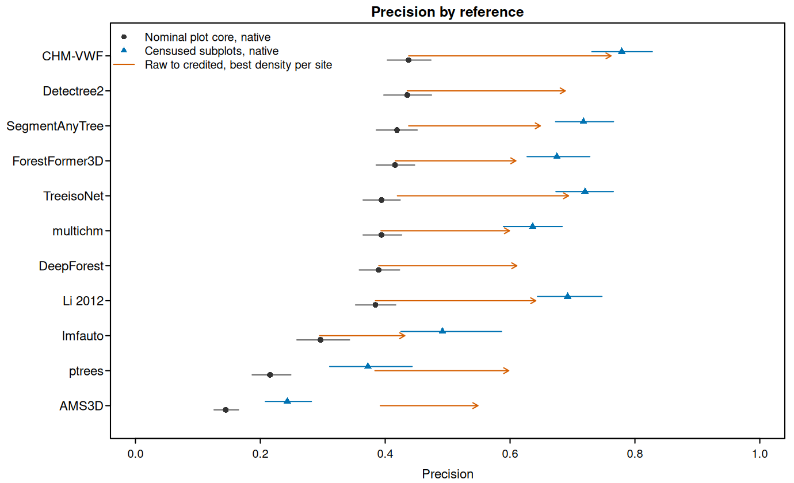
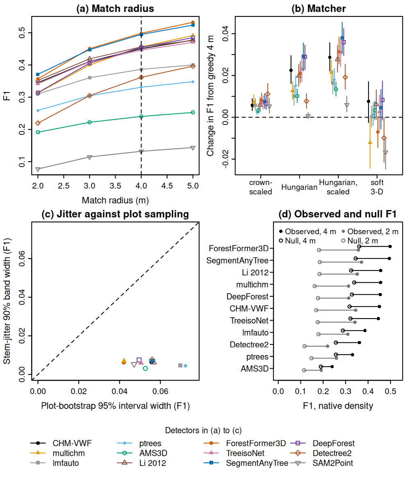

# Supplementary material

Supplement to the draft manuscript [Choosing tree detectors by point
density](manuscript.md). Each section names the study report its numbers come
from. Density is median first-return pulse density over the 106 plots: 9.8
pulses/m² at native density and 4.7, 2.5, 2.0, 1.3 and 0.6 pulses/m² at the five
decimated density levels; the level at 2.0 pulses/m² lies at the QL2 floor and
is called the QL2 level. Every LiDAR detector reads the same fixed evaluation
clips (Section 3.3 of the manuscript).

## S1. Recall by crown class

Native density, five sites, nominal plot core, with 95% plot-bootstrap
intervals: 1,872 overstory stems (dominant and codominant) and 592 understory
stems (intermediate and suppressed), 404 of the latter at WREF. Detections carry
no crown class, so the strata have recall only. Source: [master
tables](../results/master-tables-results.md).

**Table S1.** Recall by crown class at native density.

| Detector | Overstory | Understory |
| --- | --- | --- |
| AMS3D | 0.735 [0.686, 0.777] | 0.627 [0.560, 0.701] |
| `ptrees` | 0.786 [0.746, 0.827] | 0.459 [0.365, 0.555] |
| ForestFormer3D | 0.674 [0.645, 0.704] | 0.454 [0.387, 0.522] |
| `multichm` | 0.599 [0.568, 0.632] | 0.340 [0.291, 0.396] |
| SegmentAnyTree | 0.698 [0.657, 0.739] | 0.291 [0.218, 0.364] |
| DeepForest (RGB) | 0.630 [0.594, 0.667] | 0.262 [0.206, 0.323] |
| Li 2012 | 0.663 [0.617, 0.710] | 0.228 [0.159, 0.298] |
| `lmfauto` | 0.658 [0.605, 0.708] | 0.225 [0.149, 0.300] |
| TreeisoNet | 0.606 [0.562, 0.650] | 0.193 [0.131, 0.256] |
| CHM-VWF | 0.554 [0.511, 0.601] | 0.171 [0.118, 0.226] |
| Detectree2 (RGB) | 0.365 [0.325, 0.403] | 0.123 [0.089, 0.162] |

## S2. Accuracy by site

Source: [master tables](../results/master-tables-results.md) and [model
comparison](../results/model-benchmark-results.md); 95% plot-bootstrap intervals
in brackets. SJER has six plots and wide intervals.

**Table S2.** Native-density F1 by site, nominal plot core, with 95% intervals.

| Detector | SJER | SOAP | TEAK | WREF | ABBY |
| --- | --- | --- | --- | --- | --- |
| ForestFormer3D | 0.325 [0.216, 0.470] | 0.454 [0.398, 0.528] | 0.495 [0.437, 0.568] | 0.491 [0.459, 0.524] | 0.542 [0.508, 0.576] |
| SegmentAnyTree | 0.274 [0.149, 0.421] | 0.469 [0.404, 0.534] | 0.517 [0.437, 0.603] | 0.463 [0.416, 0.505] | 0.559 [0.517, 0.598] |
| `multichm` | 0.342 [0.213, 0.448] | 0.437 [0.378, 0.498] | 0.449 [0.389, 0.527] | 0.452 [0.418, 0.488] | 0.489 [0.454, 0.526] |
| Li 2012 | 0.257 [0.160, 0.369] | 0.356 [0.297, 0.412] | 0.393 [0.329, 0.468] | 0.432 [0.396, 0.466] | 0.557 [0.507, 0.605] |
| DeepForest (RGB) | 0.261 [0.116, 0.404] | 0.451 [0.420, 0.495] | 0.461 [0.384, 0.546] | 0.423 [0.385, 0.460] | 0.510 [0.469, 0.550] |
| CHM-VWF | 0.307 [0.169, 0.471] | 0.382 [0.329, 0.446] | 0.388 [0.325, 0.461] | 0.392 [0.356, 0.428] | 0.557 [0.510, 0.605] |
| TreeisoNet | 0.280 [0.176, 0.388] | 0.390 [0.348, 0.437] | 0.373 [0.313, 0.451] | 0.393 [0.360, 0.430] | 0.571 [0.532, 0.608] |
| `lmfauto` | 0.301 [0.167, 0.436] | 0.337 [0.266, 0.410] | 0.373 [0.314, 0.448] | 0.425 [0.384, 0.465] | 0.384 [0.328, 0.452] |
| Detectree2 (RGB) | 0.250 [0.154, 0.322] | 0.405 [0.354, 0.468] | 0.337 [0.278, 0.405] | 0.314 [0.273, 0.355] | 0.426 [0.361, 0.478] |
| `ptrees` | 0.164 [0.095, 0.245] | 0.259 [0.211, 0.329] | 0.305 [0.216, 0.409] | 0.302 [0.247, 0.368] | 0.446 [0.393, 0.501] |
| AMS3D | 0.100 [0.057, 0.156] | 0.190 [0.142, 0.277] | 0.342 [0.234, 0.457] | 0.258 [0.226, 0.298] | 0.244 [0.203, 0.288] |

DeepForest's SJER and TEAK scores are not zero-shot: its training annotations
include imagery of those two sites.

## S3. Sensitivity populations

Every detector was also scored on a population without the 10 cm DBH floor (116
plots, 2,854 stems) and on one without the six-tree plot rule (149 plots, 2,628
stems). Source: [master tables](../results/master-tables-results.md).

**Table S3.** Paired F1 difference from CHM-VWF at native density under the
three populations.

| Population | ForestFormer3D | SegmentAnyTree | TreeisoNet | `multichm` | Li 2012 |
| --- | --- | --- | --- | --- | --- |
| Main | +0.048 [+0.028, +0.069] | +0.044 [+0.021, +0.067] | −0.004 [−0.018, +0.009] | +0.005 [−0.018, +0.028] | +0.006 [−0.009, +0.019] |
| No DBH floor | +0.038 [+0.015, +0.060] | +0.035 [+0.009, +0.059] | −0.008 [−0.025, +0.009] | −0.003 [−0.026, +0.019] | +0.011 [−0.005, +0.029] |
| No six-tree rule | +0.033 [+0.009, +0.054] | — | −0.013 [−0.027, −0.001] | −0.001 [−0.022, +0.019] | −0.007 [−0.019, +0.005] |

SegmentAnyTree has no row for the third population because its inference fails
on one sparse clip there, which is left missing and not scored as empty. At 0.6
pulses/m², `multichm` leads CHM-VWF by +0.060, +0.067 and +0.031 under the three
populations, and AMS3D by +0.063, +0.048 and +0.045, all with intervals that
exclude zero. These are observed leads; corrected for chance in the main
population they are −0.008 [−0.031, +0.011] for `multichm` and +0.020 [−0.006,
+0.045] for AMS3D (Table 4 of the manuscript), and the null was not computed for
the sensitivity populations.

## S4. Censused subplots

Source: [censused-subplot study](../results/census-support-results.md).

**Table S4.** Plots admitted to censused-subplot scoring, tower / distributed in
brackets.

| Site | Plots | Nearest census within four years | Stems in those plots | Exact 2021 census | Stems |
| --- | ---: | --- | ---: | ---: | ---: |
| SJER | 6 | 2 (2 / 0) | 31 | 0 | 0 |
| SOAP | 18 | 1 (1 / 0) | 16 | 0 | 0 |
| TEAK | 19 | 9 (2 / 7) | 149 | 2 | 48 |
| WREF | 38 | 28 (18 / 10) | 842 | 4 | 174 |
| ABBY | 25 | 17 (10 / 7) | 569 | 10 | 458 |
| All | 106 | 57 (33 / 24) | 1,607 | 16 | 680 |

The admitted censuses lie between one year before and three years after the
flights. The exact 2021 check gives the same direction as the main rule: native
precision of 0.79 against 0.44 in the nominal plot core for CHM-VWF, 0.77
against 0.44 for SegmentAnyTree and 0.75 against 0.42 for ForestFormer3D. The
stricter exclusion rule admits 54 plots and gives native precision about 0.01
below the main rule for every detector.

## S5. Co-detection credit

An isolated false positive is credited when detectors from at least two other
families leave an isolated false positive within 2 m. Each detector is scored at
its best tested density per site, so the raw values differ from the
native-density table of the manuscript. Source: [coverage-gap
study](../results/coverage-gap-results.md).

**Table S5.** Raw and credited scores, five sites pooled.

| Detector | Recall | Precision | F1 | Credited precision | Credited F1 | Gain |
| --- | --- | --- | --- | --- | --- | --- |
| SegmentAnyTree | 0.590 | 0.438 | 0.503 | 0.648 | 0.618 | +0.115 |
| ForestFormer3D | 0.616 | 0.416 | 0.497 | 0.609 | 0.613 | +0.116 |
| Li 2012 | 0.561 | 0.384 | 0.456 | 0.641 | 0.598 | +0.142 |
| CHM-VWF | 0.492 | 0.458 | 0.474 | 0.763 | 0.598 | +0.124 |
| TreeisoNet | 0.521 | 0.420 | 0.465 | 0.694 | 0.595 | +0.130 |
| DeepForest (RGB) | 0.545 | 0.390 | 0.454 | 0.611 | 0.576 | +0.122 |
| `multichm` | 0.546 | 0.393 | 0.457 | 0.599 | 0.571 | +0.114 |
| AMS3D | 0.590 | 0.392 | 0.471 | 0.548 | 0.568 | +0.097 |
| `ptrees` | 0.539 | 0.384 | 0.448 | 0.598 | 0.567 | +0.119 |
| `lmfauto` | 0.604 | 0.295 | 0.396 | 0.431 | 0.503 | +0.107 |
| Detectree2 (RGB) | 0.309 | 0.435 | 0.362 | 0.688 | 0.427 | +0.065 |

CHM-VWF's row pools 104 plots and 2,496 stems, because two TEAK plots lack its
selected configuration; every other row pools 106 plots and 2,525 stems. Across
radii of 1.5 to 3 m and one or two witnessing families, the pooled gain is
+0.106 to +0.135.

## S6. Detector fusion

Detections of eight LiDAR detectors and DeepForest were clustered across
detectors and kept by union, by majority and by agreement of at least k
detectors. The value of k is chosen on the same plots, so the gains are in
sample. Source: [fusion study](../results/detector-fusion-results.md).

**Table S6.** F1 of fused modes against the best single detector, 106 plots per
density.

| Pulses/m² | Best single detector | Union | Majority | Best agreement rule | Difference |
| --- | --- | ---: | ---: | --- | ---: |
| 9.8 | ForestFormer3D 0.498 | 0.321 | 0.472 | k = 3, 0.489 | −0.009 |
| 4.7 | ForestFormer3D 0.487 | 0.392 | 0.462 | k = 2, 0.496 | +0.009 |
| 2.5 | SegmentAnyTree 0.469 | 0.427 | 0.450 | k = 2, 0.490 | +0.021 |
| 1.3 | AMS3D 0.459 | 0.434 | 0.426 | k = 2, 0.481 | +0.022 |
| 0.6 | DeepForest (RGB) 0.454 | 0.446 | 0.359 | k = 2, 0.473 | +0.019 |

The fusion study did not include the QL2 level (2.0 pulses/m²). The union raises
recall to 0.85 at native density at a precision of 0.20. At 0.6 pulses/m² the
best single detector is the RGB one, whose accuracy does not depend on point
density.

## S7. Crown delineation

Crown diameters from every segmenter, among them a random walker
[@grady2006random] and the methods of @dalponte2016treecentric and
@silva2016imputation, were compared with NEON field crown diameters on the plots
with at least six such stems. The equivalent-circle diameter is compared with
the field ninety-degree diameter and the widest axis with the field maximum
diameter. Source: [crown benchmark](../results/crown-segmentation-results.md).

**Table S7.** Crown diameter error at native density on the 790 stems matched by
every listed segmenter.

| Segmenter | Equivalent diameter RMSE (m) | Bias (m) | Widest axis RMSE (m) | Bias (m) |
| --- | ---: | ---: | ---: | ---: |
| Random walker with a stop rule | 1.71 | +0.46 | 2.83 | +1.67 |
| SegmentAnyTree | 1.74 | +0.37 | 2.38 | +0.88 |
| lasR region growing | 1.87 | +0.80 | 2.95 | +1.90 |
| Dalponte 2016 | 1.90 | +0.84 | 3.49 | +2.36 |
| ForestFormer3D | 1.92 | +0.82 | 2.56 | +1.18 |
| Silva 2016 | 2.01 | +0.93 | 3.45 | +2.45 |
| `ptrees` | 2.28 | +0.02 | 3.00 | +0.76 |
| AMS3D | 3.11 | +0.27 | 3.91 | +0.86 |
| Li 2012 | 3.70 | +2.07 | 5.48 | +3.70 |

For the stop-rule random walker the equivalent-diameter RMSE is 1.76 m at native
density, 1.65 to 1.76 m down to 1.3 pulses/m² and 1.91 m at 0.6 pulses/m²: crown
width tolerates sparser data than stem detection does.

## S8. Mask scores on NEON and the proxy reference

NEON has no per-point tree labels. Mask scores use a proxy reference in which
each canopy point is assigned to the nearest mapped stem within that stem's
field crown radius. Source: [instance IoU
study](../results/instance-iou-pq-results.md).

**Table S8.** Mask scores against the proxy at native density, five sites, IoU
threshold 0.5.

| Detector | Precision | Recall | F1 | Panoptic quality |
| --- | --- | --- | --- | --- |
| SegmentAnyTree | 0.119 | 0.211 | 0.152 | 0.098 |
| ForestFormer3D | 0.104 | 0.192 | 0.135 | 0.087 |
| Li 2012 | 0.099 | 0.185 | 0.129 | 0.083 |
| `ptrees` | 0.055 | 0.208 | 0.087 | 0.056 |
| AMS3D | 0.035 | 0.183 | 0.058 | 0.038 |
| TreeisoNet | 0.026 | 0.020 | 0.023 | 0.015 |

TreeisoNet's masks are reported at its checkpoint voxel, the setting fixed
before the runs; at the coarser voxel of its apex pass its mask F1 is 0.138, a
sensitivity computed after the results were seen. Kendall's τ between the apex
ranking and the mask ranking of the six detectors is 0.60.

The proxy was validated on FGI-EMIT, where true labels exist, by building it
from the true trees ([proxy
validation](../results/fgiemit-proxy-validation-results.md)). Scored as if it
were a prediction, the proxy reaches a mask F1 of 0.60 against the truth with
measured crown radii and 0.44 with the 2 m fallback radius used when a field
width is missing; its median tree IoU is 0.74 for free-standing trees and 0.17
for trees beneath a taller neighbour. On the ten development plots, against the
proxy, ForestFormer3D's mask F1 falls from 0.72 to 0.49 (−0.230 [−0.292,
−0.161]) and SegmentAnyTree's from 0.62 to 0.47 (−0.147 [−0.195, −0.097]). The
proxy keeps the order of the two models and compresses their difference from
0.10 to 0.02. NEON mask scores are therefore a ranking, not a measure of mask
quality.

## S9. Calibration and validation of the baseline

The baseline's canopy-model resolution (0.25, 0.5 or 1.0 m) and window slope
(0.05, 0.10 or 0.15) were tuned on a stratified half of each site's plots and
scored on the other half, over ten seeds. Source: [calibration/validation
study](../results/calibration-validation-results.md).

**Table S9.** Held-out F1 after tuning: the median over ten seeds with the range
in parentheses (a range over seeds, not an interval), and the share of seeds
that selected 0.5 m.

| Site | 9.8 pulses/m² | 0.5 m chosen | 4.7 pulses/m² | 0.5 m chosen | 0.6 pulses/m² | 0.5 m chosen |
| --- | --- | --- | --- | --- | --- | --- |
| SJER | 0.301 (0.182–0.444) | 3 / 10 | 0.349 (0.185–0.430) | 2 / 10 | 0.357 (0.203–0.413) | 3 / 10 |
| SOAP | 0.392 (0.335–0.417) | 8 / 10 | 0.377 (0.338–0.406) | 10 / 10 | 0.402 (0.348–0.437) | 9 / 10 |
| TEAK | 0.422 (0.358–0.476) | 4 / 10 | 0.393 (0.354–0.421) | 10 / 10 | 0.397 (0.364–0.434) | 10 / 10 |
| WREF | 0.403 (0.365–0.447) | 6 / 10 | 0.357 (0.343–0.398) | 10 / 10 | 0.342 (0.324–0.369) | 10 / 10 |
| ABBY | 0.549 (0.472–0.578) | 6 / 10 | 0.486 (0.452–0.508) | 10 / 10 | 0.431 (0.412–0.448) | 10 / 10 |

Held-out F1 after tuning is within a few hundredths of the fixed configuration's
F1 on all of a site's plots (for example 0.549 against 0.557 at ABBY at native
density); the two are not scored on the same plots, so this is a check of
magnitude rather than a paired comparison. The paper does not tune the baseline;
the regional split of the manuscript is its held-out test.

## S10. Detector not analysed and historical studies

A promptable refiner, SAM2Point [@guo2024sam2point], built on SAM 2
[@ravi2024sam] and seeded with up to 40 CHM-VWF tops per plot scored F1 0.132 at
native density, against 0.405 for its own seeds on the same plots. It keeps 81%
of its seeds as trees in plots with up to 15 prompts and 20% in plots with 31 to
40, because early masks absorb their neighbours' points. It is not analysed
further. Source: [master tables](../results/master-tables-results.md).

Per-detection confidence calibration, per-cell routing between detectors by a
learned policy and the paired fusion of RGB and LiDAR detections were studied on
the earlier three-site population only and found small effects. Their reports
are marked historical and are not part of the paper's evidence; the
density-routed pipeline of Section 4.7 of the manuscript is a separate, post hoc
analysis of the five-site population (Section S25).

## S11. Configuration provenance

The configuration provenance record lists every tunable setting of every
detector, the data it was chosen on and the commit that fixed it, against the
time the Washington sites were first scored. The detector table gives checkpoint
hashes, image identifiers and licences. Source: [configuration provenance
record](../docs/configuration-provenance.md) and [detector
table](../results/detector-table.md).

## S12. Chance agreement

The null shifts each plot's detections within the core and its matching margin
by each of 200 random offsets, the same for every detector and density, and
scores the mean counts over the 200 shifts like the observed detections (Section
4.2 of the manuscript). It is the score of copies with no skill at placing trees
and tends to overstate the chance part of a score. Corrected F1 is (F1 − null
F1) / (1 − null F1); a corrected lead is a difference of corrected F1 with a
paired 95% interval. The QL2 level (2.0 pulses/m²), whose fixed evaluation clips
form a separate set, was scored with the same offsets and resamples. The null is
a Monte Carlo estimate: on the five sites an independent set of 200 offsets
changes the pooled null F1 of any detector by at most 0.002 and any corrected F1
lead by at most 0.002 (regional leads and their differences move by up to 0.006
and single-site leads by up to 0.013, at SJER), and minimum shifts of 6 m or 12
m instead of 8 m change the two segmenters' native corrected leads by at most
0.001 (ForestFormer3D +0.020 and +0.021, SegmentAnyTree +0.034 and +0.035,
against +0.020 and +0.034 at 8 m). Source: [matcher-robustness
study](../results/matcher-robustness-results.md).

**Table S12a.** Native density, five sites: observed and null F1 at radii of 4
and 2 m, corrected F1, at 4 m the plain difference above the null, and at 2 m
the corrected lead over CHM-VWF with its paired interval.

| Detector | F1, 4 m | Null F1, 4 m | Corrected F1, 4 m | F1 above the null (F1 − null F1), 4 m | F1, 2 m | Null F1, 2 m | Corrected F1, 2 m | Corrected lead, 2 m |
| --- | --- | --- | --- | --- | --- | --- | --- | --- |
| SegmentAnyTree | 0.495 | 0.345 | 0.229 [0.201, 0.255] | 0.150 [0.131, 0.168] | 0.371 | 0.185 | 0.228 [0.204, 0.251] | +0.017 [−0.001, +0.033] |
| ForestFormer3D | 0.498 | 0.361 | 0.215 [0.191, 0.239] | 0.138 [0.121, 0.154] | 0.357 | 0.181 | 0.214 [0.190, 0.239] | +0.003 [−0.014, +0.021] |
| CHM-VWF | 0.450 | 0.318 | 0.195 [0.169, 0.222] | 0.133 [0.114, 0.154] | 0.345 | 0.169 | 0.211 [0.186, 0.235] | — |
| Li 2012 | 0.456 | 0.325 | 0.195 [0.172, 0.217] | 0.132 [0.115, 0.149] | 0.352 | 0.184 | 0.206 [0.183, 0.228] | −0.006 [−0.019, +0.008] |
| DeepForest (RGB) | 0.454 | 0.328 | 0.188 [0.163, 0.212] | 0.126 [0.109, 0.143] | 0.314 | 0.177 | 0.166 [0.143, 0.188] | −0.045 [−0.065, −0.025] |
| TreeisoNet | 0.446 | 0.322 | 0.183 [0.161, 0.205] | 0.124 [0.108, 0.141] | 0.342 | 0.176 | 0.201 [0.178, 0.226] | −0.010 [−0.023, +0.002] |
| `multichm` | 0.456 | 0.338 | 0.178 [0.158, 0.202] | 0.118 [0.104, 0.134] | 0.313 | 0.162 | 0.181 [0.161, 0.201] | −0.031 [−0.050, −0.012] |
| Detectree2 (RGB) | 0.362 | 0.257 | 0.141 [0.118, 0.165] | 0.105 [0.088, 0.122] | 0.220 | 0.117 | 0.116 [0.094, 0.139] | −0.095 [−0.122, −0.071] |
| `lmfauto` | 0.386 | 0.288 | 0.138 [0.115, 0.165] | 0.099 [0.082, 0.117] | 0.310 | 0.179 | 0.159 [0.136, 0.185] | −0.052 [−0.073, −0.031] |
| `ptrees` | 0.331 | 0.257 | 0.099 [0.080, 0.124] | 0.074 [0.060, 0.091] | 0.259 | 0.148 | 0.130 [0.112, 0.149] | −0.081 [−0.105, −0.057] |
| AMS3D | 0.240 | 0.190 | 0.063 [0.051, 0.075] | 0.051 [0.042, 0.060] | 0.191 | 0.115 | 0.086 [0.074, 0.100] | −0.125 [−0.150, −0.102] |

**Table S12b.** Corrected F1 by density at 4 m, five sites. Columns give the
median first-return density in pulses/m²; 2.0 is the QL2 level.

| Detector | 9.8 | 4.7 | 2.5 | 2.0 | 1.3 | 0.6 |
| --- | --- | --- | --- | --- | --- | --- |
| SegmentAnyTree | 0.229 | 0.222 | 0.205 | 0.185 | 0.150 | 0.047 |
| ForestFormer3D | 0.215 | 0.211 | 0.183 | 0.182 | 0.177 | 0.164 |
| CHM-VWF | 0.195 | 0.170 | 0.172 | 0.168 | 0.161 | 0.164 |
| TreeisoNet | 0.183 | 0.188 | 0.188 | 0.184 | 0.180 | 0.185 |
| `multichm` | 0.178 | 0.171 | 0.158 | 0.169 | 0.162 | 0.156 |
| `lmfauto` | 0.138 | 0.112 | 0.084 | 0.080 | 0.072 | 0.073 |
| `ptrees` | 0.099 | 0.182 | 0.166 | 0.169 | 0.154 | 0.103 |
| AMS3D | 0.063 | 0.091 | 0.134 | 0.147 | 0.183 | 0.184 |

**Table S12c.** Corrected lead over CHM-VWF by density and radius, five sites;
2.0 is the QL2 level.

| Detector | Radius | 9.8 | 4.7 | 2.5 | 2.0 | 1.3 | 0.6 |
| --- | --- | --- | --- | --- | --- | --- | --- |
| SegmentAnyTree | 4 m | +0.034 [+0.008, +0.057] | +0.053 [+0.026, +0.080] | +0.033 [+0.005, +0.060] | +0.017 [−0.008, +0.041] | −0.011 [−0.039, +0.018] | −0.117 [−0.139, −0.097] |
| SegmentAnyTree | 2 m | +0.017 [−0.001, +0.033] | +0.036 [+0.014, +0.059] | +0.019 [−0.010, +0.045] | −0.005 [−0.027, +0.018] | −0.014 [−0.038, +0.009] | −0.111 [−0.134, −0.090] |
| ForestFormer3D | 4 m | +0.020 [−0.002, +0.041] | +0.041 [+0.014, +0.069] | +0.011 [−0.014, +0.037] | +0.014 [−0.012, +0.040] | +0.016 [−0.010, +0.041] | +0.000 [−0.024, +0.022] |
| ForestFormer3D | 2 m | +0.003 [−0.014, +0.021] | +0.020 [−0.003, +0.042] | +0.013 [−0.011, +0.036] | +0.008 [−0.012, +0.028] | +0.000 [−0.021, +0.019] | +0.001 [−0.022, +0.022] |
| TreeisoNet | 4 m | −0.011 [−0.029, +0.005] | +0.018 [−0.004, +0.041] | +0.016 [−0.003, +0.039] | +0.016 [−0.006, +0.039] | +0.020 [−0.001, +0.043] | +0.021 [−0.005, +0.046] |
| TreeisoNet | 2 m | −0.010 [−0.023, +0.002] | +0.024 [+0.006, +0.043] | +0.027 [+0.008, +0.044] | +0.024 [+0.004, +0.042] | +0.035 [+0.015, +0.053] | +0.024 [+0.002, +0.042] |
| `multichm` | 4 m | −0.017 [−0.039, +0.005] | +0.001 [−0.025, +0.027] | −0.013 [−0.037, +0.010] | +0.001 [−0.025, +0.030] | +0.001 [−0.023, +0.026] | −0.008 [−0.031, +0.011] |
| `multichm` | 2 m | −0.031 [−0.050, −0.012] | −0.012 [−0.033, +0.008] | −0.012 [−0.036, +0.010] | −0.023 [−0.044, −0.001] | −0.006 [−0.026, +0.014] | −0.009 [−0.028, +0.008] |
| AMS3D | 4 m | −0.132 [−0.159, −0.107] | −0.079 [−0.107, −0.052] | −0.037 [−0.067, −0.009] | −0.022 [−0.048, +0.005] | +0.022 [−0.010, +0.052] | +0.020 [−0.006, +0.045] |
| AMS3D | 2 m | −0.125 [−0.150, −0.102] | −0.068 [−0.093, −0.044] | −0.028 [−0.054, −0.001] | −0.010 [−0.034, +0.013] | +0.014 [−0.011, +0.036] | +0.023 [+0.003, +0.044] |
| `ptrees` | 4 m | −0.095 [−0.123, −0.067] | +0.012 [−0.014, +0.037] | −0.006 [−0.030, +0.019] | +0.000 [−0.022, +0.022] | −0.007 [−0.026, +0.011] | −0.061 [−0.083, −0.040] |
| `ptrees` | 2 m | −0.081 [−0.105, −0.057] | +0.004 [−0.017, +0.024] | +0.001 [−0.019, +0.020] | +0.002 [−0.021, +0.023] | −0.008 [−0.028, +0.013] | −0.056 [−0.073, −0.040] |
| `lmfauto` | 4 m | −0.056 [−0.079, −0.034] | −0.057 [−0.085, −0.027] | −0.088 [−0.115, −0.061] | −0.088 [−0.113, −0.061] | −0.088 [−0.113, −0.061] | −0.091 [−0.116, −0.068] |
| `lmfauto` | 2 m | −0.052 [−0.073, −0.031] | −0.049 [−0.075, −0.022] | −0.074 [−0.104, −0.046] | −0.081 [−0.102, −0.055] | −0.073 [−0.098, −0.047] | −0.065 [−0.087, −0.044] |

At native density the null reproduces 70 to 79% of each detector's F1 at 4 m,
pooled over the five sites (52 to 66% in California and 75 to 84% in
Washington), and 79 to 97% of its understory recall and 68 to 80% of its
overstory recall. Understory recall above the null is 0.094 for AMS3D and
ForestFormer3D, 0.061 for SegmentAnyTree, 0.047 for `ptrees`, 0.040 for
`multichm` and 0.016 [−0.012, 0.050] for CHM-VWF at 4 m, and 0.153, 0.108,
0.064, 0.090, 0.042 and 0.042 at 2 m.

**Table S12d.** Corrected lead over CHM-VWF by region at 4 m, at native density
and at 4.7 pulses/m², with the California minus Washington difference.

| Detector | Pulses/m² | California | Washington | Difference |
| --- | --- | --- | --- | --- |
| ForestFormer3D | 9.8 | +0.060 [+0.026, +0.094] | +0.004 [−0.026, +0.029] | +0.056 [+0.014, +0.099] |
| ForestFormer3D | 4.7 | +0.041 [−0.016, +0.091] | +0.040 [+0.010, +0.073] | +0.001 [−0.060, +0.060] |
| SegmentAnyTree | 9.8 | +0.061 [+0.015, +0.103] | +0.017 [−0.014, +0.042] | +0.044 [−0.007, +0.094] |
| SegmentAnyTree | 4.7 | +0.036 [−0.025, +0.090] | +0.056 [+0.027, +0.083] | −0.020 [−0.088, +0.036] |
| TreeisoNet | 9.8 | −0.017 [−0.044, +0.008] | −0.008 [−0.032, +0.013] | −0.009 [−0.042, +0.025] |
| TreeisoNet | 4.7 | −0.019 [−0.067, +0.028] | +0.034 [+0.010, +0.058] | −0.052 [−0.106, −0.000] |

At native density the Washington estimates are carried by ABBY (ForestFormer3D
−0.043 [−0.092, +0.004], SegmentAnyTree −0.002 [−0.054, +0.038]); at WREF they
are +0.035 [−0.000, +0.066] and +0.033 [−0.005, +0.067].

**Table S12e.** Corrected recall and corrected precision at native density, five
sites, (score − null) / (1 − null), with the corrected leads over CHM-VWF
(paired intervals), at 4 m and at 2 m.

| Detector | Corrected recall, 4 m | Corrected precision, 4 m | Recall lead, 4 m | Precision lead, 4 m | Corrected recall, 2 m | Corrected precision, 2 m | Recall lead, 2 m | Precision lead, 2 m |
| --- | --- | --- | --- | --- | --- | --- | --- | --- |
| ForestFormer3D | 0.305 [0.258, 0.351] | 0.167 [0.146, 0.190] | +0.108 [+0.079, +0.139] | −0.026 [−0.052, −0.003] | 0.270 [0.235, 0.305] | 0.178 [0.155, 0.202] | +0.059 [+0.038, +0.080] | −0.034 [−0.054, −0.013] |
| SegmentAnyTree | 0.308 [0.260, 0.355] | 0.183 [0.157, 0.209] | +0.112 [+0.079, +0.145] | −0.010 [−0.039, +0.012] | 0.281 [0.244, 0.319] | 0.192 [0.169, 0.215] | +0.070 [+0.048, +0.092] | −0.020 [−0.038, −0.002] |
| `multichm` | 0.227 [0.195, 0.262] | 0.147 [0.126, 0.172] | +0.030 [+0.002, +0.059] | −0.046 [−0.072, −0.024] | 0.214 [0.187, 0.244] | 0.156 [0.138, 0.178] | +0.003 [−0.020, +0.026] | −0.055 [−0.077, −0.036] |
| Li 2012 | 0.257 [0.217, 0.303] | 0.158 [0.136, 0.184] | +0.060 [+0.039, +0.083] | −0.035 [−0.052, −0.021] | 0.258 [0.224, 0.295] | 0.171 [0.149, 0.195] | +0.047 [+0.032, +0.065] | −0.041 [−0.054, −0.028] |
| DeepForest (RGB) | 0.242 [0.205, 0.280] | 0.154 [0.131, 0.181] | +0.046 [+0.020, +0.069] | −0.039 [−0.062, −0.019] | 0.203 [0.173, 0.234] | 0.141 [0.118, 0.164] | −0.008 [−0.031, +0.012] | −0.071 [−0.094, −0.050] |
| CHM-VWF | 0.196 [0.164, 0.234] | 0.193 [0.164, 0.227] | — | — | 0.211 [0.180, 0.243] | 0.212 [0.186, 0.243] | — | — |
| TreeisoNet | 0.220 [0.189, 0.259] | 0.157 [0.134, 0.183] | +0.024 [+0.004, +0.044] | −0.035 [−0.055, −0.019] | 0.230 [0.201, 0.263] | 0.179 [0.156, 0.204] | +0.019 [+0.003, +0.034] | −0.033 [−0.048, −0.018] |
| `lmfauto` | 0.231 [0.190, 0.278] | 0.100 [0.079, 0.127] | +0.035 [+0.013, +0.058] | −0.093 [−0.118, −0.070] | 0.243 [0.207, 0.285] | 0.119 [0.097, 0.147] | +0.032 [+0.013, +0.053] | −0.093 [−0.115, −0.072] |
| Detectree2 (RGB) | 0.116 [0.094, 0.141] | 0.181 [0.148, 0.216] | −0.080 [−0.117, −0.049] | −0.012 [−0.051, +0.027] | 0.095 [0.075, 0.113] | 0.150 [0.118, 0.182] | −0.116 [−0.146, −0.090] | −0.062 [−0.094, −0.032] |
| `ptrees` | 0.344 [0.285, 0.412] | 0.059 [0.045, 0.076] | +0.148 [+0.103, +0.199] | −0.134 [−0.166, −0.108] | 0.335 [0.291, 0.380] | 0.081 [0.068, 0.096] | +0.124 [+0.096, +0.153] | −0.131 [−0.158, −0.107] |
| AMS3D | 0.321 [0.268, 0.383] | 0.035 [0.028, 0.043] | +0.125 [+0.077, +0.171] | −0.158 [−0.189, −0.132] | 0.327 [0.284, 0.374] | 0.050 [0.042, 0.058] | +0.116 [+0.081, +0.154] | −0.162 [−0.190, −0.139] |

Corrected F1 equals the harmonic mean of corrected recall and corrected
precision within 0.003 on the five-site and regional scopes and within 0.005 at
single sites, for every detector and radius.

**Table S12f.** Corrected leads over CHM-VWF by site at native density and 4 m,
with the share of CHM-VWF's F1 that the null reproduces at that site and the
range of that share over the eleven detectors.

| Site | ForestFormer3D | SegmentAnyTree | TreeisoNet | Null share, CHM-VWF | Null share, all detectors |
| --- | --- | --- | --- | --- | --- |
| SJER | +0.019 [−0.057, +0.131] | −0.035 [−0.134, +0.043] | −0.028 [−0.148, +0.047] | 48% | 45–65% |
| SOAP | +0.061 [+0.006, +0.106] | +0.072 [+0.004, +0.131] | −0.010 [−0.059, +0.035] | 57% | 51–68% |
| TEAK | +0.069 [+0.018, +0.129] | +0.094 [+0.023, +0.170] | −0.012 [−0.045, +0.027] | 54% | 53–66% |
| WREF | +0.035 [−0.000, +0.066] | +0.033 [−0.005, +0.067] | −0.011 [−0.035, +0.011] | 67% | 66–80% |
| ABBY | −0.043 [−0.092, +0.004] | −0.002 [−0.054, +0.038] | −0.004 [−0.040, +0.029] | 81% | 80–87% |

The chance level itself runs from about half of F1 at SJER to four fifths at
ABBY.

**Table S12g.** Rank stability in corrected F1 of the eight detectors run at
every density: Spearman correlation between their corrected F1 at native density
and at each density level, with 95% plot-bootstrap intervals, at both radii. The
observed-F1 values are in Section 5.2 of the manuscript.

| Radius | 4.7 | 2.5 | 2.0 | 1.3 | 0.6 |
| --- | --- | --- | --- | --- | --- |
| 4 m | 0.76 [0.67, 0.93] | 0.81 [0.52, 0.90] | 0.71 [0.31, 0.88] | −0.19 [−0.29, 0.36] | −0.17 [−0.40, 0.02] |
| 2 m | 0.76 [0.62, 0.90] | 0.64 [0.38, 0.83] | 0.36 [−0.02, 0.67] | −0.05 [−0.33, 0.26] | −0.17 [−0.36, 0.00] |

## S13. Rank stability with detectors left out

Spearman correlation between the native-density ranking and the ranking at each
density level, recomputed on every bootstrap draw with the named detectors
removed, nominal plot core, five sites. The pair SegmentAnyTree and AMS3D was
chosen after seeing the results. Source: [master
tables](../results/master-tables-results.md).

**Table S13.** Rank correlation with native density, with 95% intervals. Columns
give the median first-return density in pulses/m².

| Left out | 4.7 | 2.5 | 2.0 | 1.3 | 0.6 |
| --- | --- | --- | --- | --- | --- |
| None (eight detectors) | 0.83 [0.69, 0.93] | 0.76 [0.55, 0.88] | 0.71 [0.38, 0.81] | −0.05 [−0.17, 0.26] | −0.19 [−0.36, 0.14] |
| None (eight detectors), censused subplots | 0.86 [0.64, 0.95] | 0.64 [0.48, 0.81] | 0.52 [0.14, 0.71] | 0.02 [−0.19, 0.21] | 0.12 [−0.26, 0.26] |
| CHM-VWF | 0.93 [0.75, 0.96] | 0.82 [0.71, 0.89] | 0.86 [0.54, 0.86] | −0.11 [−0.25, 0.25] | −0.25 [−0.46, 0.18] |
| `multichm` | 0.82 [0.71, 0.89] | 0.71 [0.46, 0.82] | 0.57 [0.36, 0.75] | −0.04 [−0.21, 0.18] | −0.18 [−0.43, 0.07] |
| `lmfauto` | 0.82 [0.64, 0.96] | 0.79 [0.50, 0.93] | 0.75 [0.25, 0.86] | −0.29 [−0.46, 0.14] | −0.36 [−0.54, 0.07] |
| `ptrees` | 0.89 [0.82, 1.00] | 0.82 [0.57, 0.93] | 0.82 [0.36, 0.89] | −0.29 [−0.36, 0.18] | −0.36 [−0.54, 0.07] |
| AMS3D | 0.75 [0.54, 0.89] | 0.71 [0.50, 0.89] | 0.82 [0.29, 0.89] | 0.43 [0.21, 0.75] | 0.11 [−0.11, 0.36] |
| ForestFormer3D | 0.75 [0.54, 0.89] | 0.68 [0.43, 0.82] | 0.57 [0.25, 0.75] | −0.11 [−0.29, 0.18] | −0.32 [−0.43, 0.00] |
| TreeisoNet | 0.89 [0.71, 0.89] | 0.79 [0.57, 0.86] | 0.68 [0.43, 0.79] | 0.04 [−0.21, 0.25] | −0.21 [−0.43, 0.18] |
| SegmentAnyTree | 0.75 [0.54, 0.89] | 0.68 [0.39, 0.82] | 0.57 [0.29, 0.75] | −0.04 [−0.11, 0.43] | 0.07 [−0.07, 0.57] |
| SegmentAnyTree and AMS3D | 0.60 [0.26, 0.83] | 0.60 [0.31, 0.83] | 0.71 [0.26, 0.89] | 0.54 [0.43, 0.89] | 0.54 [0.43, 0.89] |
| SegmentAnyTree and AMS3D, censused subplots | 0.71 [0.37, 0.94] | 0.66 [0.43, 0.89] | 0.66 [0.43, 0.89] | 0.83 [0.54, 0.94] | 0.89 [0.54, 0.94] |

With six or seven detectors the correlation takes few values, so a point
estimate can sit at the end of its interval. Under random orderings, a Spearman
correlation of at least 0.62 arises in 5% of orderings of eight detectors (0.71
in 3%) and 0.77 in 5% of orderings of six; the eight-detector values at 4.7, 2.5
and 2.0 pulses/m² have chance probabilities 0.008, 0.018 and 0.029, those at 1.3
and 0.6 pulses/m² 0.56 and 0.69, and the six-detector 0.54 has 0.15.

## S14. Reference stands

Descriptors of the reference population per site, computed from the population
files of the fixed evaluation clips: mapped stems and basal area per hectare of
nominal plot core, field heights and diameters of the reference stems, and the
three most frequent species with their stem counts. Source: [instance
audit](../results/instance-audit-results.md).

**Table S14.** Reference stands by site.

| Site | Plots | Core area (ha) | Stems | Stems/ha | Basal area (m²/ha) | Median height (m) (stems with heights) | Maximum height (m) | Median DBH (cm) | Main species (stems) |
| --- | --- | --- | --- | --- | --- | --- | --- | --- | --- |
| SJER | 6 | 0.96 | 57 | 59 | 3.4 | 7.4 (28 of 57) | 17.7 | 19.3 | Quercus wislizeni (33); Quercus douglasii (19); Pinus sabiniana (5) |
| SOAP | 18 | 1.56 | 231 | 148 | 13.2 | 10.1 (228 of 231) | 51.4 | 24.6 | Calocedrus decurrens (85); Quercus chrysolepis (75); Pinus ponderosa (50) |
| TEAK | 19 | 1.48 | 374 | 253 | 32.1 | 10.3 (368 of 374) | 49.3 | 22.2 | Abies magnifica (114); Abies concolor (82); Pinus contorta (74) |
| WREF | 38 | 3.92 | 1063 | 271 | 29.2 | 16.5 (1039 of 1063) | 63.0 | 21.0 | Tsuga heterophylla (460); Pseudotsuga menziesii (365); Abies amabilis (150) |
| ABBY | 25 | 2.56 | 800 | 312 | 13.2 | 10.7 (800 of 800) | 62.6 | 14.3 | Pseudotsuga menziesii (748); Tsuga heterophylla (19); Alnus rubra (17) |

SJER's cores hold few mapped stems relative to the trees present, so its
precision is set by reference coverage (Section S19); ABBY is a young, even-aged
Douglas-fir stand; WREF old growth holds 404 of the 592 understory stems.

## S15. Inference settings of the learned detectors and of ForestMamba

The settings below are those fixed by the published code and checkpoints, read
from the pinned configuration files and the checkpoints' embedded run
configurations; none was tuned on the benchmark except TreeisoNet's confidence
threshold (Section 4.1 of the manuscript). The ForestMamba row gives the
settings of the run added after the tables were fixed (Section S23). Source:
[detector table](../results/detector-table.md), [configuration
provenance](../docs/configuration-provenance.md) and the [ForestMamba
runtime](../gpu/forestmamba-sm120/README.md).

**Table S15.** Inference settings.

| Detector | Source and checkpoint | Settings |
| --- | --- | --- |
| ForestFormer3D | ForestFormer3D commit 6a75c37, `epoch_3000_fix.pth` (Zenodo record 16742708) | 0.2 m voxels; 16 m-radius input cylinders over the whole clip, up to 640,000 points each; 300 queries; score threshold 0.4; instances kept if the superpoint score is at least 0.15 and they hold at least 10 points; matrix non-maximum suppression with a linear kernel; at most 300 instances per cylinder. The source was patched only to load the checkpoint on current PyTorch and spconv versions; the nearest-neighbour rows are batched 2,048 at a time (20,000 upstream), which changes memory use and not results. |
| SegmentAnyTree | segment-any-tree commit a3561ed, `model_file/PointGroup-PAPER.pt` | 0.2 m grid subsampling; 8 m-radius cylinder sampling; PointGroup clustering (type 5) with a search radius of 1.5 grid cells (0.3 m) and a mean-shift bandwidth of 0.6; score network on, IoU threshold 0.25; upstream defaults, run through compatibility shims that leave the source unchanged. |
| TreeisoNet | TreeAIBox commit 5380dde, `als_treeloc.pth` and `als_treeoff.pth` | Localisation network on 0.8 × 0.8 × 2.0 m voxels (TreeAIBox's airborne setting); peaks above confidence 0.22 snapped to the highest canopy point within 2 m; offset network at the checkpoint voxel (0.1 m) for masks, with a 2 m mask height cutoff. |
| ForestMamba | ForestMamba commit f0c5239, `v6_epoch_1500_fix.pth` from the authors' public release folder, SHA-256 pinned; run after the tables were fixed (Section S23) | Configuration `forestmamba_chm_radius16_qp300_2many_v6.py`: 16 m-radius input cylinders over the whole clip; tree queries seeded at canopy-height peaks of at least 1.5 m on fixed 0.3 m and 0.7 m height grids with a fixed 0.25·h^0.5 m peak window, supplemented by farthest-point samples; heights measured from the lowest ground return, classified noise left out; upstream defaults otherwise, run on current PyTorch with prebuilt Mamba kernels. |

The all-return point densities of the six density levels are 17.9, 8.4, 4.4,
3.5, 2.2 and 1.1 points/m² (five-site medians), mean point spacings of 0.24,
0.35, 0.48, 0.53, 0.67 and 0.95 m, against the 0.2 m voxel of the two segmenters
and SegmentAnyTree's 0.3 m clustering radius.

## S16. The baseline without its smoothing

The paper's CHM-VWF smooths its 0.5 m canopy model with a circular 3 m moving
mean below 8 first returns/m², a rule fixed before the runs. A post hoc run of
CHM-VWF on the same fixed evaluation clips with the smoothing disabled
(`detect_lidrplugins_sweep.R` with `SMOOTH_BELOW=0`) is pooled here with the
master-table resamples, against the leading detectors and the baseline with its
pre-declared smoothing rule; at native density only the 18 plots below 8
pulses/m² differ. The QL2 level, whose clips form a separate set, was not run.
Source: [baseline smoothing
sensitivity](../results/baseline-smoothing-sensitivity-results.md).

**Table S16a.** CHM-VWF with and without the smoothing by density, five sites:
F1 with 95% intervals, recall, dominant-class recall (347 stems), and the paired
change in F1 and recall.

| Pulses/m² | F1, with smoothing | Recall | Dominant recall | F1, no smoothing | Recall | Dominant recall | Change in F1 | Change in recall |
| --- | --- | --- | --- | --- | --- | --- | --- | --- |
| 9.8 | 0.450 [0.423, 0.478] | 0.464 | 0.71 | 0.454 [0.426, 0.480] | 0.480 | 0.71 | +0.003 [−0.002, +0.009] | +0.015 [+0.006, +0.028] |
| 4.7 | 0.395 [0.370, 0.420] | 0.327 | 0.56 | 0.463 [0.437, 0.489] | 0.497 | 0.71 | +0.068 [+0.047, +0.091] | +0.171 [+0.143, +0.198] |
| 2.5 | 0.396 [0.371, 0.421] | 0.328 | 0.54 | 0.453 [0.427, 0.479] | 0.478 | 0.69 | +0.058 [+0.037, +0.079] | +0.150 [+0.127, +0.175] |
| 1.3 | 0.383 [0.357, 0.408] | 0.311 | 0.54 | 0.449 [0.424, 0.473] | 0.463 | 0.69 | +0.066 [+0.049, +0.084] | +0.152 [+0.130, +0.176] |
| 0.6 | 0.374 [0.353, 0.396] | 0.296 | 0.54 | 0.431 [0.406, 0.456] | 0.419 | 0.65 | +0.058 [+0.040, +0.074] | +0.122 [+0.101, +0.142] |

**Table S16b.** Observed F1 lead over the baseline with its pre-declared
smoothing rule / over the baseline without smoothing, by density, with paired
intervals.

| Detector | 9.8 | 4.7 | 2.5 | 1.3 | 0.6 |
| --- | --- | --- | --- | --- | --- |
| ForestFormer3D | +0.048 [+0.028, +0.069] / +0.045 [+0.023, +0.065] | +0.092 [+0.065, +0.120] / +0.024 [+0.003, +0.046] | +0.062 [+0.035, +0.088] / +0.004 [−0.015, +0.025] | +0.055 [+0.029, +0.079] / −0.011 [−0.032, +0.007] | +0.047 [+0.022, +0.069] / −0.011 [−0.031, +0.009] |
| SegmentAnyTree | +0.044 [+0.021, +0.067] / +0.041 [+0.017, +0.063] | +0.091 [+0.064, +0.117] / +0.023 [+0.004, +0.042] | +0.073 [+0.046, +0.099] / +0.015 [−0.003, +0.034] | −0.007 [−0.030, +0.016] / −0.073 [−0.091, −0.056] | −0.246 [−0.268, −0.223] / −0.303 [−0.329, −0.274] |
| TreeisoNet | −0.004 [−0.018, +0.009] / −0.007 [−0.020, +0.006] | +0.056 [+0.032, +0.082] / −0.012 [−0.024, +0.001] | +0.057 [+0.034, +0.081] / −0.001 [−0.014, +0.013] | +0.061 [+0.038, +0.086] / −0.004 [−0.018, +0.009] | +0.066 [+0.037, +0.093] / +0.008 [−0.014, +0.029] |
| `multichm` | +0.005 [−0.018, +0.028] / +0.002 [−0.020, +0.025] | +0.056 [+0.028, +0.083] / −0.013 [−0.038, +0.014] | +0.045 [+0.020, +0.071] / −0.013 [−0.034, +0.011] | +0.057 [+0.031, +0.084] / −0.009 [−0.034, +0.016] | +0.060 [+0.036, +0.082] / +0.002 [−0.019, +0.025] |

Without the smoothing the baseline is flat across the density series, and below
native density the leads of the detectors that do not collapse are within 0.03
of zero; only the two segmenters' leads at 4.7 pulses/m² exclude zero, both
marginally, and below the QL2 floor SegmentAnyTree, which collapses, is 0.073
and 0.303 behind the unsmoothed baseline. The main tables keep the baseline's
pre-declared smoothing rule (Section 5.2 of the manuscript).

## S17. Recall by height band and dominance class

Recall of the reference stems by field height band and by the two overstory
canopy positions, five sites, nominal plot core, at native density / at the QL2
level (2.0 pulses/m²); detectors not run at every density have native values
only. Height bands: below 8 m (401 stems), 8 to 15 m (1201) and 15 m and above
(861); dominant 347 and codominant 1525 stems. Source: [master
tables](../results/master-tables-results.md).

**Table S17.** Recall by height band and dominance class, native / QL2 level.

| Detector | < 8 m | 8–15 m | ≥ 15 m | Dominant | Codominant |
| --- | --- | --- | --- | --- | --- |
| ForestFormer3D | 0.46 / 0.36 | 0.60 / 0.50 | 0.72 / 0.66 | 0.76 / 0.74 | 0.65 / 0.57 |
| SegmentAnyTree | 0.43 / 0.22 | 0.60 / 0.49 | 0.68 / 0.54 | 0.79 / 0.62 | 0.68 / 0.52 |
| `multichm` | 0.38 / 0.41 | 0.47 / 0.48 | 0.70 / 0.67 | 0.76 / 0.77 | 0.56 / 0.56 |
| Li 2012 | 0.39 / — | 0.61 / — | 0.56 / — | 0.77 / — | 0.64 / — |
| DeepForest (RGB) | 0.37 / — | 0.54 / — | 0.62 / — | 0.71 / — | 0.61 / — |
| CHM-VWF | 0.29 / 0.16 | 0.49 / 0.29 | 0.50 / 0.42 | 0.71 / 0.55 | 0.52 / 0.34 |
| TreeisoNet | 0.28 / 0.29 | 0.55 / 0.56 | 0.55 / 0.54 | 0.76 / 0.75 | 0.57 / 0.57 |
| `lmfauto` | 0.33 / 0.46 | 0.63 / 0.71 | 0.55 / 0.63 | 0.73 / 0.81 | 0.64 / 0.73 |
| Detectree2 (RGB) | 0.14 / — | 0.29 / — | 0.41 / — | 0.50 / — | 0.33 / — |
| `ptrees` | 0.57 / 0.23 | 0.74 / 0.36 | 0.73 / 0.45 | 0.86 / 0.59 | 0.77 / 0.40 |
| AMS3D | 0.89 / 0.58 | 0.84 / 0.81 | 0.44 / 0.46 | 0.75 / 0.73 | 0.73 / 0.69 |

At the QL2 level the baseline, with its pre-declared smoothing rule, keeps 0.42
of the stems of at least 15 m and 0.55 of the dominant stems, against 0.50 and
0.71 at native density; without its smoothing it keeps 0.69 of the dominant
stems at 2.5 pulses/m² (Table S16a).

## S18. Instance assignment, apex floor and dead stems

An audit of the learned detectors' persisted instance clouds and apexes on the
nominal plot cores, five sites pooled (`scripts/instance_audit.R`). For
SegmentAnyTree the tree share is the share of core points its semantic head
labels as tree; for both segmenters the assigned share is the share of core
points grouped into an instance, and the instance sizes are counted over the
core points of each instance. Apexes below 2 m are core detections the classical
detectors' height floor would have removed. Source: [instance
audit](../results/instance-audit-results.md).

**Table S18a.** Instance assignment by density.

| Detector | Pulses/m² | Tree share | Assigned share | Assigned share of tree points | Core instances | Mean points per instance | Median of plot medians | Apexes below 2 m |
| --- | --- | --- | --- | --- | --- | --- | --- | --- |
| SegmentAnyTree | 9.8 | 0.72 | 0.62 | 0.86 | 4449 | 272 | 182 | 0.0% |
| SegmentAnyTree | 4.7 | 0.70 | 0.53 | 0.76 | 4064 | 110 | 89 | 0.0% |
| SegmentAnyTree | 2.5 | 0.74 | 0.40 | 0.54 | 3409 | 49 | 42 | 0.0% |
| SegmentAnyTree | 1.3 | 0.80 | 0.18 | 0.23 | 1751 | 22 | 19 | 0.0% |
| SegmentAnyTree | 0.6 | 0.89 | 0.05 | 0.05 | 374 | 13 | 13 | 0.0% |
| ForestFormer3D | 9.8 | — | 0.67 | — | 4706 | 278 | 188 | 0.7% |
| ForestFormer3D | 4.7 | — | 0.64 | — | 4437 | 119 | 104 | 1.2% |
| ForestFormer3D | 2.5 | — | 0.61 | — | 4158 | 62 | 59 | 2.6% |
| ForestFormer3D | 1.3 | — | 0.57 | — | 3772 | 32 | 31 | 4.2% |
| ForestFormer3D | 0.6 | — | 0.55 | — | 3243 | 18 | 18 | 5.8% |

SegmentAnyTree's semantic head keeps labelling most core points as tree while
its instance grouping empties, consistent with a fixed 0.3 m clustering radius
on clouds whose mean point spacing grows to 0.95 m (Table S15); ForestFormer3D
keeps grouping but with ever smaller instances. TreeisoNet's apexes below 2 m
are at most 0.3% at any density level and SegmentAnyTree has none. Scoring
ForestFormer3D's apexes below 2 m as removed would raise its five-site F1 by
+0.002 at native density and by +0.004, +0.007, +0.011 and +0.013 at the density
levels of Table S18a from 4.7 to 0.6 pulses/m², recomputed from the pooled
counts. In the order by F1 of Table 4 of the manuscript it would lift
ForestFormer3D to a nominal second at 1.3 pulses/m² (0.449 against TreeisoNet's
0.444 and `multichm`'s 0.440) and to a nominal third at 0.6 pulses/m², 0.0002
above `multichm`; the order at the other density levels is unchanged.
SegmentAnyTree returned no core detection in 2 of the 106 plots at 1.3 pulses/m²
and in 19 at 0.6; ForestFormer3D, `ptrees` and AMS3D each in one plot at 0.6.

**Table S18b.** Native false positives of CHM-VWF and TreeisoNet near mapped
dead stems: the cores hold 498 mapped dead stems of at least 10 cm DBH measured
within the four-year window; a detection is near a dead stem when one lies
within the given distance.

| Detector | Core false positives | Within 4 m of a dead stem | Within 2 m | True positives | True positives within 4 m | Live reference stems within 4 m of a dead stem |
| --- | --- | --- | --- | --- | --- | --- |
| TreeisoNet | 1837 | 8% | 3% | 1195 | 21% | 31% |
| CHM-VWF | 1392 | 8% | 4% | 1083 | 21% | 31% |

False positives sit near dead stems less often than true positives do, so
detections of mapped dead trees are a minor part of the commission; removing
dead-adjacent false positives would raise CHM-VWF's pooled precision by about
0.02.

## S19. Accuracy by region

Site and regional detail behind Section 5.3 of the manuscript. California (SJER,
SOAP and TEAK) is the development region and Washington (WREF and ABBY) the
replication region (Section 4.5 of the manuscript). Source: [master
tables](../results/master-tables-results.md), the [matcher-robustness
study](../results/matcher-robustness-results.md) for the corrected leads and the
[coverage-gap study](../results/coverage-gap-results.md) for the co-detected
false positives.

Site sets the level of accuracy more than the choice among the leading detectors
does (Table S2). Native F1 for ForestFormer3D runs from 0.33 at SJER to 0.54 at
ABBY, and for CHM-VWF from 0.31 to 0.56. SJER, the open woodland with six plots,
has the lowest F1 for every detector and wide intervals (0.17 to 0.47 for
CHM-VWF), but not because its trees are hard to find: among the LiDAR detectors
recall there is 0.53 to 0.98, the highest or second-highest site for most of
them, and precision is the lowest, 0.05 to 0.23. Its six tower-plot cores hold
57 mapped reference stems, 59 per hectare, every LiDAR detector places 2.2 to 18
times as many detections as there are reference stems (CHM-VWF 134 against 57;
the two RGB detectors 1.4 and 3.6 times), and 92 of CHM-VWF's 98 isolated false
positives there are co-detected by two other families (Section 4.3 of the
manuscript), so SJER's F1 is set by the reference coverage of the nominal core
rather than by detection. ABBY, the young managed forest, is the easiest site
for most detectors, and there CHM-VWF, Li 2012, TreeisoNet and SegmentAnyTree
are within 0.015 of each other.

The two segmenters also lead in Washington, by about 0.03 (+0.032 [+0.005,
+0.059] and +0.030 [+0.006, +0.050], both marginal by the rule of Section 4.4 of
the manuscript) against 0.09 in California (Table S19), and for both the
difference between the regions excludes zero (+0.054 [+0.013, +0.098] and,
marginally, +0.057 [+0.008, +0.106]). Every detector scores higher in Washington
and the baseline gains more than the two segmenters, so their leads shrink.
`multichm` and DeepForest lead the baseline in California (+0.054 [+0.020,
+0.086] and +0.049 [+0.013, +0.082]) and not in Washington. DeepForest was
trained on annotations from SJER and TEAK, but its California lead does not
follow those sites: it leads by as much at SOAP, which is not a training site
(F1 0.451 against 0.382), as at TEAK (0.461 against 0.388), and trails the
baseline at SJER (0.261 against 0.307; Table S2). Li 2012 gains most (difference
of leads −0.041 [−0.071, −0.014]): it is slightly behind the baseline in
California (−0.022 [−0.046, −0.001]) and slightly ahead of it in Washington
(+0.020 [+0.004, +0.037]), both marginal, and in Washington it is
indistinguishable from the two segmenters; TreeisoNet is level with the baseline
in both regions. Inside censused subplots the two leads are close in both
regions (+0.061 against +0.059 for ForestFormer3D, +0.085 against +0.066 for
SegmentAnyTree), but the censused California scope is twelve plots and its
intervals are too wide to separate the regions.

Corrected for chance at native density, the segmenters' leads are clear in
California (+0.060 [+0.026, +0.094] for ForestFormer3D and +0.061 [+0.015,
+0.103] for SegmentAnyTree) and not distinguishable from zero in Washington
(+0.004 [−0.026, +0.029] and +0.017 [−0.014, +0.042]), where Li 2012 is level
with them. The difference between the regions excludes zero for ForestFormer3D
(+0.056 [+0.014, +0.099]) but not for SegmentAnyTree (+0.044 [−0.007, +0.094])
at 4 m, and for both at 2 m (+0.067 [+0.035, +0.101] and +0.053 [+0.020,
+0.089]). At 4 m the Washington estimate is carried by ABBY (−0.043 and −0.002);
at WREF both corrected leads are about +0.03, with intervals that touch zero
(Table S12f). With two or three sites per region, held fixed in the bootstrap,
this is a contrast between these sites. Nor is it detectable below native
density: at 4.7 pulses/m² the corrected leads are similar in the two regions
(ForestFormer3D +0.041 [−0.016, +0.091] in California and +0.040 [+0.010,
+0.073], marginal, in Washington; SegmentAnyTree +0.036 [−0.025, +0.090] and
+0.056 [+0.027, +0.083]) and the regional differences, +0.001 [−0.060, +0.060]
and −0.020 [−0.088, +0.036] (Table S12d), include both zero and the
native-density difference, because CHM-VWF loses 0.07 F1 in Washington at its
switch to the smoothed canopy model. At native density the replication region
thus reproduces the direction of the observed leads, marginally, but not leads
above chance.

**Table S19.** Development (California: 43 plots, 662 stems) and replication
(Washington: 63 plots, 1,863 stems) regions at native density, nominal plot
core. Corrected leads are in corrected F1 at 4 m (Section 4.2 of the
manuscript); differences are California minus Washington. DeepForest's training
annotations include SJER and TEAK (Table 2 of the manuscript).

| Detector | F1, California | F1, Washington | Lead over CHM-VWF, California | Lead, Washington | Difference of leads | Corrected lead, California | Corrected lead, Washington | Difference of corrected leads |
| --- | --- | --- | --- | --- | --- | --- | --- | --- |
| CHM-VWF | 0.374 [0.334, 0.416] | 0.480 [0.448, 0.513] | — | — | — | — | — | — |
| ForestFormer3D | 0.459 [0.421, 0.505] | 0.512 [0.488, 0.537] | +0.086 [+0.054, +0.120] | +0.032 [+0.005, +0.059] | +0.054 [+0.013, +0.098] | +0.060 [+0.026, +0.094] | +0.004 [−0.026, +0.029] | +0.056 [+0.014, +0.099] |
| SegmentAnyTree | 0.461 [0.408, 0.511] | 0.510 [0.478, 0.539] | +0.087 [+0.041, +0.131] | +0.030 [+0.006, +0.050] | +0.057 [+0.008, +0.106] | +0.061 [+0.015, +0.103] | +0.017 [−0.014, +0.042] | +0.044 [−0.007, +0.094] |
| `multichm` | 0.428 [0.388, 0.469] | 0.467 [0.443, 0.492] | +0.054 [+0.020, +0.086] | −0.013 [−0.040, +0.015] | +0.067 [+0.024, +0.108] | +0.021 [−0.022, +0.062] | −0.034 [−0.060, −0.009] | +0.055 [+0.004, +0.102] |
| DeepForest (RGB) | 0.423 [0.377, 0.467] | 0.466 [0.436, 0.493] | +0.049 [+0.013, +0.082] | −0.014 [−0.035, +0.006] | +0.063 [+0.023, +0.102] | +0.045 [+0.003, +0.081] | −0.028 [−0.053, −0.007] | +0.073 [+0.028, +0.118] |
| Li 2012 | 0.352 [0.312, 0.392] | 0.500 [0.468, 0.529] | −0.022 [−0.046, −0.001] | +0.020 [+0.004, +0.037] | −0.041 [−0.071, −0.014] | −0.034 [−0.061, −0.010] | +0.017 [−0.002, +0.035] | −0.052 [−0.085, −0.020] |
| TreeisoNet | 0.361 [0.323, 0.401] | 0.484 [0.455, 0.511] | −0.013 [−0.034, +0.008] | +0.004 [−0.013, +0.020] | −0.017 [−0.043, +0.009] | −0.017 [−0.044, +0.008] | −0.008 [−0.032, +0.013] | −0.009 [−0.042, +0.025] |

The density response also differs between regions. CHM-VWF is flat across
density in California (every change from native within 0.02, every interval
spanning zero) and loses 0.07 at 4.7 pulses/m² and 0.10 at 0.6 pulses/m² in
Washington. Between native density and 0.6 pulses/m², SegmentAnyTree falls at
four sites (by 0.33 to 0.43 F1) and is level at SJER (−0.094 [−0.270, +0.093]),
ForestFormer3D falls at four sites (by 0.05 to 0.10) and is level at SJER
(−0.016 [−0.124, +0.075]), TreeisoNet and `multichm` stay within 0.05, and AMS3D
rises at four sites (by 0.17 to 0.25) and is level at TEAK (+0.023 [−0.083,
+0.138]); CHM-VWF, `ptrees` and `lmfauto` change sign between sites. At the
intermediate density levels SegmentAnyTree gains at SJER (+0.081 [+0.031,
+0.126] at 2.5 pulses/m² and +0.059 [+0.001, +0.098] at the QL2 level,
marginally), the only site where it does not lose ground before the sparsest
level. In observed F1, at the QL2 level SegmentAnyTree leads CHM-VWF in
Washington (+0.067 [+0.041, +0.094]) and is level with it in California (+0.034
[−0.009, +0.082]), where it is behind `multichm` (−0.041 [−0.079, −0.005]),
marginally.

## S20. Precision under three references

Precision under the three references of Section 4.3 of the manuscript: the
nominal plot core, censused subplots (Section S4) and the co-detection credit
(Section S5). Smaller, dead and unmapped trees inside a censused subplot still
count against precision, so censused precision remains a lower bound. Source:
[censused-subplot study](../results/census-support-results.md), [coverage-gap
study](../results/coverage-gap-results.md) and [master
tables](../results/master-tables-results.md).

The co-detection credit raises F1 by 0.07 to 0.14 per detector at its best
density per site and leaves the two segmenters in the lead (Table S5). Both
brackets point the same way: nominal-plot precision understates every detector
(Fig. S1). Inside censused subplots it understates the baseline most: CHM-VWF's
precision rises by 0.29 to 0.34 across densities, against 0.08 to 0.33 for the
other detectors, and only at 0.6 pulses/m² do other detectors gain nearly as
much (0.33 for SegmentAnyTree, 0.32 for `ptrees` and AMS3D).

**Figure S1.** Precision under three references. Circles: nominal plot core at
native density, 106 plots, with 95% intervals. Triangles: censused subplots at
native density, 57 plots, with 95% intervals. Arrows: raw to credited precision
at the density each detector scores best at per site (Table S5), except CHM-VWF,
whose arrow is at native density. For the other LiDAR detectors except Li 2012
that density is a sparser density level at one or more sites, and the arrows of
AMS3D, `ptrees`, TreeisoNet and SegmentAnyTree start visibly away from the
native-density circle. Circles and triangles are on different plot sets; on the
same 57 plots CHM-VWF's nominal precision is 0.48.

## S21. Sensitivity of the evaluation

Detail of the sensitivity analyses of Section 4.6 of the manuscript: chance
agreement at two radii, alternative matchers and radii, stem-position jitter,
the gap between census and flight, and the tuning of the baseline. Source:
[matcher-robustness study](../results/matcher-robustness-results.md) for chance
agreement and matching, [positional
uncertainty](../results/positional-uncertainty-results.md), [temporal
sensitivity](../results/temporal-sensitivity-results.md) and the
[calibration/validation study](../results/calibration-validation-results.md).

**Chance agreement.** At native density the null reproduces 70 to 79% of every
detector's F1 at 4 m and 49 to 60% at 2 m (67 to 79% and 44 to 66% below native
density; 69 to 77% and 44 to 64% at the QL2 level). Every match within 2 m is
also a match within 4 m, so a detector's share of stems found by skill cannot be
larger at 2 m than at 4 m. The F1 above the null grows from 4 to 2 m for ten of
the eleven detectors (CHM-VWF 0.133 to 0.176; Fig. S2d), but under the
correction of Section 4.2 of the manuscript the F1 above the null is the skill
share times the headroom, so most of that growth is expected as the null falls:
with constant skill CHM-VWF's 0.133 would become 0.162, and for the two
segmenters the growth equals the expectation. The test of the correction is
therefore corrected F1 itself, which is higher at 2 m for seven of the eleven
detectors, unchanged for the two segmenters (0.215 and 0.214 for ForestFormer3D,
0.229 and 0.228 for SegmentAnyTree) and lower for the two RGB detectors;
CHM-VWF's rises from 0.195 to 0.211 and that of the other detectors changes by
up to 0.03, so the segmenters' corrected leads shrink at 2 m (Table S12a):
ForestFormer3D's from +0.020 to +0.003 [−0.014, +0.021] and SegmentAnyTree's
from +0.034 to +0.017 [−0.001, +0.033]. Their leads in F1 above the null are
smaller (+0.005 and 0.000 for ForestFormer3D, +0.017 and +0.010 for
SegmentAnyTree). Of these eight estimates for the two segmenters, only
SegmentAnyTree's corrected lead at 4 m has an interval that excludes zero, and
only marginally. In California both corrected leads hold at 2 m (+0.049 [+0.028,
+0.071] and +0.054 [+0.023, +0.082]); in Washington both are level with the
baseline (−0.018 [−0.042, +0.007] and +0.000 [−0.020, +0.019]). At the QL2 level
the corrected leads of the four leading detectors are −0.023 to +0.024 at 2 m;
only `multichm`'s (−0.023 [−0.044, −0.001]) and TreeisoNet's (+0.024 [+0.004,
+0.042]) exclude zero, both marginally. The null's constants do not drive these
results: on the five sites an independent set of 200 offsets changes any null F1
by at most 0.002 and any corrected F1 lead by at most 0.002, and minimum shifts
of 6 m or 12 m instead of 8 m change the segmenters' native corrected leads by
at most 0.001 (Section S12).

**Matching.** In observed F1, the alternative matchers leave the leads in place;
a tighter radius does not (Fig. S2). Hungarian assignment raises every
detector's native F1, by at most 0.03, and by at most 0.04 with a crown-scaled
tolerance; the soft three-dimensional cost moves detectors by −0.02 to +0.01.
The two segmenters lead CHM-VWF by 0.03 to 0.06 under every matcher and at radii
of 3 to 5 m, and over that range the ranking of the twelve detectors, SAM2Point
included, keeps a Kendall τ of at least 0.85 with the ranking under the default
matcher. Over all detectors and densities, 2 m lowers F1 by 0.04 to 0.16 (0.05
to 0.14 at native density) and 5 m raises it by 0.01 to 0.04, for every detector
in the same direction but not by the same amount. At 2 m SegmentAnyTree keeps a
marginal observed lead of +0.026 [+0.009, +0.043] over CHM-VWF, ForestFormer3D's
falls to +0.012 [−0.008, +0.031], and τ falls to 0.79. The loss is in the
replication region: in California both leads stay at 0.06 to 0.07 at 2 m, while
in Washington they are 0.02 at 3 m (+0.024 [−0.004, +0.051] and +0.022 [−0.001,
+0.042]), and at 2 m ForestFormer3D is 0.010 behind the baseline [−0.036,
+0.016] and SegmentAnyTree 0.012 ahead [−0.008, +0.029]. `multichm` depends most
on the radius: at native density it goes from level with CHM-VWF at 4 m to 0.032
behind it at 2 m [−0.053, −0.011], and at 2.5 pulses/m² its lead over CHM-VWF
falls from +0.045 at 4 m to +0.026 at 3 m and +0.016 [−0.007, +0.039] at 2 m,
while the three learned detectors keep +0.041 to +0.065. At the QL2 level,
scored with the same grid, `multichm`'s lead falls from +0.058 at 4 m to +0.043
at 3 m and +0.011 [−0.010, +0.033] at 2 m, while the learned detectors keep
+0.030 to +0.065 at 2 m.

**Stem position.** Independent jitter of each stem by its recorded uncertainty
gives 90% bands at most 0.008 F1 wide, a quarter or less of the plot-sampling
intervals, and the two segmenters beat CHM-VWF in every one of 200 draws. A
shared offset of a whole plot is not tested and would act like a change of
radius.

**Temporal gap.** Scoring only against stems measured in the flight year, on the
44 plots that have any, raises recall by 0.01 to 0.04 for most detectors and
lowers precision for all, because the stems measured in other years still stand
and their detections now count as errors; F1 on this cut is a lower bound.
SegmentAnyTree keeps a marginal lead over CHM-VWF on the cut (+0.039 [+0.008,
+0.069], against +0.050 with all stems on the same plots), clear in California
(+0.113 [+0.031, +0.196]) and not distinguishable from zero in Washington
(+0.025 [−0.002, +0.053]). ForestFormer3D's lead vanishes overall (+0.000
[−0.034, +0.034], against +0.034), holds in California (+0.075 [+0.016, +0.135])
and is negative in Washington, within an interval that spans zero (−0.018
[−0.061, +0.020]), because it had matched 64% of the stems the cut removes,
against 32% for CHM-VWF. Its lead in the replication region is therefore not
robust to the reference window. The paired change of each lead between the two
references has its own interval: −0.034 [−0.060, −0.014] for ForestFormer3D on
the 44 plots (−0.038 [−0.072, −0.013] in Washington) and −0.011 [−0.021,
−0.003], a marginal change, for SegmentAnyTree, so the cut moves
ForestFormer3D's lead and barely moves SegmentAnyTree's.

**Tuning.** Tuning the baseline's resolution and window on calibration plots
yields held-out F1 within a few hundredths of the fixed configuration's F1 on
all of a site's plots (Table S9); the two are not scored on the same plots, so
this is a check of magnitude rather than a paired comparison. The best cell of
the grid beats the fixed configuration in sample by 0.006 to 0.016.

**Figure S2.** Sensitivity of the evaluation at native density, five sites. (a)
F1 against the match radius. (b) Change in F1 from the default greedy 4 m
matcher under four alternatives, with 95% intervals. (c) Width of the 90%
stem-jitter band against the width of the 95% plot-bootstrap interval for each
detector. (d) Observed F1 and the F1 of randomly shifted copies of the same
detections (the null of Section 4.2 of the manuscript) at the 4 m and 2 m radii;
the segment between the open and the filled symbol is the F1 above the null.
SAM2Point is shown in (a) to (c) for completeness (Section S10).

## S22. Compute cost

Run times of the detectors at native density, on which the cost per square
kilometre in Table 2 of the manuscript rests. Timings depend on the machine.
Source: [compute cost](../results/compute-cost-results.md).

The classical detectors, TreeisoNet and Detectree2 take seconds per plot;
ForestFormer3D takes one to two minutes and SegmentAnyTree four to seven (Table
S22). For these two segmenters the plot size sets the time more than the number
of points does: ForestFormer3D takes 64 to 69 s on distributed plots and 98 to
104 s on tower plots, SegmentAnyTree 251 to 297 s and 411 to 445 s. Scaled by
the clip area (a tower clip of 90 m × 90 m is 0.0081 km²), ForestFormer3D costs
about 3.4 GPU-hours per km², SegmentAnyTree about 14, TreeisoNet about 16 min
and the classical detectors a few CPU-minutes per km², before the tiling
overhead that whole-scene inference over larger areas would add.

**Table S22.** Wall time and peak GPU memory per plot at native density on nine
plots (one tower and one distributed plot per site; SJER has only tower plots),
on an Intel Core i9-14900K and one NVIDIA RTX 5090. DeepForest predicts every
image tile of a site once, so its time is a per-site cost.

| Detector | Runs on | Median wall time (s) | Maximum (s) | Peak GPU memory (MiB) |
| --- | --- | ---: | ---: | ---: |
| CHM-VWF | CPU | 2.9 | 3.6 | — |
| `multichm` | CPU | 6.0 | 7.6 | — |
| `lmfauto` | CPU | 2.3 | 2.5 | — |
| `ptrees` | CPU | 3.2 | 3.5 | — |
| AMS3D | CPU | 5.0 | 53.3 | — |
| Li 2012 | CPU | 3.7 | 9.2 | — |
| TreeisoNet | GPU | 7.9 | 8.6 | 2,886 |
| ForestFormer3D | GPU | 97.9 | 103.7 | 1,944 |
| SegmentAnyTree | GPU | 411.1 | 445.4 | 888 |
| Detectree2 | CPU | 8.1 | 9.2 | — |
| DeepForest | GPU | 265.7 | 326.3 | 962 |

## S23. A detector added after the tables were fixed

ForestMamba [@nguyen2026forestmamba] is a fork of the ForestFormer3D code that
replaces its encoder context and transformer query decoder with Mamba
state-space layers and seeds its tree queries at the peaks of a canopy height
model built from the voxels it labels as tree; its authors report a
FOR-instanceV2 weighted-mean F1 of 83.4 against ForestFormer3D's 82.3. Its
release checkpoint (`v6_epoch_1500_fix.pth` from the authors' release folder,
pinned by SHA-256 in the repository, with the code at upstream commit f0c5239),
trained on FOR-instanceV2, was ported to current PyTorch and prebuilt Mamba
kernels, both newer than the upstream pins, in a container built on the
benchmark's ForestFormer3D image; the port reproduces the authors' published
predictions of the same checkpoint on three FOR-instanceV2 test scenes within
the model's run-to-run variation. It was run zero-shot on the fixed evaluation
clips of the five sites, the QL2 level included, with the settings of Table S15,
after the tables of this paper were fixed, and compared with ForestFormer3D,
SegmentAnyTree, TreeisoNet and CHM-VWF by the same code, population, matching
rule and shift null, which reproduces those four detectors' numbers exactly.
None of the result tables or figures changes. The detector counts of the
abstract and Section 1 of the manuscript refer to the eleven detectors of its
Table 2, and "the learned detectors" elsewhere in the paper to the three of its
Section 4.1; both leave it out, as do the rank correlations of Sections 4.4 and
5.2, which are stated for the eight detectors run at every density (Table 4),
and the density-routed pipeline of Section 4.7, whose candidates are the same
eight. The run asks whether a fourth learned detector fits the pattern of the
result tables. Source: [ForestMamba
benchmark](../results/forestmamba-results.md) and [ForestMamba
runtime](../gpu/forestmamba-sm120/README.md).

At native density ForestMamba scores F1 0.442 [0.421, 0.464], −0.056 [−0.078,
−0.032] against ForestFormer3D and level with TreeisoNet and CHM-VWF, because it
places 0.78 detections per field stem, the fewest of the learned detectors, at
the highest precision (0.480) and the lowest recall (0.410) of the five
detectors compared; it recalls 0.247 of the understory stems, 0.045 [0.007,
0.085] above the null, marginally, against ForestFormer3D's 0.454 and 0.094.
Thinning raises its detection count to about one per stem: it is level with
ForestFormer3D at every decimated density level, 0.454 [0.433, 0.475] against
0.452 at the QL2 level, and loses 0.034 [0.011, 0.059] F1 from native density to
0.6 pulses/m² (0.022, level, in a repeat run), against ForestFormer3D's 0.078
and SegmentAnyTree's 0.367. Its leads over the baseline with its pre-declared
smoothing rule at the decimated density levels, 0.06 to 0.07 F1 from 4.7 to 1.3
pulses/m², follow that rule as the other detectors' do (Section 5.2 of the
manuscript; Section S16): against the baseline without its smoothing (not run at
the QL2 level) it is −0.011 to +0.010 from native density to 1.3 pulses/m² and
−0.023 [−0.041, −0.006] at 0.6 pulses/m², marginally, and level there in the
repeat run. Randomly shifted copies of its detections reach 69 to 72% of its F1,
69% at native density against 70 to 79% for the eleven detectors of Table 3 of
the manuscript. Corrected for chance it is level with ForestFormer3D at every
density level; against the baseline with its pre-declared smoothing rule its
corrected lead is +0.040 [+0.016, +0.066] at 4.7 pulses/m², marginal at 2.5 and
1.3 pulses/m² (+0.028 and +0.021), +0.020 [−0.001, +0.043], level, at the QL2
level, like the other learned detectors' there (+0.014 to +0.017), and level at
native density and 0.6 pulses/m² (+0.002 and +0.000). Inside censused subplots
its native-density F1, 0.564 [0.526, 0.601], is the lowest of the five, level
with CHM-VWF's. Its semantic head labels 19% of the vegetation points as wood at
native density and 86% at 0.6 pulses/m², so the sparse airborne clips lie
outside its training domain, yet its instance head keeps about one detection per
stem at every decimated density level, unlike SegmentAnyTree's grouping stage
(Section 6.2 of the manuscript). Its runs are not bit-repeatable: a second run
at the native and sparsest density levels changed the counts of 79 to 86% of the
cells, pooled F1 by at most 0.007 and single sites by up to 0.023, a variation
the main runs of ForestFormer3D and TreeisoNet did not measure. It takes a
median 55 s per plot on the nine plots of Table S22, against 92 s for
ForestFormer3D re-timed in the same session.

## S24. Repository checks of recent models

Dated checks of the recent models of Section 2.3 of the manuscript:
SegmentAnyTreeV2 [@wielgosz2026segmentanytreev2], SelectAnyTree
[@nguyen2026selectanytree], ForestMamba [@nguyen2026forestmamba], ForPT
[@yue2026toward], ITS-Net [@li2026itsnet] and ForestQuery
[@zhan2026forestquery], none of which reports performance at 1 to 8 pulses/m².
Source: the cited papers and their repositories; the [paper
proposal](../docs/paper-proposal.md) records the repository checks.

On 21 October 2026 SegmentAnyTreeV2 still announced its weights on acceptance,
and the repositories of SelectAnyTree and ForestQuery held no code or
checkpoint; ForPT's repository, public since 9 October 2026, held code and
linked eleven Hugging Face checkpoints for pretraining, semantic segmentation,
species and age but none for instance segmentation; and ITS-Net's repository,
created in November 2025, held code without a checkpoint. The statements of
absence in Sections 2.1 to 2.3 of the manuscript rest on a scan of about ninety
primary sources completed on 30 September 2026, a literature check completed on
21 October 2026 and those repository checks, except ForestMamba's and
ForestQuery's, which rest on their papers; ForestQuery was posted on 2 October
2026, after the scan. ForestMamba, a fork of the ForestFormer3D code with Mamba
state-space layers and canopy-height query seeding, was not among the sources of
that scan; it has public code and weights, was run on the same clips in October
2026, after the tables were fixed, and is reported in Section S23. The harness
took it as a fourth learned detector, with its own container and driver but no
change to the clips, population, matching rule or null.

## S25. Density routing by band and region

The density-routed pipeline of Section 4.7 of the manuscript routes each cell,
one plot at one density level, by its measured first-return density: band A at 8
pulses/m² or more (QL1 or denser), B from 2 to below 8 (QL2 to QL1) and C below
2 (below QL2). In each band the GPU route runs the candidate, among the eight
detectors run at every density, with the highest pooled F1 on the band's
California cells, and the CPU route the best of the five classical ones
(CHM-VWF, `multichm`, `lmfauto`, `ptrees` and AMS3D); the Washington cells are
the held-out check. The native-only choice is each route's California best at
the native level and the single choice its California best over every cell,
each used at every density. The design was fixed after the five-site results
were known, so the analysis is post hoc, and the Washington best, chosen on the
data it is compared on, is descriptive. Table 7 of the manuscript gives the
decision table and its held-out check; the tables below give the bands, every
candidate in every band and region, each Washington pick against the other
candidates of its band and the native-only choice against the route. The last
two tables pool every cell: each route, choice and fixed detector, and the GPU
route against each fixed detector and the other choices.

Corrected F1 is at the 4 m radius, and intervals are 95% plot-bootstrap
intervals over the master tables' resamples, paired for differences. California
scores are in sample, for the selection and for the detector settings. Band C
holds decimated cells only, and the comparison with native sparse flights
suggests that decimation is optimistic (Section 5.6 of the manuscript); CHM-VWF
keeps its pre-declared smoothing rule below 8 pulses/m²; precision is that of
the nominal plot core, a lower bound. Pooled over every cell, the six levels
weigh equally, each stem counting once per level, whereas a national archive
has another mix of densities. Source: [density-routing
study](../results/density-routing-results.md), which also compares the CPU route
and the GPU native-only choice with every fixed detector over all cells.

**Table S25a.** Bands of measured first-return density by scope, with the cells
of each density level, headed by the level's five-site median in pulses/m².
Stems sum the reference over a band's cells: a stem counts once at every level
whose cell falls in the band. Ranges are rounded; a cell's band uses its
unrounded density.

| Band | Pulses/m² | Scope | Cells | Plots | Stems | Median pulses/m² [range] | Cells at 9.8 | Cells at 4.7 | Cells at 2.5 | Cells at 2.0 | Cells at 1.3 | Cells at 0.6 |
| --- | --- | --- | ---: | ---: | ---: | --- | ---: | ---: | ---: | ---: | ---: | ---: |
| A (QL1 or denser) | ≥ 8 | five sites | 88 | 88 | 2,175 | 10.5 [8.09, 17.76] | 88 | 0 | 0 | 0 | 0 | 0 |
| B (QL2 to QL1) | 2 to < 8 | five sites | 281 | 106 | 6,403 | 3.1 [2.01, 7.98] | 18 | 106 | 105 | 52 | 0 | 0 |
| C (below QL2) | < 2 | five sites | 267 | 106 | 6,572 | 1.2 [0.53, 2.00] | 0 | 0 | 1 | 54 | 106 | 106 |
| A (QL1 or denser) | ≥ 8 | California | 37 | 37 | 603 | 12.2 [8.51, 17.76] | 37 | 0 | 0 | 0 | 0 | 0 |
| B (QL2 to QL1) | 2 to < 8 | California | 132 | 43 | 2,017 | 3.1 [2.01, 7.98] | 6 | 43 | 43 | 40 | 0 | 0 |
| C (below QL2) | < 2 | California | 89 | 43 | 1,352 | 1.2 [0.62, 1.99] | 0 | 0 | 0 | 3 | 43 | 43 |
| A (QL1 or denser) | ≥ 8 | Washington | 51 | 51 | 1,572 | 9.6 [8.09, 15.16] | 51 | 0 | 0 | 0 | 0 | 0 |
| B (QL2 to QL1) | 2 to < 8 | Washington | 149 | 63 | 4,386 | 3.9 [2.03, 7.67] | 12 | 63 | 62 | 12 | 0 | 0 |
| C (below QL2) | < 2 | Washington | 178 | 63 | 5,220 | 1.2 [0.53, 2.00] | 0 | 0 | 1 | 51 | 63 | 63 |

**Table S25b.** Every candidate by band, five sites (both regions): pooled F1
and corrected F1 with 95% intervals. Picked in: the routes (GPU, CPU) and bands
(A, B, C) in which the detector is the pick.

| Detector | Picked in | A: F1 | A: corrected F1 | B: F1 | B: corrected F1 | C: F1 | C: corrected F1 |
| --- | --- | --- | --- | --- | --- | --- | --- |
| ForestFormer3D | GPU B | 0.494 [0.471, 0.518] | 0.214 [0.189, 0.237] | 0.469 [0.450, 0.489] | 0.198 [0.176, 0.222] | 0.438 [0.420, 0.456] | 0.171 [0.150, 0.192] |
| SegmentAnyTree | GPU A | 0.496 [0.465, 0.527] | 0.233 [0.202, 0.263] | 0.473 [0.449, 0.495] | 0.212 [0.187, 0.238] | 0.327 [0.305, 0.347] | 0.117 [0.101, 0.135] |
| TreeisoNet |  | 0.445 [0.415, 0.472] | 0.180 [0.155, 0.204] | 0.448 [0.422, 0.473] | 0.187 [0.163, 0.211] | 0.447 [0.420, 0.474] | 0.184 [0.160, 0.206] |
| `multichm` | GPU C, CPU ABC | 0.446 [0.424, 0.467] | 0.168 [0.146, 0.191] | 0.449 [0.431, 0.469] | 0.175 [0.155, 0.197] | 0.441 [0.423, 0.459] | 0.156 [0.140, 0.174] |
| CHM-VWF |  | 0.449 [0.418, 0.480] | 0.190 [0.163, 0.219] | 0.397 [0.372, 0.423] | 0.176 [0.150, 0.203] | 0.383 [0.360, 0.406] | 0.161 [0.139, 0.185] |
| AMS3D |  | 0.232 [0.204, 0.262] | 0.060 [0.048, 0.074] | 0.349 [0.324, 0.374] | 0.112 [0.095, 0.129] | 0.443 [0.421, 0.466] | 0.172 [0.150, 0.196] |
| `ptrees` |  | 0.322 [0.286, 0.359] | 0.095 [0.074, 0.121] | 0.422 [0.396, 0.445] | 0.170 [0.149, 0.194] | 0.345 [0.324, 0.366] | 0.140 [0.119, 0.161] |
| `lmfauto` |  | 0.394 [0.355, 0.431] | 0.140 [0.115, 0.167] | 0.298 [0.268, 0.334] | 0.094 [0.074, 0.120] | 0.270 [0.241, 0.306] | 0.074 [0.059, 0.094] |

**Table S25c.** Every candidate by band, California: the selection data, in
sample.

| Detector | Picked in | A: F1 | A: corrected F1 | B: F1 | B: corrected F1 | C: F1 | C: corrected F1 |
| --- | --- | --- | --- | --- | --- | --- | --- |
| ForestFormer3D | GPU B | 0.454 [0.414, 0.499] | 0.264 [0.220, 0.316] | 0.428 [0.392, 0.469] | 0.247 [0.210, 0.292] | 0.380 [0.338, 0.420] | 0.213 [0.180, 0.250] |
| SegmentAnyTree | GPU A | 0.462 [0.404, 0.521] | 0.273 [0.214, 0.339] | 0.417 [0.379, 0.460] | 0.244 [0.196, 0.296] | 0.246 [0.207, 0.283] | 0.147 [0.113, 0.181] |
| TreeisoNet |  | 0.363 [0.323, 0.407] | 0.193 [0.151, 0.244] | 0.363 [0.323, 0.403] | 0.197 [0.159, 0.240] | 0.371 [0.330, 0.414] | 0.206 [0.171, 0.247] |
| `multichm` | GPU C, CPU ABC | 0.428 [0.388, 0.472] | 0.232 [0.190, 0.278] | 0.426 [0.388, 0.466] | 0.229 [0.192, 0.271] | 0.419 [0.386, 0.454] | 0.225 [0.195, 0.259] |
| CHM-VWF |  | 0.369 [0.329, 0.410] | 0.203 [0.159, 0.251] | 0.360 [0.317, 0.405] | 0.222 [0.175, 0.273] | 0.357 [0.313, 0.399] | 0.220 [0.178, 0.266] |
| AMS3D |  | 0.213 [0.163, 0.279] | 0.082 [0.052, 0.123] | 0.325 [0.282, 0.370] | 0.151 [0.118, 0.189] | 0.394 [0.355, 0.436] | 0.211 [0.170, 0.258] |
| `ptrees` |  | 0.256 [0.211, 0.307] | 0.104 [0.072, 0.144] | 0.345 [0.307, 0.386] | 0.186 [0.147, 0.232] | 0.266 [0.235, 0.300] | 0.151 [0.124, 0.181] |
| `lmfauto` |  | 0.346 [0.299, 0.393] | 0.173 [0.124, 0.227] | 0.359 [0.318, 0.406] | 0.186 [0.144, 0.234] | 0.335 [0.287, 0.389] | 0.158 [0.117, 0.207] |

**Table S25d.** Every candidate by band, Washington: the held-out check.

| Detector | Picked in | A: F1 | A: corrected F1 | B: F1 | B: corrected F1 | C: F1 | C: corrected F1 |
| --- | --- | --- | --- | --- | --- | --- | --- |
| ForestFormer3D | GPU B | 0.509 [0.483, 0.536] | 0.189 [0.160, 0.218] | 0.489 [0.468, 0.512] | 0.169 [0.145, 0.196] | 0.457 [0.437, 0.478] | 0.155 [0.130, 0.181] |
| SegmentAnyTree | GPU A | 0.512 [0.476, 0.546] | 0.208 [0.177, 0.238] | 0.502 [0.476, 0.526] | 0.193 [0.168, 0.222] | 0.346 [0.323, 0.370] | 0.109 [0.090, 0.130] |
| TreeisoNet |  | 0.483 [0.451, 0.514] | 0.173 [0.144, 0.203] | 0.496 [0.466, 0.521] | 0.182 [0.154, 0.210] | 0.471 [0.441, 0.501] | 0.175 [0.146, 0.204] |
| `multichm` | GPU C, CPU ABC | 0.454 [0.428, 0.478] | 0.135 [0.111, 0.161] | 0.461 [0.441, 0.483] | 0.142 [0.120, 0.166] | 0.448 [0.428, 0.470] | 0.133 [0.113, 0.153] |
| CHM-VWF |  | 0.482 [0.446, 0.520] | 0.182 [0.148, 0.220] | 0.415 [0.386, 0.446] | 0.152 [0.127, 0.183] | 0.390 [0.365, 0.417] | 0.143 [0.118, 0.171] |
| AMS3D |  | 0.241 [0.212, 0.272] | 0.049 [0.038, 0.062] | 0.361 [0.332, 0.390] | 0.091 [0.073, 0.109] | 0.456 [0.432, 0.482] | 0.160 [0.136, 0.189] |
| `ptrees` |  | 0.353 [0.308, 0.403] | 0.091 [0.064, 0.123] | 0.459 [0.430, 0.485] | 0.161 [0.139, 0.188] | 0.366 [0.343, 0.391] | 0.136 [0.110, 0.162] |
| `lmfauto` |  | 0.410 [0.360, 0.460] | 0.128 [0.100, 0.161] | 0.282 [0.247, 0.325] | 0.068 [0.051, 0.092] | 0.258 [0.227, 0.298] | 0.059 [0.045, 0.078] |

**Table S25e.** Washington: each pick against every other candidate of its band,
as paired differences, pick minus candidate, in F1 and corrected F1; the
Washington best is marked and is descriptive.

| Band | Route | Pick | Versus | Pick minus candidate, F1 | Pick minus candidate, corrected F1 |
| --- | --- | --- | --- | --- | --- |
| A | GPU | SegmentAnyTree | ForestFormer3D | +0.003 [−0.023, +0.026] | +0.019 [−0.006, +0.046] |
| A | GPU | SegmentAnyTree | TreeisoNet | +0.029 [+0.005, +0.051] | +0.035 [+0.007, +0.064] |
| A | GPU | SegmentAnyTree | `multichm` | +0.059 [+0.029, +0.083] | +0.073 [+0.047, +0.098] |
| A | GPU | SegmentAnyTree | CHM-VWF | +0.030 [+0.006, +0.053] | +0.026 [−0.006, +0.053] |
| A | GPU | SegmentAnyTree | AMS3D | +0.271 [+0.229, +0.305] | +0.159 [+0.128, +0.188] |
| A | GPU | SegmentAnyTree | `ptrees` | +0.159 [+0.108, +0.206] | +0.117 [+0.078, +0.154] |
| A | GPU | SegmentAnyTree | `lmfauto` | +0.103 [+0.046, +0.145] | +0.080 [+0.048, +0.109] |
| B | GPU | ForestFormer3D | SegmentAnyTree (Washington best) | −0.013 [−0.031, +0.010] | −0.024 [−0.046, +0.001] |
| B | GPU | ForestFormer3D | TreeisoNet | −0.007 [−0.029, +0.019] | −0.013 [−0.036, +0.008] |
| B | GPU | ForestFormer3D | `multichm` | +0.028 [+0.015, +0.042] | +0.027 [+0.009, +0.045] |
| B | GPU | ForestFormer3D | CHM-VWF | +0.074 [+0.044, +0.108] | +0.017 [−0.009, +0.045] |
| B | GPU | ForestFormer3D | AMS3D | +0.128 [+0.105, +0.156] | +0.078 [+0.057, +0.099] |
| B | GPU | ForestFormer3D | `ptrees` | +0.030 [+0.010, +0.051] | +0.008 [−0.013, +0.029] |
| B | GPU | ForestFormer3D | `lmfauto` | +0.207 [+0.169, +0.241] | +0.101 [+0.082, +0.117] |
| C | GPU | `multichm` | ForestFormer3D | −0.010 [−0.025, +0.006] | −0.022 [−0.038, −0.007] |
| C | GPU | `multichm` | SegmentAnyTree | +0.101 [+0.077, +0.126] | +0.024 [+0.006, +0.041] |
| C | GPU | `multichm` | TreeisoNet (Washington best) | −0.024 [−0.055, +0.009] | −0.042 [−0.064, −0.018] |
| C | GPU | `multichm` | CHM-VWF | +0.058 [+0.030, +0.087] | −0.010 [−0.032, +0.010] |
| C | GPU | `multichm` | AMS3D | −0.009 [−0.033, +0.017] | −0.027 [−0.047, −0.009] |
| C | GPU | `multichm` | `ptrees` | +0.081 [+0.052, +0.111] | −0.004 [−0.023, +0.016] |
| C | GPU | `multichm` | `lmfauto` | +0.190 [+0.150, +0.220] | +0.074 [+0.055, +0.090] |
| A | CPU | `multichm` | CHM-VWF (Washington best) | −0.028 [−0.057, +0.001] | −0.047 [−0.073, −0.022] |
| A | CPU | `multichm` | `lmfauto` | +0.044 [−0.006, +0.087] | +0.007 [−0.025, +0.033] |
| A | CPU | `multichm` | `ptrees` | +0.100 [+0.057, +0.142] | +0.044 [+0.010, +0.076] |
| A | CPU | `multichm` | AMS3D | +0.212 [+0.183, +0.241] | +0.086 [+0.062, +0.111] |
| B | CPU | `multichm` | CHM-VWF | +0.046 [+0.017, +0.079] | −0.010 [−0.033, +0.014] |
| B | CPU | `multichm` | `lmfauto` | +0.178 [+0.138, +0.214] | +0.074 [+0.053, +0.091] |
| B | CPU | `multichm` | `ptrees` | +0.002 [−0.022, +0.029] | −0.019 [−0.040, +0.004] |
| B | CPU | `multichm` | AMS3D | +0.100 [+0.071, +0.129] | +0.051 [+0.029, +0.074] |
| C | CPU | `multichm` | CHM-VWF | +0.058 [+0.030, +0.087] | −0.010 [−0.032, +0.010] |
| C | CPU | `multichm` | `lmfauto` | +0.190 [+0.150, +0.220] | +0.074 [+0.055, +0.090] |
| C | CPU | `multichm` | `ptrees` | +0.081 [+0.052, +0.111] | −0.004 [−0.023, +0.016] |
| C | CPU | `multichm` | AMS3D (Washington best) | −0.009 [−0.033, +0.017] | −0.027 [−0.047, −0.009] |

**Table S25f.** The native-only choice against the route, by band and scope: the
route minus the native-only choice in F1 and corrected F1, with paired
intervals. Band A runs the same detector in both, and with only a CPU both are
`multichm` in every band.

| Band | Compute | Native-only choice | Route's pick | Scope | Route minus native-only, F1 | Route minus native-only, corrected F1 |
| --- | --- | --- | --- | --- | --- | --- |
| A | GPU | SegmentAnyTree | SegmentAnyTree | five sites | +0.000 [+0.000, +0.000] | +0.000 [+0.000, +0.000] |
| A | GPU | SegmentAnyTree | SegmentAnyTree | California | +0.000 [+0.000, +0.000] | +0.000 [+0.000, +0.000] |
| A | GPU | SegmentAnyTree | SegmentAnyTree | Washington | +0.000 [+0.000, +0.000] | +0.000 [+0.000, +0.000] |
| B | GPU | SegmentAnyTree | ForestFormer3D | five sites | −0.005 [−0.020, +0.013] | −0.014 [−0.031, +0.003] |
| B | GPU | SegmentAnyTree | ForestFormer3D | California | +0.011 [−0.015, +0.033] | +0.003 [−0.025, +0.028] |
| B | GPU | SegmentAnyTree | ForestFormer3D | Washington | −0.013 [−0.031, +0.010] | −0.024 [−0.046, +0.001] |
| C | GPU | SegmentAnyTree | `multichm` | five sites | +0.114 [+0.093, +0.136] | +0.039 [+0.023, +0.056] |
| C | GPU | SegmentAnyTree | `multichm` | California | +0.173 [+0.128, +0.214] | +0.078 [+0.044, +0.114] |
| C | GPU | SegmentAnyTree | `multichm` | Washington | +0.101 [+0.077, +0.126] | +0.024 [+0.006, +0.041] |
| A | CPU | `multichm` | `multichm` | five sites | +0.000 [+0.000, +0.000] | +0.000 [+0.000, +0.000] |
| A | CPU | `multichm` | `multichm` | California | +0.000 [+0.000, +0.000] | +0.000 [+0.000, +0.000] |
| A | CPU | `multichm` | `multichm` | Washington | +0.000 [+0.000, +0.000] | +0.000 [+0.000, +0.000] |
| B | CPU | `multichm` | `multichm` | five sites | +0.000 [+0.000, +0.000] | +0.000 [+0.000, +0.000] |
| B | CPU | `multichm` | `multichm` | California | +0.000 [+0.000, +0.000] | +0.000 [+0.000, +0.000] |
| B | CPU | `multichm` | `multichm` | Washington | +0.000 [+0.000, +0.000] | +0.000 [+0.000, +0.000] |
| C | CPU | `multichm` | `multichm` | five sites | +0.000 [+0.000, +0.000] | +0.000 [+0.000, +0.000] |
| C | CPU | `multichm` | `multichm` | California | +0.000 [+0.000, +0.000] | +0.000 [+0.000, +0.000] |
| C | CPU | `multichm` | `multichm` | Washington | +0.000 [+0.000, +0.000] | +0.000 [+0.000, +0.000] |

**Table S25g.** Every cell pooled: F1 and corrected F1 of each route, choice and
fixed detector over the whole density series, by scope, with 95% intervals. The
six levels weigh equally; the Washington best is descriptive.

| Policy or detector | Five sites, F1 | Five sites, corrected F1 | California, F1 | California, corrected F1 | Washington, F1 | Washington, corrected F1 |
| --- | --- | --- | --- | --- | --- | --- |
| GPU route | 0.461 [0.444, 0.480] | 0.185 [0.167, 0.205] | 0.431 [0.394, 0.467] | 0.244 [0.210, 0.285] | 0.473 [0.453, 0.494] | 0.157 [0.138, 0.179] |
| CPU route | 0.445 [0.428, 0.464] | 0.166 [0.150, 0.184] | 0.424 [0.389, 0.461] | 0.228 [0.195, 0.264] | 0.454 [0.434, 0.475] | 0.137 [0.119, 0.158] |
| Native-only choice, GPU | 0.428 [0.407, 0.447] | 0.180 [0.162, 0.199] | 0.388 [0.355, 0.424] | 0.224 [0.185, 0.267] | 0.444 [0.420, 0.465] | 0.159 [0.140, 0.182] |
| Native-only choice, CPU | 0.445 [0.428, 0.464] | 0.166 [0.150, 0.184] | 0.424 [0.389, 0.461] | 0.228 [0.195, 0.264] | 0.454 [0.434, 0.475] | 0.137 [0.119, 0.158] |
| Single choice, GPU | 0.445 [0.428, 0.464] | 0.166 [0.150, 0.184] | 0.424 [0.389, 0.461] | 0.228 [0.195, 0.264] | 0.454 [0.434, 0.475] | 0.137 [0.119, 0.158] |
| Single choice, CPU | 0.445 [0.428, 0.464] | 0.166 [0.150, 0.184] | 0.424 [0.389, 0.461] | 0.228 [0.195, 0.264] | 0.454 [0.434, 0.475] | 0.137 [0.119, 0.158] |
| Washington best per band, GPU (descriptive) | 0.466 [0.442, 0.488] | 0.204 [0.181, 0.225] | 0.409 [0.372, 0.448] | 0.235 [0.194, 0.281] | 0.490 [0.463, 0.514] | 0.187 [0.163, 0.213] |
| Washington best per band, CPU (descriptive) | 0.447 [0.429, 0.465] | 0.176 [0.157, 0.196] | 0.408 [0.374, 0.445] | 0.220 [0.185, 0.259] | 0.461 [0.441, 0.481] | 0.156 [0.135, 0.180] |
| ForestFormer3D | 0.460 [0.442, 0.477] | 0.189 [0.169, 0.209] | 0.415 [0.379, 0.453] | 0.237 [0.203, 0.278] | 0.478 [0.457, 0.498] | 0.166 [0.143, 0.189] |
| SegmentAnyTree | 0.428 [0.407, 0.447] | 0.180 [0.162, 0.199] | 0.388 [0.355, 0.424] | 0.224 [0.185, 0.267] | 0.444 [0.420, 0.465] | 0.159 [0.140, 0.182] |
| TreeisoNet | 0.447 [0.422, 0.472] | 0.185 [0.162, 0.206] | 0.366 [0.326, 0.405] | 0.199 [0.163, 0.241] | 0.483 [0.455, 0.510] | 0.177 [0.152, 0.204] |
| `multichm` | 0.445 [0.428, 0.464] | 0.166 [0.150, 0.184] | 0.424 [0.389, 0.461] | 0.228 [0.195, 0.264] | 0.454 [0.434, 0.475] | 0.137 [0.119, 0.158] |
| CHM-VWF | 0.401 [0.379, 0.423] | 0.172 [0.149, 0.195] | 0.361 [0.321, 0.402] | 0.218 [0.177, 0.263] | 0.415 [0.391, 0.442] | 0.152 [0.128, 0.181] |
| AMS3D | 0.346 [0.321, 0.369] | 0.113 [0.098, 0.129] | 0.308 [0.267, 0.354] | 0.143 [0.110, 0.178] | 0.362 [0.334, 0.389] | 0.099 [0.084, 0.117] |
| `ptrees` | 0.370 [0.348, 0.391] | 0.138 [0.122, 0.157] | 0.299 [0.268, 0.336] | 0.151 [0.122, 0.187] | 0.398 [0.375, 0.422] | 0.133 [0.114, 0.154] |
| `lmfauto` | 0.292 [0.265, 0.327] | 0.087 [0.071, 0.109] | 0.347 [0.304, 0.394] | 0.172 [0.130, 0.219] | 0.280 [0.249, 0.321] | 0.068 [0.052, 0.089] |

**Table S25h.** The GPU route minus each fixed detector and the other choices,
every cell, by scope, as paired differences in F1 and corrected F1 with 95%
intervals.

| Versus | Five sites, F1 | Five sites, corrected F1 | California, F1 | California, corrected F1 | Washington, F1 | Washington, corrected F1 |
| --- | --- | --- | --- | --- | --- | --- |
| ForestFormer3D | +0.001 [−0.004, +0.007] | −0.004 [−0.010, +0.003] | +0.016 [+0.007, +0.025] | +0.007 [−0.003, +0.017] | −0.005 [−0.012, +0.002] | −0.008 [−0.017, −0.000] |
| SegmentAnyTree | +0.033 [+0.020, +0.048] | +0.005 [−0.005, +0.016] | +0.043 [+0.024, +0.062] | +0.020 [+0.001, +0.037] | +0.029 [+0.013, +0.047] | −0.002 [−0.014, +0.011] |
| TreeisoNet | +0.014 [−0.005, +0.034] | +0.001 [−0.014, +0.017] | +0.065 [+0.039, +0.095] | +0.045 [+0.022, +0.067] | −0.010 [−0.033, +0.015] | −0.020 [−0.039, −0.002] |
| `multichm` | +0.016 [+0.009, +0.023] | +0.020 [+0.012, +0.028] | +0.007 [−0.005, +0.019] | +0.016 [+0.001, +0.032] | +0.020 [+0.012, +0.027] | +0.021 [+0.012, +0.029] |
| CHM-VWF | +0.061 [+0.039, +0.080] | +0.013 [−0.005, +0.032] | +0.070 [+0.030, +0.108] | +0.026 [−0.013, +0.063] | +0.058 [+0.033, +0.083] | +0.005 [−0.014, +0.025] |
| AMS3D | +0.115 [+0.096, +0.134] | +0.072 [+0.059, +0.085] | +0.123 [+0.092, +0.151] | +0.102 [+0.076, +0.125] | +0.111 [+0.090, +0.134] | +0.058 [+0.043, +0.072] |
| `ptrees` | +0.091 [+0.078, +0.105] | +0.047 [+0.036, +0.059] | +0.132 [+0.112, +0.150] | +0.093 [+0.075, +0.111] | +0.075 [+0.058, +0.092] | +0.025 [+0.011, +0.039] |
| `lmfauto` | +0.169 [+0.135, +0.197] | +0.098 [+0.081, +0.112] | +0.084 [+0.058, +0.107] | +0.072 [+0.049, +0.094] | +0.193 [+0.156, +0.224] | +0.090 [+0.073, +0.104] |
| Native-only choice, GPU | +0.033 [+0.020, +0.048] | +0.005 [−0.005, +0.016] | +0.043 [+0.024, +0.062] | +0.020 [+0.001, +0.037] | +0.029 [+0.013, +0.047] | −0.002 [−0.014, +0.011] |
| CPU route | +0.016 [+0.009, +0.023] | +0.020 [+0.012, +0.028] | +0.007 [−0.005, +0.019] | +0.016 [+0.001, +0.032] | +0.020 [+0.012, +0.027] | +0.021 [+0.012, +0.029] |
| Single choice, GPU | +0.016 [+0.009, +0.023] | +0.020 [+0.012, +0.028] | +0.007 [−0.005, +0.019] | +0.016 [+0.001, +0.032] | +0.020 [+0.012, +0.027] | +0.021 [+0.012, +0.029] |
| Washington best per band, GPU (descriptive) | −0.005 [−0.020, +0.011] | −0.018 [−0.029, −0.006] | +0.021 [+0.005, +0.039] | +0.009 [−0.010, +0.026] | −0.016 [−0.036, +0.004] | −0.029 [−0.045, −0.014] |

The CPU route, the CPU native-only choice and both single choices are
`multichm` in every band, and the GPU native-only choice is SegmentAnyTree at
every level, so in Tables S25g and S25h their rows repeat those detectors'
rows.
