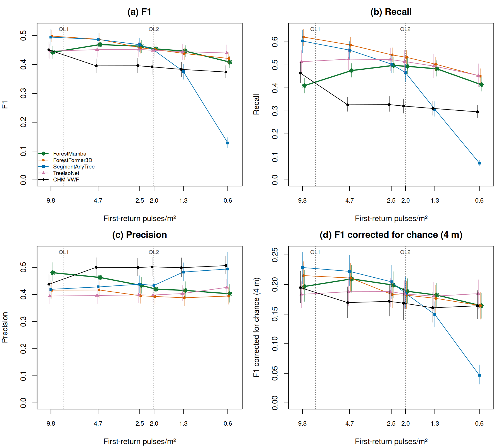

# ForestMamba on the frozen five-site ladder

ForestMamba is a newer zero-shot instance segmenter for tree point clouds, a
fork of the ForestFormer3D code that seeds its tree queries at canopy-height
peaks. It was run, with its released checkpoint and no tuning, on the
benchmark's frozen five-site population and density ladder and compared on
equal support with ForestFormer3D, SegmentAnyTree, TreeisoNet and CHM-VWF from
the paper's re-runs. It is not one of the paper's twelve arms; it was added
after the paper's tables were fixed, and none of their numbers changes.

## Summary

- **Native density.** On the 106 plots ForestMamba scores F1 0.442
  [0.421, 0.464] at native density (9.8 pulses/m²): 0.056 below
  ForestFormer3D and 0.052 below SegmentAnyTree, level with TreeisoNet and
  CHM-VWF. It is the most conservative learned arm: 0.78 core detections per
  field stem against 1.33 to 1.36 for the two segmenters, so it has the
  highest precision of the five arms (0.480) and the lowest recall (0.410).
- **Down the ladder.** Its F1 rises to 0.469 at 4.7 pulses/m² and loses only
  0.034 from native density to 0.6 pulses/m², the smallest loss of the three
  segmenters (ForestFormer3D 0.078, SegmentAnyTree 0.367). On every decimated
  rung it is level with ForestFormer3D. It leads the declared CHM-VWF by 0.06
  to 0.07 F1 from 4.7 to 1.3 pulses/m², but is level with CHM-VWF run without
  its sparse-density smoothing on every rung but the sparsest, where it is
  behind (−0.023, weak).
- **Chance agreement.** Shifted copies of its detections earn 69 to 72% of its
  F1, as for the other arms. Corrected for chance it is level with
  ForestFormer3D on every rung and ahead of CHM-VWF only at 4.7 to
  1.3 pulses/m², by 0.02 to 0.04.
- **Censused subplots.** Its low recall costs most where precision is
  measured inside surveyed census subplots: censused F1 0.564 at native density
  against 0.668 for ForestFormer3D and 0.608 for CHM-VWF, the lowest of the
  five arms. Below native density it is level with ForestFormer3D at 2.5 and
  1.3 pulses/m² and leads CHM-VWF by 0.07 to 0.11.
- **Understory.** It recalls 0.247 of the 592 intermediate and suppressed
  stems at native density, 0.045 above the chance null (ForestFormer3D 0.454
  and 0.094).
- **Sites.** The native deficit is largest at ABBY, where it places 0.60
  detections per stem against 1.29 for ForestFormer3D; its ABBY F1 rises from
  0.424 at native density to 0.550 at 2.5 pulses/m², where ForestFormer3D's
  falls.
- **What the model labels.** The checkpoint's semantic head labels 19% of
  vegetation points as wood at native density and 86% at 0.6 pulses/m²: the
  sparse clips are out of its training domain, yet below native density its
  detection count stays near one per field stem.
- **QL2 floor.** At 2.0 pulses/m² it scores F1 0.454 [0.433, 0.475], level
  with ForestFormer3D, SegmentAnyTree and TreeisoNet (0.449 to 0.452) and
  0.062 above CHM-VWF; corrected for chance the four learned arms are level
  and none leads CHM-VWF clearly.

## Model

ForestMamba ([arXiv 2606.01549](https://arxiv.org/abs/2606.01549), BMVC 2026)
is a fork of the ForestFormer3D code. It replaces the sparse-convolution
encoder's context and the transformer query decoder with Mamba state-space
layers, and seeds its tree queries at peaks of a canopy height model built on
the fly from the voxels it labels as tree, supplemented by farthest-point
samples for the understory. Its paper reports a FOR-instanceV2 weighted-mean F1
of 83.4 against ForestFormer3D's 82.3, with three times faster inference and
2.3 times less GPU memory than transformer methods. FOR-instanceV2 holds drone,
terrestrial and mobile laser scanning; neither model was trained on airborne
data.

The canopy-height seeding is close to this repository's CHM-first method, with
two differences. The model builds its height grids at a fixed 0.3 m and 0.7 m,
not at a resolution derived from measured density, and its allometric peak
window, w(h) = 0.25·h^0.5, is stored at its initial values in the release, so
it is fixed rather than learned.

## Port and validation

The released checkpoint runs zero-shot on the RTX 5090 in the
[ForestMamba runtime](../gpu/forestmamba-sm120/README.md), built on the
ForestFormer3D image with prebuilt sm_120 Mamba kernels. The upstream code is
pinned at its BMVC release commit and the checkpoint by SHA-256. Its licence
is CC BY-NC 4.0, as for ForestFormer3D: non-commercial use only.

The port was checked against the authors' own published predictions of the
same checkpoint on three FOR-instanceV2 test scenes. Each scene's published
points, already in local coordinates, went through the driver's staging,
strict load and test route, and both prediction sets were scored by the
authors' evaluator against the same reference labels; run on the authors'
predictions, the evaluator reproduces their published per-scene table exactly.

| Scene | Points | Authors P / R / F1 | This port P / R / F1 | F1, earlier run | Authors' instances matched (IoU ≥ 0.5) | Tree/background agreement |
|---|---:|---|---|---:|---:|---:|
| RMIT | 260,438 | 0.839 / 0.812 / 0.825 | 0.839 / 0.812 / 0.825 | 0.839 | 61 of 62 | 99.4% |
| NIBIO2 plot 15 | 489,366 | 0.989 / 0.912 / 0.949 | 0.989 / 0.922 / 0.954 | 0.954 | 94 of 94 | 99.1% |
| TUWIEN | 1,401,559 | 0.839 / 0.743 / 0.788 | 0.871 / 0.771 / 0.818 | 0.788 | 31 of 31 | 99.0% |

The table is the final image's run; the earlier run of the same model path
shows the run-to-run variation, up to 0.03 F1 on a scene. The port's F1
equals the authors' on RMIT in the final run and on TUWIEN in the earlier
one, and lies within that variation elsewhere. These are the checkpoint's own
test scenes, not airborne data: they show that the Blackwell port preserves
the model, not how it transfers to NEON.

The checkpoint is read without unpickling arbitrary code and loaded strictly;
its 49 sparse-convolution weights are stored in the older `(k,k,k,in,out)`
layout and mmdet3d's spconv-2 hook converts them during the load, verified
tensor by tensor. Python, numpy and torch are seeded and torch's
deterministic algorithms are on, but two runs of one clip still differ
slightly, because the sparse-convolution and voxel-hashing kernels are outside
torch's control; the [repeated rungs](#run-to-run-variation) measure what this
does to the pooled scores.

## Protocol

The arm, [`detect_forestmamba_sweep.R`](../scripts/detect_forestmamba_sweep.R),
is the ForestFormer3D whole-scene arm with the ForestMamba model. It reads the
declared `adopted` population of the [frozen-clip study](frozen-clips-results.md)
(106 plots, 2,525 stems at SJER, SOAP, TEAK, WREF and ABBY) and its sealed
raw-with-ground clips at native density and the four decimated rungs, and the
same plots' clips at the QL2 floor of 2.0 pulses/m² from the
[QL2 rung](master-tables-results.md#the-ql2-rung)'s own root. Each clip is
one scene. Classified noise stays out of the scene, and heights are measured
from the lowest ground return, because the model reads staged height as tree
height. The instances are reduced to their highest points, which the frozen
clip's terrain model turns into heights above ground, and scored like every
other arm: greedy one-to-one matching within 4 m with the height gate, inside
the nominal plot core. The run is seeded (seed 0), recorded in a run manifest
(image, upstream revision, checkpoint hash, code digests, seed, tolerance,
frozen root, population) and per-cell receipts, and its instance clouds are
kept for the mask and censused-subplot readers.

[`analyze_forestmamba.R`](../scripts/analyze_forestmamba.R) compares it with
ForestFormer3D, SegmentAnyTree, TreeisoNet and CHM-VWF from the paper's
re-runs on the same roots and population. Every arm covers all 530 ladder
cells and 106 QL2 cells. Scores pool summed counts and carry the
[master tables](master-tables-results.md)' paired plot-bootstrap intervals
(1,000 draws, plots resampled within site, seed 20261002); differences are
ForestMamba minus the other arm on the same draws. For the four comparison
arms the analysis reproduces the paper's nominal-box, censused, chance and
mask numbers exactly. As in the paper, a contrast whose interval ends within
0.01 of zero is called weak.

- Corrected F1, (F1 − null) / (1 − null), uses the paper's chance agreement:
  ForestMamba's detections are shifted by the same 200 toroidal offsets per
  plot that `paper_sensitivity.R MODE=null` applied to the other arms
  (re-scoring the persisted ForestFormer3D clouds this way reproduces the
  paper's null counts exactly).
- Censused precision is scored inside the 57 admitted plots (1,190 censused
  references) of the [censused-subplot study](census-support-results.md),
  under its nearest-census declaration.
- Point masks are scored against the Voronoi-on-stems proxy of the
  [instance study](instance-iou-pq-results.md), on the cells every model
  scored.
- The native and sparsest rungs were run a second time with the same settings
  to measure the run-to-run variation, and the driver's receipts give the
  model's point labels and the compute per cell.

## Detection F1 down the ladder

Nominal plot core, five sites, F1 with 95% intervals (rung by all-return
target, with the five-site median in first-return pulses/m²):

| Arm | native (9.8) | 8 (4.7) | 4 (2.5) | QL2 3.2 (2.0) | 2 (1.3) | 1 (0.6) |
| --- | --- | --- | --- | --- | --- | --- |
| ForestMamba | 0.442 [0.421, 0.464] | 0.469 [0.449, 0.489] | 0.463 [0.441, 0.484] | 0.454 [0.433, 0.475] | 0.446 [0.426, 0.466] | 0.408 [0.388, 0.427] |
| ForestFormer3D | 0.498 [0.478, 0.520] | 0.487 [0.466, 0.509] | 0.457 [0.439, 0.476] | 0.452 [0.431, 0.473] | 0.438 [0.417, 0.458] | 0.421 [0.401, 0.441] |
| SegmentAnyTree | 0.495 [0.466, 0.522] | 0.487 [0.463, 0.509] | 0.469 [0.443, 0.492] | 0.449 [0.426, 0.471] | 0.376 [0.349, 0.401] | 0.128 [0.110, 0.147] |
| TreeisoNet | 0.446 [0.420, 0.470] | 0.452 [0.425, 0.476] | 0.453 [0.427, 0.478] | 0.449 [0.422, 0.473] | 0.444 [0.416, 0.471] | 0.440 [0.410, 0.468] |
| CHM-VWF | 0.450 [0.423, 0.478] | 0.395 [0.370, 0.420] | 0.396 [0.371, 0.421] | 0.392 [0.365, 0.416] | 0.383 [0.357, 0.408] | 0.374 [0.353, 0.396] |

ForestMamba minus each arm, F1:

| ForestMamba minus | native (9.8) | 8 (4.7) | 4 (2.5) | QL2 3.2 (2.0) | 2 (1.3) | 1 (0.6) |
| --- | --- | --- | --- | --- | --- | --- |
| ForestFormer3D | −0.056 [−0.078, −0.032] | −0.018 [−0.038, +0.001] | +0.006 [−0.012, +0.022] | +0.002 [−0.016, +0.018] | +0.008 [−0.008, +0.025] | −0.012 [−0.027, +0.003] |
| SegmentAnyTree | −0.052 [−0.081, −0.022] | −0.018 [−0.032, −0.002] | −0.005 [−0.021, +0.011] | +0.004 [−0.013, +0.022] | +0.071 [+0.051, +0.092] | +0.280 [+0.254, +0.303] |
| TreeisoNet | −0.004 [−0.032, +0.027] | +0.018 [−0.004, +0.040] | +0.010 [−0.005, +0.027] | +0.005 [−0.012, +0.024] | +0.002 [−0.011, +0.017] | −0.031 [−0.051, −0.011] |
| CHM-VWF | −0.008 [−0.040, +0.025] | +0.074 [+0.052, +0.097] | +0.067 [+0.043, +0.090] | +0.062 [+0.038, +0.086] | +0.063 [+0.041, +0.086] | +0.034 [+0.011, +0.054] |

Change in F1 from native density, paired over plots:

| Arm | 8 (4.7) | 4 (2.5) | 2 (1.3) | 1 (0.6) |
| --- | --- | --- | --- | --- |
| ForestMamba | +0.027 [+0.007, +0.046] | +0.021 [−0.004, +0.044] | +0.004 [−0.020, +0.028] | −0.034 [−0.059, −0.011] |
| ForestFormer3D | −0.011 [−0.024, +0.002] | −0.041 [−0.055, −0.027] | −0.060 [−0.075, −0.047] | −0.078 [−0.097, −0.060] |
| SegmentAnyTree | −0.008 [−0.023, +0.006] | −0.026 [−0.047, −0.007] | −0.119 [−0.148, −0.091] | −0.367 [−0.399, −0.332] |
| TreeisoNet | +0.005 [−0.002, +0.012] | +0.006 [−0.003, +0.015] | −0.002 [−0.013, +0.009] | −0.006 [−0.022, +0.007] |
| CHM-VWF | −0.055 [−0.079, −0.032] | −0.055 [−0.080, −0.032] | −0.067 [−0.093, −0.044] | −0.077 [−0.101, −0.052] |



*F1, recall, precision and F1 corrected for chance against the rungs'
five-site median first-return pulse density, five sites, with 95% intervals.
The dotted lines are the USGS QL1 (8 pulses/m²) and QL2 (2 pulses/m²) floors.*

- At native density ForestMamba is behind both segmenters,
  −0.056 [−0.078, −0.032] against ForestFormer3D and
  −0.052 [−0.081, −0.022] against SegmentAnyTree, and level with TreeisoNet
  (−0.004) and CHM-VWF (−0.008).
- Thinning raises its F1 at 4.7 pulses/m² (+0.027 [+0.007, +0.046], weak),
  the only gain from native density on the ladder whose interval excludes
  zero; it is level at 2.5 and 1.3 pulses/m² and loses 0.034 [0.011, 0.059]
  at 0.6 pulses/m². ForestFormer3D loses 0.04 to 0.08 from 2.5 pulses/m²
  down, SegmentAnyTree collapses below 2.5 pulses/m², TreeisoNet is flat, and
  CHM-VWF loses 0.055 to 0.077 below native density.
- The gap to ForestFormer3D therefore closes below native density: −0.018
  [−0.038, +0.001] at 4.7 pulses/m², +0.006 and +0.008 at 2.5 and
  1.3 pulses/m², and −0.012 [−0.027, +0.003] at 0.6 pulses/m². ForestMamba
  leads SegmentAnyTree by 0.071 and 0.280 at the two sparsest rungs and trails
  TreeisoNet only at 0.6 pulses/m² (−0.031 [−0.051, −0.011]).
- Its leads over CHM-VWF on the decimated rungs (+0.034 to +0.074) follow the
  baseline's smoothing rule. Below 8 pulses/m² the declared CHM-VWF smooths its
  canopy model, which costs it 0.06 to 0.07 F1 on each decimated rung (see the
  [baseline smoothing sensitivity](baseline-smoothing-sensitivity-results.md)).
  Against CHM-VWF run without the rule, a post hoc sensitivity run on the five
  ladder rungs, ForestMamba is level from native density to 1.3 pulses/m²
  (−0.011 to +0.010) and behind at 0.6 pulses/m² (−0.023 [−0.041, −0.006],
  weak):

| Comparison | native (9.8) | 8 (4.7) | 4 (2.5) | QL2 3.2 (2.0) | 2 (1.3) | 1 (0.6) |
| --- | --- | --- | --- | --- | --- | --- |
| CHM-VWF without smoothing, F1 | 0.454 [0.426, 0.480] | 0.463 [0.437, 0.489] | 0.453 [0.427, 0.479] | — | 0.449 [0.424, 0.473] | 0.431 [0.406, 0.456] |
| ForestMamba minus CHM-VWF as declared | −0.008 [−0.040, +0.025] | +0.074 [+0.052, +0.097] | +0.067 [+0.043, +0.090] | +0.062 [+0.038, +0.086] | +0.063 [+0.041, +0.086] | +0.034 [+0.011, +0.054] |
| ForestMamba minus CHM-VWF without smoothing | −0.011 [−0.043, +0.021] | +0.006 [−0.014, +0.028] | +0.010 [−0.007, +0.027] | — | −0.002 [−0.017, +0.013] | −0.023 [−0.041, −0.006] |

## Recall, precision and detection count

Recall, precision and core detections per reference stem at the two ends of
the ladder:

| Arm | Recall, native (9.8) | Precision, native (9.8) | Detections per stem, native (9.8) | Recall, QL2 3.2 (2.0) | Precision, QL2 3.2 (2.0) | Detections per stem, QL2 3.2 (2.0) | Recall, 1 (0.6) | Precision, 1 (0.6) | Detections per stem, 1 (0.6) |
| --- | --- | --- | --- | --- | --- | --- | --- | --- | --- |
| ForestMamba | 0.410 | 0.480 | 0.78 | 0.494 | 0.420 | 1.06 | 0.414 | 0.402 | 0.93 |
| ForestFormer3D | 0.621 | 0.416 | 1.36 | 0.533 | 0.393 | 1.22 | 0.451 | 0.394 | 1.04 |
| SegmentAnyTree | 0.604 | 0.419 | 1.33 | 0.467 | 0.433 | 0.96 | 0.074 | 0.494 | 0.13 |
| TreeisoNet | 0.514 | 0.394 | 1.20 | 0.515 | 0.398 | 1.19 | 0.454 | 0.426 | 0.97 |
| CHM-VWF | 0.464 | 0.438 | 0.98 | 0.321 | 0.502 | 0.58 | 0.296 | 0.506 | 0.53 |

ForestMamba minus each arm:

| ForestMamba minus | recall, native (9.8) | precision, native (9.8) | recall, QL2 3.2 (2.0) | precision, QL2 3.2 (2.0) | recall, 1 (0.6) | precision, 1 (0.6) |
| --- | --- | --- | --- | --- | --- | --- |
| ForestFormer3D | −0.211 [−0.236, −0.183] | +0.064 [+0.046, +0.086] | −0.039 [−0.063, −0.018] | +0.027 [+0.012, +0.042] | −0.037 [−0.054, −0.019] | +0.008 [−0.007, +0.023] |
| SegmentAnyTree | −0.194 [−0.240, −0.147] | +0.061 [+0.039, +0.086] | +0.027 [+0.005, +0.053] | −0.014 [−0.032, +0.005] | +0.341 [+0.314, +0.369] | −0.091 [−0.144, −0.037] |
| TreeisoNet | −0.104 [−0.150, −0.056] | +0.086 [+0.059, +0.115] | −0.021 [−0.048, +0.005] | +0.022 [+0.004, +0.041] | −0.040 [−0.072, −0.006] | −0.024 [−0.042, −0.005] |
| CHM-VWF | −0.054 [−0.101, −0.007] | +0.043 [+0.012, +0.076] | +0.173 [+0.151, +0.196] | −0.082 [−0.106, −0.058] | +0.118 [+0.099, +0.136] | −0.104 [−0.131, −0.079] |

Core detections per reference stem on every rung:

| Arm | native (9.8) | 8 (4.7) | 4 (2.5) | QL2 3.2 (2.0) | 2 (1.3) | 1 (0.6) |
| --- | --- | --- | --- | --- | --- | --- |
| ForestMamba | 0.78 | 0.93 | 1.04 | 1.06 | 1.07 | 0.93 |
| ForestFormer3D | 1.36 | 1.29 | 1.24 | 1.22 | 1.18 | 1.04 |
| SegmentAnyTree | 1.33 | 1.21 | 1.05 | 0.96 | 0.57 | 0.13 |
| TreeisoNet | 1.20 | 1.22 | 1.21 | 1.19 | 1.13 | 0.97 |
| CHM-VWF | 0.98 | 0.60 | 0.59 | 0.58 | 0.56 | 0.53 |

- At native density ForestMamba places 0.78 core detections per field stem,
  the fewest of the five arms, and its recall (0.410) is the lowest: 0.211
  below ForestFormer3D and 0.054 below CHM-VWF. Its precision (0.480) is the
  highest, 0.043 to 0.086 above the others.
- Thinning raises its detection count to about one per stem and its recall to
  0.498 at 2.5 pulses/m², while precision falls from 0.480 to 0.402 at
  0.6 pulses/m². ForestFormer3D moves the other way, from 1.36 detections per
  stem at native density to 1.04 at 0.6 pulses/m², so the two arms meet below
  native density.

## Chance agreement

Corrected F1, (F1 − null) / (1 − null), five sites, with 95% intervals:

| Arm | native (9.8) | 8 (4.7) | 4 (2.5) | QL2 3.2 (2.0) | 2 (1.3) | 1 (0.6) |
| --- | --- | --- | --- | --- | --- | --- |
| ForestMamba | 0.197 [0.172, 0.224] | 0.210 [0.187, 0.233] | 0.199 [0.177, 0.222] | 0.189 [0.169, 0.210] | 0.182 [0.163, 0.202] | 0.164 [0.143, 0.186] |
| ForestFormer3D | 0.215 [0.191, 0.239] | 0.211 [0.188, 0.236] | 0.183 [0.161, 0.207] | 0.182 [0.159, 0.206] | 0.177 [0.153, 0.199] | 0.164 [0.142, 0.187] |
| SegmentAnyTree | 0.229 [0.201, 0.255] | 0.222 [0.198, 0.249] | 0.205 [0.175, 0.232] | 0.185 [0.161, 0.213] | 0.150 [0.128, 0.171] | 0.047 [0.032, 0.064] |
| TreeisoNet | 0.183 [0.161, 0.205] | 0.188 [0.164, 0.212] | 0.188 [0.163, 0.211] | 0.184 [0.160, 0.206] | 0.180 [0.156, 0.204] | 0.185 [0.159, 0.208] |
| CHM-VWF | 0.195 [0.169, 0.222] | 0.170 [0.144, 0.196] | 0.172 [0.147, 0.199] | 0.168 [0.141, 0.194] | 0.161 [0.136, 0.186] | 0.164 [0.142, 0.190] |

ForestMamba minus each arm, corrected F1:

| ForestMamba minus | native (9.8) | 8 (4.7) | 4 (2.5) | QL2 3.2 (2.0) | 2 (1.3) | 1 (0.6) |
| --- | --- | --- | --- | --- | --- | --- |
| ForestFormer3D | −0.018 [−0.039, +0.004] | −0.001 [−0.024, +0.021] | +0.016 [−0.001, +0.036] | +0.007 [−0.015, +0.027] | +0.006 [−0.014, +0.027] | +0.000 [−0.019, +0.019] |
| SegmentAnyTree | −0.032 [−0.057, −0.005] | −0.013 [−0.033, +0.009] | −0.006 [−0.026, +0.016] | +0.004 [−0.020, +0.027] | +0.033 [+0.011, +0.056] | +0.117 [+0.094, +0.139] |
| TreeisoNet | +0.013 [−0.010, +0.038] | +0.022 [−0.001, +0.045] | +0.011 [−0.007, +0.031] | +0.004 [−0.016, +0.025] | +0.002 [−0.014, +0.018] | −0.020 [−0.039, −0.001] |
| CHM-VWF | +0.002 [−0.023, +0.028] | +0.040 [+0.016, +0.066] | +0.028 [+0.006, +0.048] | +0.020 [−0.001, +0.043] | +0.021 [+0.001, +0.045] | +0.000 [−0.024, +0.021] |

Null F1 as a share of observed F1:

| Arm | native (9.8) | 8 (4.7) | 4 (2.5) | QL2 3.2 (2.0) | 2 (1.3) | 1 (0.6) |
| --- | --- | --- | --- | --- | --- | --- |
| ForestMamba | 69% | 70% | 71% | 72% | 72% | 72% |
| ForestFormer3D | 72% | 72% | 73% | 73% | 72% | 73% |
| SegmentAnyTree | 70% | 70% | 71% | 72% | 71% | 67% |
| TreeisoNet | 72% | 72% | 72% | 72% | 72% | 71% |
| CHM-VWF | 70% | 69% | 68% | 69% | 69% | 67% |

- The null earns 69 to 72% of ForestMamba's F1 on every rung, as it does for
  the other arms, so ForestMamba's higher precision does not buy a lower
  chance share.
- Corrected for chance ForestMamba is level with ForestFormer3D on every rung
  (−0.018 [−0.039, +0.004] at native density, +0.016 [−0.001, +0.036] at
  2.5 pulses/m²) and level with TreeisoNet except at 0.6 pulses/m²
  (−0.020 [−0.039, −0.001], weak). It trails SegmentAnyTree at native density
  (−0.032 [−0.057, −0.005], weak) and leads it at 1.3 and 0.6 pulses/m².
- Against CHM-VWF the corrected lead is +0.040 [+0.016, +0.066] at
  4.7 pulses/m², weaker at 2.5 and 1.3 pulses/m² (+0.028 [+0.006, +0.048] and
  +0.021 [+0.001, +0.045], both weak), and zero at native density and at
  0.6 pulses/m².

## Censused subplots

Censused F1 inside the admitted subplots of 57 plots (1,190 censused
references), with 95% intervals:

| Arm | native (9.8) | 8 (4.7) | 4 (2.5) | QL2 3.2 (2.0) | 2 (1.3) | 1 (0.6) |
| --- | --- | --- | --- | --- | --- | --- |
| ForestMamba | 0.564 [0.526, 0.601] | 0.610 [0.582, 0.639] | 0.608 [0.580, 0.638] | 0.603 [0.572, 0.635] | 0.583 [0.553, 0.614] | 0.541 [0.511, 0.569] |
| ForestFormer3D | 0.668 [0.640, 0.695] | 0.658 [0.630, 0.687] | 0.614 [0.592, 0.638] | 0.615 [0.587, 0.643] | 0.588 [0.569, 0.611] | 0.566 [0.532, 0.603] |
| SegmentAnyTree | 0.677 [0.644, 0.708] | 0.655 [0.624, 0.685] | 0.626 [0.594, 0.659] | 0.595 [0.556, 0.633] | 0.453 [0.404, 0.502] | 0.146 [0.120, 0.173] |
| TreeisoNet | 0.622 [0.581, 0.663] | 0.623 [0.583, 0.661] | 0.635 [0.594, 0.673] | 0.629 [0.589, 0.667] | 0.616 [0.571, 0.658] | 0.592 [0.535, 0.643] |
| CHM-VWF | 0.608 [0.566, 0.651] | 0.502 [0.456, 0.548] | 0.504 [0.455, 0.550] | 0.495 [0.450, 0.538] | 0.481 [0.435, 0.527] | 0.475 [0.440, 0.511] |

ForestMamba minus each arm, censused F1:

| ForestMamba minus | native (9.8) | 8 (4.7) | 4 (2.5) | QL2 3.2 (2.0) | 2 (1.3) | 1 (0.6) |
| --- | --- | --- | --- | --- | --- | --- |
| ForestFormer3D | −0.103 [−0.145, −0.068] | −0.048 [−0.080, −0.014] | −0.006 [−0.034, +0.024] | −0.011 [−0.038, +0.016] | −0.006 [−0.035, +0.022] | −0.026 [−0.050, −0.001] |
| SegmentAnyTree | −0.112 [−0.162, −0.067] | −0.045 [−0.073, −0.017] | −0.018 [−0.039, +0.002] | +0.009 [−0.019, +0.039] | +0.130 [+0.096, +0.167] | +0.395 [+0.359, +0.430] |
| TreeisoNet | −0.057 [−0.107, −0.006] | −0.013 [−0.044, +0.017] | −0.027 [−0.051, +0.000] | −0.026 [−0.051, −0.001] | −0.033 [−0.058, −0.005] | −0.051 [−0.086, −0.009] |
| CHM-VWF | −0.044 [−0.100, +0.006] | +0.108 [+0.074, +0.140] | +0.104 [+0.065, +0.145] | +0.108 [+0.074, +0.149] | +0.102 [+0.062, +0.144] | +0.066 [+0.036, +0.093] |

Censused recall and precision:

| Arm | Recall, native (9.8) | Precision, native (9.8) | Recall, QL2 3.2 (2.0) | Precision, QL2 3.2 (2.0) | Recall, 1 (0.6) | Precision, 1 (0.6) |
| --- | --- | --- | --- | --- | --- | --- |
| ForestMamba | 0.445 | 0.770 | 0.524 | 0.710 | 0.439 | 0.702 |
| ForestFormer3D | 0.661 | 0.675 | 0.571 | 0.666 | 0.479 | 0.693 |
| SegmentAnyTree | 0.640 | 0.718 | 0.492 | 0.752 | 0.080 | 0.857 |
| TreeisoNet | 0.547 | 0.720 | 0.550 | 0.735 | 0.476 | 0.781 |
| CHM-VWF | 0.499 | 0.779 | 0.347 | 0.862 | 0.327 | 0.867 |

- Inside the censused subplots fewer unmatched detections are unmapped trees,
  so precision rises for every arm and recall weighs more in the ranking.
  ForestMamba's censused precision at native density (0.770) is second only
  to CHM-VWF's (0.779), but its censused recall (0.445) is the lowest, so its
  censused F1 (0.564) is the lowest of the five arms: −0.103 [−0.145, −0.068]
  against ForestFormer3D and −0.044 [−0.100, +0.006] against CHM-VWF.
- Below native density the gap narrows. ForestMamba is behind ForestFormer3D
  at 4.7 pulses/m² (−0.048 [−0.080, −0.014]) and 0.6 pulses/m²
  (−0.026 [−0.050, −0.001], weak) and level at 2.5 and 1.3 pulses/m² (−0.006
  at both); it is ahead of CHM-VWF by 0.066 to 0.108 on every decimated rung
  and behind TreeisoNet at 1.3 and 0.6 pulses/m² (−0.033 [−0.058, −0.005] and
  −0.051 [−0.086, −0.009], both weak).

## Crown classes

Recall of overstory (dominant and codominant, 1,872 stems) and understory
(intermediate and suppressed, 592 stems) stems, five sites:

| Arm | Overstory, native (9.8) | Understory, native (9.8) | Overstory, QL2 3.2 (2.0) | Understory, QL2 3.2 (2.0) | Overstory, 1 (0.6) | Understory, 1 (0.6) |
| --- | --- | --- | --- | --- | --- | --- |
| ForestMamba | 0.460 [0.426, 0.496] | 0.247 [0.186, 0.310] | 0.570 [0.538, 0.604] | 0.238 [0.182, 0.301] | 0.480 [0.448, 0.512] | 0.189 [0.143, 0.242] |
| ForestFormer3D | 0.674 [0.645, 0.704] | 0.454 [0.387, 0.522] | 0.603 [0.576, 0.632] | 0.299 [0.242, 0.360] | 0.512 [0.481, 0.543] | 0.231 [0.184, 0.282] |
| SegmentAnyTree | 0.698 [0.657, 0.739] | 0.291 [0.218, 0.364] | 0.542 [0.504, 0.579] | 0.216 [0.154, 0.284] | 0.086 [0.074, 0.099] | 0.029 [0.015, 0.044] |
| TreeisoNet | 0.606 [0.562, 0.650] | 0.193 [0.131, 0.256] | 0.604 [0.557, 0.649] | 0.204 [0.143, 0.266] | 0.538 [0.487, 0.587] | 0.166 [0.111, 0.224] |
| CHM-VWF | 0.554 [0.511, 0.601] | 0.171 [0.118, 0.226] | 0.383 [0.348, 0.416] | 0.110 [0.073, 0.150] | 0.357 [0.327, 0.387] | 0.086 [0.055, 0.125] |

Recall above the chance null (baseline minus null recall), as the paper reads
understory recall:

| Arm | Overstory above null, native (9.8) | Understory above null, native (9.8) | Overstory above null, QL2 3.2 (2.0) | Understory above null, QL2 3.2 (2.0) | Overstory above null, 1 (0.6) | Understory above null, 1 (0.6) |
| --- | --- | --- | --- | --- | --- | --- |
| ForestMamba | +0.146 [+0.122, +0.173] | +0.045 [+0.007, +0.085] | +0.163 [+0.141, +0.189] | +0.042 [+0.011, +0.076] | +0.144 [+0.121, +0.170] | +0.030 [+0.000, +0.064] |
| ForestFormer3D | +0.190 [+0.163, +0.217] | +0.094 [+0.050, +0.136] | +0.170 [+0.143, +0.197] | +0.043 [+0.000, +0.086] | +0.144 [+0.116, +0.169] | +0.036 [+0.001, +0.070] |
| SegmentAnyTree | +0.211 [+0.184, +0.237] | +0.061 [+0.020, +0.099] | +0.152 [+0.128, +0.181] | +0.047 [+0.011, +0.085] | +0.028 [+0.018, +0.039] | +0.011 [+0.000, +0.024] |
| TreeisoNet | +0.168 [+0.143, +0.194] | +0.023 [−0.005, +0.054] | +0.164 [+0.139, +0.189] | +0.033 [+0.003, +0.068] | +0.157 [+0.131, +0.183] | +0.020 [−0.013, +0.053] |
| CHM-VWF | +0.167 [+0.139, +0.194] | +0.016 [−0.012, +0.050] | +0.124 [+0.100, +0.149] | +0.005 [−0.020, +0.034] | +0.126 [+0.106, +0.149] | −0.010 [−0.034, +0.016] |

ForestMamba minus each arm, recall above the null:

| ForestMamba minus | Overstory, native (9.8) | Understory, native (9.8) | Overstory, QL2 3.2 (2.0) | Understory, QL2 3.2 (2.0) | Overstory, 1 (0.6) | Understory, 1 (0.6) |
| --- | --- | --- | --- | --- | --- | --- |
| ForestFormer3D | −0.044 [−0.063, −0.024] | −0.049 [−0.092, −0.006] | −0.006 [−0.028, +0.013] | −0.001 [−0.038, +0.036] | +0.001 [−0.017, +0.019] | −0.006 [−0.042, +0.030] |
| SegmentAnyTree | −0.065 [−0.085, −0.042] | −0.016 [−0.055, +0.031] | +0.011 [−0.010, +0.032] | −0.005 [−0.036, +0.029] | +0.117 [+0.095, +0.141] | +0.019 [−0.012, +0.051] |
| TreeisoNet | −0.022 [−0.041, −0.002] | +0.021 [−0.016, +0.055] | +0.000 [−0.019, +0.018] | +0.009 [−0.015, +0.031] | −0.013 [−0.030, +0.008] | +0.010 [−0.019, +0.039] |
| CHM-VWF | −0.020 [−0.042, +0.002] | +0.029 [−0.003, +0.060] | +0.039 [+0.022, +0.059] | +0.037 [+0.012, +0.062] | +0.018 [+0.003, +0.034] | +0.040 [+0.009, +0.073] |

- ForestMamba finds the fewest overstory stems at native density (0.460;
  0.554 to 0.698 for the others) and an understory share between the
  segmenters and the canopy arms: 0.247, against 0.454 for ForestFormer3D,
  0.291 for SegmentAnyTree and 0.17 to 0.19 for CHM-VWF and TreeisoNet.
- Above the null its understory recall is +0.045 [+0.007, +0.085], weak:
  about half of ForestFormer3D's +0.094 (difference −0.049 [−0.092, −0.006],
  weak) and level with SegmentAnyTree, TreeisoNet and CHM-VWF.
- At 0.6 pulses/m² ForestMamba and ForestFormer3D recall the same share of
  stems above the null in both classes (overstory +0.144 for both).

## Sites and regions

F1 per site at native density, and ForestMamba minus each arm:

| Arm | SJER | SOAP | TEAK | WREF | ABBY |
| --- | --- | --- | --- | --- | --- |
| ForestMamba | 0.310 | 0.430 | 0.442 | 0.464 | 0.424 |
| ForestFormer3D | 0.325 | 0.454 | 0.495 | 0.491 | 0.542 |
| SegmentAnyTree | 0.274 | 0.469 | 0.517 | 0.463 | 0.559 |
| TreeisoNet | 0.280 | 0.390 | 0.373 | 0.393 | 0.571 |
| CHM-VWF | 0.307 | 0.382 | 0.388 | 0.392 | 0.557 |

| ForestMamba minus | SJER | SOAP | TEAK | WREF | ABBY |
| --- | --- | --- | --- | --- | --- |
| ForestFormer3D | −0.015 [−0.073, +0.047] | −0.023 [−0.070, +0.024] | −0.053 [−0.077, −0.029] | −0.026 [−0.054, +0.006] | −0.118 [−0.178, −0.053] |
| SegmentAnyTree | +0.037 [−0.087, +0.164] | −0.038 [−0.085, +0.025] | −0.075 [−0.116, −0.028] | +0.002 [−0.038, +0.041] | −0.135 [−0.197, −0.065] |
| TreeisoNet | +0.031 [−0.072, +0.159] | +0.040 [−0.012, +0.097] | +0.070 [+0.013, +0.123] | +0.071 [+0.035, +0.109] | −0.147 [−0.212, −0.080] |
| CHM-VWF | +0.004 [−0.081, +0.098] | +0.048 [+0.002, +0.094] | +0.055 [−0.001, +0.114] | +0.072 [+0.043, +0.104] | −0.133 [−0.204, −0.059] |

F1 per site at 0.6 pulses/m², and ForestMamba minus each arm:

| Arm | SJER | SOAP | TEAK | WREF | ABBY |
| --- | --- | --- | --- | --- | --- |
| ForestMamba | 0.280 | 0.353 | 0.365 | 0.375 | 0.506 |
| ForestFormer3D | 0.310 | 0.355 | 0.402 | 0.404 | 0.492 |
| SegmentAnyTree | 0.179 | 0.139 | 0.082 | 0.105 | 0.170 |
| TreeisoNet | 0.311 | 0.428 | 0.396 | 0.358 | 0.553 |
| CHM-VWF | 0.347 | 0.387 | 0.354 | 0.336 | 0.425 |

| ForestMamba minus | SJER | SOAP | TEAK | WREF | ABBY |
| --- | --- | --- | --- | --- | --- |
| ForestFormer3D | −0.030 [−0.055, +0.016] | −0.002 [−0.033, +0.041] | −0.037 [−0.073, +0.000] | −0.029 [−0.061, +0.000] | +0.014 [−0.007, +0.033] |
| SegmentAnyTree | +0.100 [−0.095, +0.289] | +0.214 [+0.132, +0.301] | +0.283 [+0.239, +0.331] | +0.270 [+0.239, +0.304] | +0.336 [+0.290, +0.374] |
| TreeisoNet | −0.032 [−0.063, +0.018] | −0.075 [−0.132, −0.032] | −0.030 [−0.079, +0.010] | +0.017 [−0.013, +0.053] | −0.047 [−0.078, −0.010] |
| CHM-VWF | −0.067 [−0.184, +0.056] | −0.034 [−0.086, +0.033] | +0.011 [−0.045, +0.065] | +0.039 [+0.002, +0.071] | +0.081 [+0.045, +0.115] |

F1 by region at native density (California: SJER, SOAP and TEAK, 43 plots;
Washington: WREF and ABBY, 63 plots), and ForestMamba minus each arm:

| Arm | California | Washington |
| --- | --- | --- |
| ForestMamba | 0.426 [0.385, 0.470] | 0.448 [0.423, 0.476] |
| ForestFormer3D | 0.459 [0.421, 0.505] | 0.512 [0.488, 0.537] |
| SegmentAnyTree | 0.461 [0.408, 0.511] | 0.510 [0.478, 0.539] |
| TreeisoNet | 0.361 [0.323, 0.401] | 0.484 [0.455, 0.511] |
| CHM-VWF | 0.374 [0.334, 0.416] | 0.480 [0.448, 0.513] |

| ForestMamba minus | California | Washington |
| --- | --- | --- |
| ForestFormer3D | −0.034 [−0.057, −0.009] | −0.064 [−0.094, −0.032] |
| SegmentAnyTree | −0.035 [−0.071, +0.006] | −0.061 [−0.097, −0.022] |
| TreeisoNet | +0.065 [+0.027, +0.105] | −0.036 [−0.072, +0.004] |
| CHM-VWF | +0.052 [+0.015, +0.090] | −0.032 [−0.073, +0.010] |

- At native density ForestMamba's F1 is below ForestFormer3D's at every
  site: by 0.015 to 0.026 at SJER, SOAP and WREF, within intervals that span
  zero, by 0.053 [0.029, 0.077] at TEAK and by 0.118 [0.053, 0.178] at ABBY.
  It leads TreeisoNet at TEAK and WREF (+0.070 and +0.071) and CHM-VWF at WREF
  (+0.072 [+0.043, +0.104]) and SOAP (+0.048 [+0.002, +0.094], weak), and
  trails all four arms at ABBY by 0.12 to 0.15.
- ABBY carries the native deficit. There ForestMamba places 0.60 core
  detections per field stem (ForestFormer3D 1.29, CHM-VWF 1.35) and recalls
  0.35 of the stems; at 4.7 pulses/m² it places 0.93 and recalls 0.53. Its
  ABBY F1 rises from 0.424 at native density to 0.522, 0.550 and 0.544 at
  4.7, 2.5 and 1.3 pulses/m² and is 0.506 at 0.6 pulses/m², level with
  ForestFormer3D (+0.014 [−0.007, +0.033]). ABBY's native clips are not
  unusually dense (median 10.2 pulses/m²), so the under-detection is a
  response of the model to these stands, not to density alone.
- By region the native deficit to ForestFormer3D is −0.034 [−0.057, −0.009]
  in California, a weak contrast, and −0.064 [−0.094, −0.032] in Washington.
  In California ForestMamba leads TreeisoNet and CHM-VWF (+0.065 and +0.052);
  in Washington it trails both by about 0.03, within intervals that reach
  zero. At 0.6 pulses/m² it is level with ForestFormer3D in both regions.

## What the model labels on airborne clips

ForestMamba's point labels per rung, pooled over the staged clip points (the
clip with its buffer), and its core detections per stem:

| Rung | Ground | Wood | Leaf | Wood share of vegetation | In no instance | Instances per clip, median | Core detections per stem |
| --- | ---: | ---: | ---: | ---: | ---: | ---: | ---: |
| native (9.8) | 31% | 13% | 56% | 19% | 41% | 112 | 0.78 |
| 8 (4.7) | 31% | 28% | 42% | 40% | 47% | 134 | 0.93 |
| 4 (2.5) | 29% | 43% | 28% | 61% | 48% | 153 | 1.04 |
| QL2 3.2 (2.0) | 28% | 47% | 24% | 66% | 47% | 155 | 1.06 |
| 2 (1.3) | 24% | 57% | 19% | 76% | 45% | 148 | 1.07 |
| 1 (0.6) | 12% | 75% | 13% | 86% | 42% | 138 | 0.93 |

- At native density the semantic head labels 81% of the vegetation points as
  leaf. As the clips thin it labels more of them as wood, until wood is 86%
  of the vegetation labels at 0.6 pulses/m², and it labels fewer points as
  ground than the clips' own ground classification: 12% at 0.6 pulses/m²
  against 27% classified as ground (31% against 23% at native density). Sparse
  airborne canopies are out of the checkpoint's training domain.
- The instance head still returns about one detection per field stem on every
  decimated rung, so the label shift does not become a detection failure like
  SegmentAnyTree's, whose grouping stops forming instances below 2.5
  pulses/m² (see the [instance audit](instance-audit-results.md)). The
  instance count per clip is highest at 2.5 and 2.0 pulses/m² (medians 153 and
  155, against 112 at native density).

## Point masks

Point-mask F1 against the Voronoi-on-stems proxy, on the cells every model
scored (the paper scored no masks on the QL2 rung):

| Model | native (9.8) | 8 (4.7) | 4 (2.5) | 2 (1.3) | 1 (0.6) |
| --- | --- | --- | --- | --- | --- |
| ForestMamba | 0.124 | 0.149 | 0.172 | 0.163 | 0.159 |
| ForestFormer3D | 0.135 | 0.139 | 0.149 | 0.147 | 0.168 |
| SegmentAnyTree | 0.152 | 0.152 | 0.150 | 0.115 | 0.046 |
| TreeisoNet | 0.023 | 0.014 | 0.005 | 0.001 | — |

Mask F1, panoptic quality and coverage at the two ends of the ladder:

| Model | F1, native (9.8) | PQ, native (9.8) | Coverage, native (9.8) | F1, 1 (0.6) | PQ, 1 (0.6) | Coverage, 1 (0.6) |
| --- | --- | --- | --- | --- | --- | --- |
| ForestMamba | 0.124 | 0.082 | 0.262 | 0.159 | 0.104 | 0.276 |
| ForestFormer3D | 0.135 | 0.087 | 0.326 | 0.168 | 0.111 | 0.279 |
| SegmentAnyTree | 0.152 | 0.098 | 0.330 | 0.046 | 0.030 | 0.041 |
| TreeisoNet | 0.023 | 0.015 | 0.119 | — | 0.000 | 0.009 |

- The proxy costs a quarter to a third of mask F1 (see the
  [proxy validation](fgiemit-proxy-validation-results.md)), so these scores
  rank the models; they are not crown accuracies. At native density
  ForestMamba's masks score just below ForestFormer3D's and SegmentAnyTree's
  (F1 0.124 against 0.135 and 0.152), on 2.5 and 1.3 pulses/m² they score
  highest (0.172 and 0.163), and at 0.6 pulses/m² they are close to
  ForestFormer3D's (0.159 against 0.168) while SegmentAnyTree's fall to 0.046.
  TreeisoNet's masks use its checkpoint's 0.1 m voxel, at which its mask pass
  finds few trees; the
  [instance study](instance-iou-pq-results.md#treeisonet-mask-voxel-sensitivity)
  shows them level with ForestFormer3D's at the apex voxel.

## The QL2 floor

The USGS 3DEP QL2 specification is an aggregate nominal density of at least
2 pulses/m². The paper froze a rung at it in its own root (all-return target
3.2 points/m², five-site median 2.0 pulses/m²), with the same population and
native clips; the tables above carry it as a column. At the floor, with the
two ladder rungs that bracket it:

| Arm | 4 (2.5), F1 | QL2 3.2 (2.0), F1 | 2 (1.3), F1 | Censused F1, QL2 | Detections per stem, QL2 |
| --- | --- | --- | --- | --- | --- |
| ForestMamba | 0.463 | 0.454 [0.433, 0.475] | 0.446 | 0.603 [0.572, 0.635] | 1.06 |
| ForestFormer3D | 0.457 | 0.452 [0.431, 0.473] | 0.438 | 0.615 [0.587, 0.643] | 1.22 |
| SegmentAnyTree | 0.469 | 0.449 [0.426, 0.471] | 0.376 | 0.595 [0.556, 0.633] | 0.96 |
| TreeisoNet | 0.453 | 0.449 [0.422, 0.473] | 0.444 | 0.629 [0.589, 0.667] | 1.19 |
| CHM-VWF | 0.396 | 0.392 [0.365, 0.416] | 0.383 | 0.495 [0.450, 0.538] | 0.58 |

ForestMamba minus each arm at the QL2 floor:

| ForestMamba minus | F1 | Corrected F1 | Censused F1 | Understory recall above null |
| --- | --- | --- | --- | --- |
| ForestFormer3D | +0.002 [−0.016, +0.018] | +0.007 [−0.015, +0.027] | −0.011 [−0.038, +0.016] | −0.001 [−0.038, +0.036] |
| SegmentAnyTree | +0.004 [−0.013, +0.022] | +0.004 [−0.020, +0.027] | +0.009 [−0.019, +0.039] | −0.005 [−0.036, +0.029] |
| TreeisoNet | +0.005 [−0.012, +0.024] | +0.004 [−0.016, +0.025] | −0.026 [−0.051, −0.001] | +0.009 [−0.015, +0.031] |
| CHM-VWF | +0.062 [+0.038, +0.086] | +0.020 [−0.001, +0.043] | +0.108 [+0.074, +0.149] | +0.037 [+0.012, +0.062] |

- At the floor ForestMamba scores F1 0.454 [0.433, 0.475], between its 0.463
  at 2.5 and 0.446 at 1.3 pulses/m², and the four learned arms are level:
  ForestMamba is +0.002 to +0.005 against ForestFormer3D, SegmentAnyTree and
  TreeisoNet, which score 0.449 to 0.452, and leads CHM-VWF by 0.062
  [0.038, 0.086].
- Corrected for chance its lead over CHM-VWF is +0.020 [−0.001, +0.043], like
  the paper's corrected leads of the other three learned arms at the floor
  (+0.014 to +0.017), none of which excludes zero.
- Its censused F1 at the floor, 0.603 [0.572, 0.635], is level with
  ForestFormer3D's and SegmentAnyTree's, behind TreeisoNet's
  (−0.026 [−0.051, −0.001], weak) and 0.108 above CHM-VWF's. With 1.06
  detections per field stem it is no longer the most conservative learned arm
  at this density.
- The five-site tie hides site differences: against ForestFormer3D,
  ForestMamba is ahead at SJER, SOAP and ABBY (+0.034 to +0.057) and behind at
  TEAK and WREF (−0.036 and −0.047).

## Run-to-run variation

## Compute

## Limitations

- The checkpoint runs zero-shot. FOR-instanceV2 holds drone, terrestrial and
  mobile scans at hundreds to thousands of points per m²; nothing airborne or
  as sparse as these clips. The scores measure transfer of the released
  model, not the ceiling of the architecture on airborne data.
- The canopy-peak queries use fixed 0.3 m and 0.7 m height grids and a fixed
  peak window. This repository's CHM-first method derives the CHM resolution
  and window from measured density; ForestMamba's would need retraining or an
  altered inference path to do so, which this benchmark does not attempt.
- Runs are not bit-repeatable: the sparse-convolution and voxel-hashing
  kernels are outside torch's deterministic control. The repeated rungs bound
  what this does to the pooled scores; the paper did not measure it for
  ForestFormer3D or TreeisoNet.
- The reference is the field-stem population of the nominal plot core, with
  the incomplete-mapping limits of the
  [reference-support audit](neon-reference-support-results.md); censused
  precision covers 57 of the 106 plots.
- Intervals express plot sampling only, are not adjusted for the number of
  contrasts, and condition on the five sites; Washington holds 74% of the
  stems, so five-site estimates lean on WREF and ABBY.
- ForestMamba is not one of the paper's twelve arms. It was added after the
  paper's tables were fixed, and none of the paper's numbers changes.

## Reproduce

Build the ForestFormer3D image ([its runtime](../gpu/forestformer3d-sm120)),
then the ForestMamba checkout, checkpoint and image:

```sh
bash gpu/forestmamba-sm120/setup.sh
```

Each job directory links the sites' `ground_truth_stems.csv`,
`plot_centroids.csv` and `vst/`, and the sealed root under `neon/`, as the
paper's job directories do. `W` is the work directory that holds the sealed
roots under `neon/` and the paper's re-run job directories `paper_runs` and
`paper_runs_ql2`:

```sh
for S in SJER SOAP TEAK ABBY WREF; do
  CLAUDE_JOB_DIR=$W/forestmamba_runs Rscript scripts/detect_forestmamba_sweep.R \
    SITE=$S RUNGS=native,8,4,2,1 SEED=0
  CLAUDE_JOB_DIR=$W/forestmamba_runs_ql2 Rscript scripts/detect_forestmamba_sweep.R \
    SITE=$S RUNGS=3.2 SEED=0 FROZEN_ROOT=$W/neon/frozen_2021_ql2
  CLAUDE_JOB_DIR=$W/forestmamba_runs_repeat1 Rscript scripts/detect_forestmamba_sweep.R \
    SITE=$S RUNGS=native,1 SEED=0
done
CLAUDE_JOB_DIR=$W/forestmamba_runs Rscript scripts/score_instances_iou.R \
  SITES=SJER,SOAP,TEAK,WREF,ABBY RUNGS=native,8,4,2,1 APEX_PROXY=0 CORES=8
D=docs/census-support-declaration-nearest.json
CLAUDE_JOB_DIR=$W/forestmamba_runs Rscript scripts/score_census_support.R \
  DECLARATION=$D ARMS=forestmamba SUPPORT=$W/paper_runs/reference_support_census_event \
  OUT=$W/forestmamba_runs/census_support_scores/nearest_ladder
CLAUDE_JOB_DIR=$W/forestmamba_runs_ql2 Rscript scripts/score_census_support.R \
  DECLARATION=$D ARMS=forestmamba RUNGS=3.2 FROZEN_ROOT=$W/neon/frozen_2021_ql2 \
  SUPPORT=$W/paper_runs/reference_support_census_event \
  OUT=$W/forestmamba_runs_ql2/census_support_scores/nearest_ladder
Rscript scripts/analyze_forestmamba.R RUNS=$W/forestmamba_runs_ql2 \
  BASE=$W/paper_runs_ql2 FROZEN_ROOT=$W/neon/frozen_2021_ql2 RUNGS=3.2 CORES=8
Rscript scripts/analyze_forestmamba.R RUNS=$W/forestmamba_runs \
  BASE=$W/paper_runs REPEATS=$W/forestmamba_runs_repeat1 CORES=8 \
  QL2=$W/forestmamba_runs_ql2/neon/forestmamba_analysis
bash scripts/compute_cost.sh OUT=$W/compute_cost_forestmamba WORK=$W ARMS=forestmamba
```

The analyses write their CSV files, `figure.png` and `tables.md` under
`neon/forestmamba_analysis` of each run directory; the main analysis reads the
QL2 analysis for the figure's QL2 points. The port check runs
[`fm_parity.py`](../gpu/forestmamba-sm120/fm_parity.py) in the image on the
authors' published FOR-instanceV2 test predictions.
